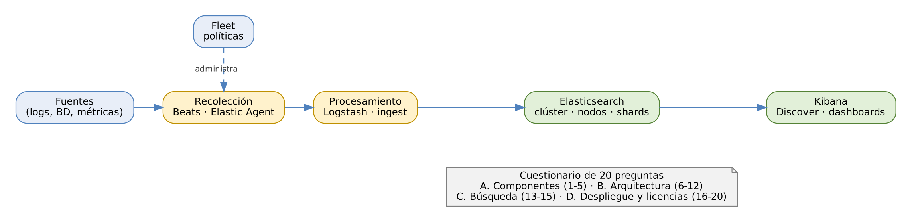

# ELK Stack: Elasticsearch, Logstash y Kibana

## Práctica 1. Cuestionario de fundamentos de ELK Stack

### Objetivo

Al finalizar la práctica, serás capaz de:

-   Identificar la función de Elasticsearch, Logstash, Kibana, Beats,
    Elastic Agent y Fleet dentro del flujo de datos.
-   Explicar los conceptos de la arquitectura distribuida de
    Elasticsearch: clúster, nodos, roles, índices, documentos, shards y
    réplicas.
-   Interpretar el estado de salud de un clúster y el mecanismo de
    búsqueda casi en tiempo real.
-   Distinguir los modelos de despliegue, los niveles de licencia y el
    ciclo de vida de las versiones 8.x y 9.x.

### Objetivo visual

{width="6.3in"}\

### Duración aproximada

-   30 minutos: 15 minutos para responder de forma individual y 15
    minutos para la revisión grupal.

### Prerrequisitos

-   Haber revisado el capítulo 1: *Fundamentos y arquitectura de ELK
    Stack*.
-   No se requiere el ambiente de laboratorio.

### Instrucciones

**Escenario:** MercaNova, la tienda en línea del caso del curso, quiere
centralizar sus logs y datos de negocio con ELK Stack. Antes de instalar
el clúster en la práctica 2, el equipo debe dominar el vocabulario y la
arquitectura de la plataforma. Este cuestionario verifica esa base y
sirve también como diagnóstico para el instructor.

1.  Responde las 20 preguntas de forma individual, sin consultar las
    diapositivas. Cada pregunta tiene **una sola respuesta correcta**.
2.  Anota tu respuesta en la hoja de respuestas de la Tarea 2.
3.  Al terminar, el instructor revisa las respuestas con el grupo. Usa
    el **Apéndice A** para entender por qué cada opción es correcta o
    incorrecta.
4.  Identifica los temas en los que fallaste y repásalos antes de la
    práctica 2: son la base de todo el curso.

------------------------------------------------------------------------

### Tarea 1. Responde el cuestionario

#### Sección A. Componentes y flujo de datos

**1. ¿Qué componente indexa, almacena y busca los datos?**

-   a\) Logstash
-   b\) Kibana
-   c\) Elasticsearch
-   d\) Filebeat

**2. ¿Qué componente se usa principalmente para transformar y
enriquecer eventos mediante filtros?**

-   a\) Kibana
-   b\) Logstash
-   c\) Fleet Server
-   d\) Metricbeat

**3. ¿Por qué se pasó de llamar "ELK" a "Elastic Stack"?**

-   a\) Se eliminó Logstash del producto.
-   b\) Se agregaron los Beats y todas las piezas se unificaron con la
    misma versión.
-   c\) Kibana cambió de nombre.
-   d\) Se cambió la licencia del software.

**4. ¿Qué administra Fleet?**

-   a\) Los índices del clúster.
-   b\) Los dashboards de Kibana.
-   c\) Las políticas e integraciones de los Elastic Agents.
-   d\) Los snapshots.

**5. ¿Qué agente unificado reemplaza a varios Beats?**

-   a\) Logstash
-   b\) Elastic Agent
-   c\) Heartbeat
-   d\) Kibana

#### Sección B. Arquitectura distribuida de Elasticsearch

**6. En Elasticsearch, un documento es…**

-   a\) Una fila de una tabla SQL.
-   b\) Un objeto JSON almacenado en un índice.
-   c\) Un archivo de log en el disco del servidor.
-   d\) Un shard.

**7. ¿Qué es un shard?**

-   a\) Una copia de seguridad del índice.
-   b\) Una partición de un índice; cada shard es un índice de Lucene.
-   c\) Un nodo del clúster.
-   d\) Un tipo de campo del mapping.

**8. ¿Dónde NUNCA se ubica una réplica?**

-   a\) En un nodo de datos.
-   b\) En el mismo nodo que su shard primario.
-   c\) En un nodo warm.
-   d\) En otro nodo del clúster.

**9. ¿Qué indica un clúster en estado yellow?**

-   a\) Todos los shards están asignados.
-   b\) Algún shard primario no está asignado.
-   c\) Todos los primarios están asignados, pero alguna réplica no.
-   d\) El clúster está apagado.

**10. ¿Cuántos nodos elegibles como master se recomiendan, como mínimo,
para tolerar la caída de uno?**

-   a\) 1
-   b\) 2
-   c\) 3
-   d\) 4

**11. ¿Qué rol de nodo ejecuta los ingest pipelines?**

-   a\) `master`
-   b\) `ingest`
-   c\) `ml`
-   d\) `transform`

**12. Un nodo configurado con `node.roles: [ ]` actúa como…**

-   a\) Nodo master dedicado.
-   b\) Nodo de solo coordinación.
-   c\) Nodo de datos frozen.
-   d\) Nodo inválido: Elasticsearch no arranca.

#### Sección C. Indexación y búsqueda

**13. ¿Qué estructura permite encontrar rápidamente los documentos que
contienen un término?**

-   a\) El translog.
-   b\) El índice invertido.
-   c\) El mapping.
-   d\) El snapshot.

**14. ¿Por qué se dice que la búsqueda es "casi en tiempo real"?**

-   a\) Porque usa una caché de resultados.
-   b\) Porque un documento es buscable tras el siguiente refresh, que
    ocurre cada segundo por defecto.
-   c\) Porque las réplicas se actualizan al instante.
-   d\) Porque Kibana se actualiza cada minuto.

**15. ¿Qué puerto usa por defecto la API REST de Elasticsearch?**

-   a\) 5601
-   b\) 9300
-   c\) 9200
-   d\) 5044

#### Sección D. Despliegue, licencias y versiones

**16. ¿Qué herramienta despliega Elastic Stack sobre Kubernetes?**

-   a\) ECE
-   b\) ECK
-   c\) Fleet
-   d\) Rally

**17. ¿Cuál de estas funciones requiere una suscripción de pago o la
licencia de prueba?**

-   a\) TLS y usuarios.
-   b\) ILM.
-   c\) Seguridad a nivel de documento y de campo.
-   d\) Dashboards.

**18. ¿Hasta cuándo tiene soporte Elastic Stack 8.19?**

-   a\) Enero de 2026.
-   b\) Julio de 2027.
-   c\) Diciembre de 2030.
-   d\) No tiene soporte.

**19. ¿Qué característica trae Elasticsearch 8.x por defecto?**

-   a\) Seguridad y TLS habilitados automáticamente en la instalación.
-   b\) Varios tipos de mapping por índice.
-   c\) Licencia Apache 2.0 únicamente.
-   d\) Acceso sin autenticación.

**20. En el laboratorio del curso, ¿cómo conviven tres nodos de
Elasticsearch en una sola VM?**

-   a\) Comparten puerto y directorio.
-   b\) Cada uno tiene directorio, puertos y servicio systemd propios.
-   c\) Solo uno arranca a la vez.
-   d\) Se ejecutan en tres VMs distintas.

------------------------------------------------------------------------

### Tarea 2. Registra tus respuestas

Anota la letra que elegiste en la columna *Mi respuesta*. Durante la
revisión grupal, marca en *Correcta* si acertaste.

| Pregunta | Mi respuesta | Correcta (sí/no) | Pregunta | Mi respuesta | Correcta (sí/no) |
|-------|----------|-------------|-------|----------|-------------|
| 1 |  |  | 11 |  |  |
| 2 |  |  | 12 |  |  |
| 3 |  |  | 13 |  |  |
| 4 |  |  | 14 |  |  |
| 5 |  |  | 15 |  |  |
| 6 |  |  | 16 |  |  |
| 7 |  |  | 17 |  |  |
| 8 |  |  | 18 |  |  |
| 9 |  |  | 19 |  |  |
| 10 |  |  | 20 |  |  |

### Tarea 3. Revisión grupal y plan de repaso

#### Paso 1. Compara tus respuestas con la clave

Con el instructor, revisa cada pregunta usando el Apéndice A. Para cada
error, lee la explicación de la opción correcta **y** la de la opción que
elegiste: entender por qué una opción es incorrecta corrige el concepto
equivocado.

#### Paso 2. Calcula tu resultado por sección

| Sección | Preguntas | Aciertos |
|---------------------------------------|-----------|----------|
| A. Componentes y flujo de datos | 1 a 5 |  |
| B. Arquitectura distribuida | 6 a 12 |  |
| C. Indexación y búsqueda | 13 a 15 |  |
| D. Despliegue, licencias y versiones | 16 a 20 |  |
| **Total** | **20** |  |

**Qué hace y por qué:** el resultado por sección indica qué temas
reforzar. La sección B es la más importante para las prácticas 2, 9 y
10, donde instalarás un clúster de tres nodos, revisarás su salud y
simularás la caída de un nodo.

#### Paso 3. Define tu plan de repaso

| Aciertos | Interpretación | Acción recomendada |
|-------|-------------------|----------------------------------|
| 18–20 | Dominio sólido | Continúa con la práctica 2. |
| 14–17 | Base suficiente | Repasa las diapositivas de las preguntas falladas. |
| 0–13 | Requiere refuerzo | Repasa el capítulo 1 completo antes de la práctica 2. |

### Resultado esperado

-   Hoja de respuestas completa y revisada con la clave del Apéndice A.
-   Resultado por sección y un plan de repaso para los temas con errores.
-   Puedes explicar con tus palabras:
    -   el recorrido de un evento desde su origen hasta Kibana;
    -   la diferencia entre shard primario y réplica, y por qué una
        réplica nunca comparte nodo con su primario;
    -   qué significan los estados green, yellow y red;
    -   por qué un documento tarda cerca de un segundo en ser buscable.

### Referencias

-   Elastic. *What is Elasticsearch? \[8.19\].*
    <https://www.elastic.co/guide/en/elasticsearch/reference/8.19/elasticsearch-intro.html>
-   Elastic. *Node roles \[8.19\].*
    <https://www.elastic.co/guide/en/elasticsearch/reference/8.19/modules-node.html>
-   Elastic. *Near real-time search \[8.19\].*
    <https://www.elastic.co/guide/en/elasticsearch/reference/8.19/near-real-time.html>
-   Elastic. *Subscriptions.* <https://www.elastic.co/subscriptions>
-   Elastic. *Product End of Life Dates.*
    <https://www.elastic.co/support/eol>

------------------------------------------------------------------------

### Apéndice A. Respuestas y justificación

#### Clave de respuestas

| Pregunta | Respuesta | Pregunta | Respuesta |
|--------------|----------------|--------------|----------------|
| 1 | c | 11 | b |
| 2 | b | 12 | b |
| 3 | b | 13 | b |
| 4 | c | 14 | b |
| 5 | b | 15 | c |
| 6 | b | 16 | b |
| 7 | b | 17 | c |
| 8 | b | 18 | b |
| 9 | c | 19 | a |
| 10 | c | 20 | b |

#### Pregunta 1. Respuesta correcta: c) Elasticsearch

Elasticsearch es el motor distribuido de búsqueda y análisis construido
sobre Apache Lucene: recibe los documentos, los indexa, los almacena en
shards y responde las consultas. **Logstash** procesa y envía datos, pero
no los almacena; **Kibana** es la interfaz que consulta a Elasticsearch;
**Filebeat** es un agente que lee archivos y los envía.

#### Pregunta 2. Respuesta correcta: b) Logstash

Logstash ejecuta pipelines con tres etapas: *input*, *filter* y
*output*. Los filtros (`grok`, `dissect`, `date`, `mutate`, `geoip`,
etc.) transforman y enriquecen cada evento. **Kibana** visualiza;
**Fleet Server** coordina agentes; **Metricbeat** recolecta métricas con
un procesamiento mínimo.

#### Pregunta 3. Respuesta correcta: b) Se agregaron los Beats y la pila se unificó

ELK eran las siglas de los tres proyectos originales. En 2015 llegaron
los Beats y con la versión 5.0 (2016) todos los componentes empezaron a
publicarse con el mismo número de versión, por lo que se adoptó el
nombre **Elastic Stack**. Logstash sigue siendo parte de la pila, Kibana
no cambió de nombre y el cambio de licencia (2021) no tuvo relación con
el nombre.

#### Pregunta 4. Respuesta correcta: c) Las políticas e integraciones de los Elastic Agents

Fleet es la interfaz de Kibana, apoyada por **Fleet Server**, que define
políticas de agente, agrega integraciones (Nginx, MySQL, System…) y
recibe el estado de cada agente. Los índices se administran con las APIs
de Elasticsearch o Index Management; los dashboards son saved objects de
Kibana; los snapshots se administran con Snapshot and Restore y SLM.

#### Pregunta 5. Respuesta correcta: b) Elastic Agent

Elastic Agent es un solo agente por host que, mediante integraciones,
recolecta logs, métricas y datos de seguridad, funciones que antes
requerían varios Beats. **Heartbeat** es un Beat específico de
disponibilidad; **Logstash** y **Kibana** no son agentes.

#### Pregunta 6. Respuesta correcta: b) Un objeto JSON almacenado en un índice

El documento es la unidad que se indexa y se busca: un objeto JSON con
campos, un identificador `_id` y su contenido original en `_source`. La
analogía con una fila SQL ayuda, pero es incompleta: un documento admite
objetos anidados y arreglos, y no hay un esquema rígido de tablas. Un
archivo de log en disco es la **fuente** del dato, no el documento; un
shard **contiene** muchos documentos.

#### Pregunta 7. Respuesta correcta: b) Una partición de un índice; cada shard es un índice de Lucene

Los índices se dividen en shards para repartir datos y trabajo entre
nodos. Cada shard es un índice de Lucene completo, con sus segmentos.
Una **copia de seguridad** es un snapshot; un **nodo** es una instancia
de Elasticsearch que aloja shards; un **tipo de campo** se define en el
mapping.

#### Pregunta 8. Respuesta correcta: b) En el mismo nodo que su shard primario

La réplica existe para que los datos sobrevivan a la caída de un nodo.
Si estuviera en el mismo nodo que su primario, ambos se perderían a la
vez. Por eso Elasticsearch nunca asigna una réplica junto a su primario:
en un clúster de un solo nodo las réplicas quedan sin asignar y el estado
es yellow. Las opciones a, c y d son ubicaciones válidas.

#### Pregunta 9. Respuesta correcta: c) Todos los primarios están asignados, pero alguna réplica no

**Yellow** significa que todos los datos están disponibles, pero sin la
redundancia completa. **Green** es la opción a (todo asignado); **red**
es la opción b (falta al menos un primario: hay datos no disponibles). Un
clúster apagado no responde a la API, no reporta ningún color.

#### Pregunta 10. Respuesta correcta: c) 3

La elección del master requiere un **quórum** (mayoría) de nodos
elegibles. Con 3 nodos el quórum es 2: si cae uno, los otros dos siguen
eligiendo master. Con 2 nodos el quórum también es 2, así que la caída de
uno detiene la elección; con 1 no hay tolerancia. Con 4 el quórum es 3 y
solo se tolera la caída de uno, igual que con 3: por eso se recomienda
un número impar.

#### Pregunta 11. Respuesta correcta: b) `ingest`

Los nodos con rol `ingest` ejecutan los procesadores de los ingest
pipelines antes de indexar. `master` administra el estado del clúster;
`ml` ejecuta Machine Learning; `transform` ejecuta transformaciones
continuas de datos.

#### Pregunta 12. Respuesta correcta: b) Nodo de solo coordinación

Con la lista de roles vacía, el nodo no guarda datos ni puede ser
master: solo recibe peticiones, las distribuye a los nodos de datos y
combina los resultados. Es útil en clústeres grandes para descargar a los
nodos de datos. Un master dedicado se configura con
`node.roles: [ master ]`; un nodo frozen con `data_frozen`. La
configuración es válida y el nodo arranca.

#### Pregunta 13. Respuesta correcta: b) El índice invertido

El índice invertido guarda, para cada término, la lista de documentos
que lo contienen; así, buscar una palabra entre millones de documentos
es leer una sola entrada. El **translog** registra operaciones para dar
durabilidad; el **mapping** define los campos; el **snapshot** es un
respaldo.

#### Pregunta 14. Respuesta correcta: b) Porque un documento es buscable tras el siguiente refresh

Al indexar, el documento entra a un buffer en memoria. El **refresh**,
cada segundo por defecto (`index.refresh_interval`), escribe el buffer
como un segmento nuevo y lo vuelve buscable. Por eso hay hasta cerca de
un segundo de retraso: búsqueda NRT (*near real time*). Las otras
opciones describen mecanismos que no determinan la visibilidad del
documento.

#### Pregunta 15. Respuesta correcta: c) 9200

9200 es el puerto HTTP(S) de la API REST. **9300** es el puerto de
transporte entre nodos; **5601** es Kibana; **5044** es el input `beats`
de Logstash. En el laboratorio los tres nodos usan 9200, 9201 y 9202
para la API, y 9300, 9301 y 9302 para el transporte.

#### Pregunta 16. Respuesta correcta: b) ECK

ECK (*Elastic Cloud on Kubernetes*) es el operador oficial para
desplegar y administrar Elastic Stack en Kubernetes de forma
declarativa. **ECE** (*Elastic Cloud Enterprise*) es una plataforma para
ofrecer clústeres como servicio en infraestructura propia; **Fleet**
administra agentes; **Rally** es una herramienta de pruebas de
rendimiento.

#### Pregunta 17. Respuesta correcta: c) Seguridad a nivel de documento y de campo

DLS y FLS requieren la suscripción Platinum o superior, o la licencia de
prueba de 30 días que activarás en la práctica 8. TLS, usuarios, roles,
ILM y dashboards están incluidos en la licencia Basic, que es gratuita.

#### Pregunta 18. Respuesta correcta: b) Julio de 2027

8.19 es la última versión menor de la serie 8 y tiene soporte hasta el
**15 de julio de 2027**. Enero de 2026 corresponde al fin de soporte de
7.17. Ninguna versión tiene soporte hasta 2030 según la tabla publicada
por Elastic. Por eso planear la migración a 9.x es parte de la
operación (capítulo 10).

#### Pregunta 19. Respuesta correcta: a) Seguridad y TLS habilitados automáticamente

Desde la versión 8.0, el primer arranque de un nodo nuevo genera
certificados, activa TLS en HTTP y transporte, crea la contraseña del
usuario `elastic` y emite un enrollment token para Kibana. Los tipos de
mapping múltiples desaparecieron en 7.x; la licencia por defecto es
Elastic License 2.0 (con SSPL y AGPLv3 como opciones del código fuente);
el acceso sin autenticación es lo contrario de lo que hace 8.x.

#### Pregunta 20. Respuesta correcta: b) Cada uno con directorio, puertos y servicio systemd propios

En la VM del laboratorio cada nodo se instala en
`/opt/elastic/es01`, `es02` y `es03`, con su propio `elasticsearch.yml`,
sus puertos (9200/9300, 9201/9301 y 9202/9302) y su servicio `es@01`,
`es@02` y `es@03`. Dos nodos no pueden compartir puerto ni directorio de
datos; los tres arrancan al mismo tiempo para formar un clúster real
dentro de una sola VM.
