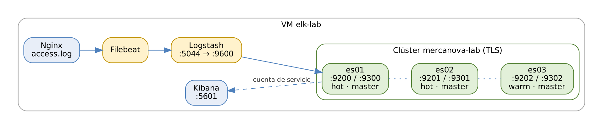

# ELK Stack: Elasticsearch, Logstash y Kibana

## Práctica 2. Desplegar un clúster de tres nodos con Kibana, Logstash y Filebeat

### Objetivo

Al finalizar la práctica, serás capaz de:

-   Preparar un servidor Linux para Elasticsearch: kernel, límites, swap,
    usuario de servicio, firewall y hora.
-   Instalar tres nodos de Elasticsearch 8.19 en una sola VM, cada uno
    con directorio, puertos y servicio systemd propios.
-   Aprovechar la seguridad automática de 8.x y unir nodos al clúster con
    enrollment tokens.
-   Instalar Kibana, Logstash y Filebeat, conectarlos con credenciales
    propias y la CA del clúster, y verificar el flujo de punta a punta.

### Objetivo visual

{width="6.3in"}\

### Duración aproximada

-   165 minutos. Se sugiere una pausa al terminar la Tarea 4.

### Prerrequisitos

-   VM Debian 12 con escritorio XFCE, 8 vCPU, 20 GB de RAM y 150 GB de
    disco, preparada con la *Guía de preparación del ambiente*.
-   Nginx, MariaDB, `curl`, `jq`, `nc`, `chrony` y `firewalld` instalados
    (los deja listos `preparar-vm-debian.sh`).
-   Material del curso copiado en `/home/student/labs`.
-   Instaladores 8.19.x en `/home/student/labs/downloads` (consulta
    `downloads/LEEME.txt`) o acceso a internet.

### Instrucciones

**Escenario:** MercaNova necesita una plataforma central de logs. Su
ambiente de producción usará tres servidores; para aprender, montarás
un clúster **real** de tres nodos dentro de tu VM. Cada nodo es un
proceso independiente con su propio directorio, puertos y servicio, igual
que si estuviera en otro servidor. Al final, un log de Nginx viajará por
Filebeat y Logstash hasta un índice de Elasticsearch, y lo consultarás
desde Kibana.

Convenciones de esta guía:

| Elemento | Valor en el laboratorio |
|------------------|------------------------------------------|
| Nombre del host | `elk-lab` |
| Clúster | `mercanova-lab` |
| Nodos | `es01`, `es02`, `es03` en `/opt/elastic/esNN` |
| Puertos HTTP | 9200, 9201, 9202 |
| Puertos transporte | 9300, 9301, 9302 |
| Usuario de servicio | `elastic` (usuario de Linux, no confundir con el superusuario `elastic` de Elasticsearch) |
| Material | `/home/student/labs` (en esta guía, `$LABS`) |

Los comandos que empiezan con `$` se ejecutan en la terminal de Linux;
los que empiezan con `GET`, `PUT` o `POST` se ejecutan en **Kibana \> Dev
Tools \> Console**.

------------------------------------------------------------------------

### Tarea 1. Preparar el sistema operativo

#### Paso 1. Verifica los recursos de la VM

``` 
$ export LABS=/home/student/labs
$ nproc; free -g; df -h /opt
$ hostnamectl
```

**Qué hace y por qué:** confirma que la VM tiene al menos 8 vCPU, 16 GB
de RAM y espacio libre en `/opt`. Los tres nodos usarán 1.5 GB de heap
cada uno, más la memoria que el sistema dedica a la **caché de
archivos**, que Lucene aprovecha para leer los segmentos de los índices.
Si el nombre del host no es `elk-lab`, cámbialo:

``` 
$ sudo hostnamectl set-hostname elk-lab
$ echo "127.0.1.1 elk-lab" | sudo tee -a /etc/hosts
```

#### Paso 2. Ajusta el kernel: `vm.max_map_count` y `swappiness`

``` 
$ sudo cp $LABS/config/system/99-elasticsearch.conf /etc/sysctl.d/
$ cat /etc/sysctl.d/99-elasticsearch.conf
vm.max_map_count = 262144
vm.swappiness = 1
$ sudo sysctl --system | grep -E "max_map_count|swappiness"
```

**Qué hace y por qué:**

| Parámetro | Valor | Razón |
|----------------|-------|-------------------------------------|
| `vm.max_map_count` | 262144 | Lucene mapea los segmentos en memoria (`mmap`). El valor por defecto de Linux (65530) es insuficiente y Elasticsearch no arranca en modo producción. |
| `vm.swappiness` | 1 | Le indica al kernel que evite mover a disco la memoria de procesos. Un heap en swap provoca pausas largas de garbage collection. |

El archivo en `/etc/sysctl.d/` hace que el ajuste sobreviva a reinicios;
`sysctl --system` lo aplica de inmediato.

#### Paso 3. Deshabilita el swap

``` 
$ sudo swapoff -a
$ sudo sed -i.bak '/\sswap\s/ s/^/#/' /etc/fstab
$ free -h | grep -i swap
```

**Qué hace y por qué:** `swapoff -a` desactiva el swap en este momento y
la línea comentada en `/etc/fstab` evita que se active al reiniciar
(`-i.bak` guarda una copia del archivo original). Un nodo de
Elasticsearch con parte de su heap en swap se vuelve lento e inestable:
puede perder contacto con el master y salir del clúster.

#### Paso 4. Crea el usuario de servicio y los directorios

``` 
$ sudo useradd --system --home /opt/elastic \
      --shell /sbin/nologin elastic
$ sudo mkdir -p /opt/elastic/certs /srv/snapshots
$ sudo chown -R elastic:elastic /opt/elastic /srv/snapshots
$ sudo cp $LABS/config/system/elastic-limits.conf \
      /etc/security/limits.d/
```

**Qué hace y por qué:**

| Opción / ruta | Significado |
|-------------------|-----------------------------------------|
| `--system` | Cuenta de sistema, sin contraseña ni caducidad. |
| `--shell /sbin/nologin` | Nadie puede iniciar sesión interactiva con ella. |
| `/opt/elastic` | Raíz de todos los componentes del laboratorio. |
| `/opt/elastic/certs` | Copia de la CA del clúster para los clientes. |
| `/srv/snapshots` | Repositorio de snapshots compartido por los tres nodos (práctica 10). |
| `elastic-limits.conf` | 65 535 descriptores de archivo y 4 096 procesos para sesiones interactivas. |

Elasticsearch **se niega a ejecutarse como root**: un proceso expuesto a
la red con privilegios de administrador sería un riesgo de seguridad.

#### Paso 5. Abre los puertos del laboratorio

``` 
$ sudo firewall-cmd --permanent --add-port=9200-9202/tcp
$ sudo firewall-cmd --permanent --add-port=9300-9302/tcp
$ sudo firewall-cmd --permanent --add-port={5601,5044,8220}/tcp
$ sudo firewall-cmd --reload
$ sudo firewall-cmd --list-ports
```

**Qué hace y por qué:** abre la API (9200–9202), el transporte entre
nodos (9300–9302), Kibana (5601), el input Beats de Logstash (5044) y
Fleet Server (8220, práctica 6). `--permanent` guarda la regla y
`--reload` la aplica. En Debian, `firewalld` lo instala el script de
preparación del ambiente. En producción, el
puerto de transporte solo debe estar abierto entre los nodos del clúster.

#### Paso 6. Verifica la sincronización de la hora

``` 
$ timedatectl status | grep -E "Time zone|synchronized"
$ chronyc tracking | grep -E "Reference|System time"
```

**Qué hace y por qué:** los eventos se correlacionan por su
`@timestamp`; un reloj desfasado entre servidores ordena mal los
eventos de un incidente. Además, los certificados TLS tienen fechas de
validez que se comparan con el reloj. Debe aparecer
`System clock synchronized: yes`.

### Tarea 2. Instalar Elasticsearch en tres directorios

#### Paso 7. Descarga y verifica el instalador

``` 
$ cd $LABS/downloads
$ V=8.19.x        # usa la versión exacta indicada por el instructor
$ URL=https://artifacts.elastic.co/downloads/elasticsearch
$ curl -O $URL/elasticsearch-$V-linux-x86_64.tar.gz
$ curl -O $URL/elasticsearch-$V-linux-x86_64.tar.gz.sha512
$ shasum -a 512 -c elasticsearch-$V-linux-x86_64.tar.gz.sha512
```

**Qué hace y por qué:** si los archivos ya están en `downloads/`, omite
los `curl`. `shasum -c` compara el hash SHA-512 del archivo con el
publicado por Elastic; debe responder `OK`. Así confirmas que el archivo
no está corrupto ni fue alterado.

#### Paso 8. Extrae una copia por nodo

``` 
$ for n in 01 02 03; do
    sudo mkdir -p /opt/elastic/es$n
    sudo tar -xzf elasticsearch-$V-linux-x86_64.tar.gz \
         -C /opt/elastic/es$n --strip-components=1
  done
$ ls /opt/elastic/es01
bin  config  jdk  lib  LICENSE.txt  logs  modules  ...
```

**Qué hace y por qué:** el tar.gz es **autocontenido**: binarios, JDK,
configuración, datos y logs viven en un solo directorio. Por eso es la
forma de tener varios nodos en un mismo host. `--strip-components=1`
quita la carpeta `elasticsearch-8.19.x/` del archivo para que el
contenido quede directamente en `esNN`. En producción usarías los
paquetes RPM/DEB, uno por servidor.

#### Paso 9. Copia la configuración de cada nodo

``` 
$ for n in 01 02 03; do
    sudo cp $LABS/config/elasticsearch/es$n.yml \
         /opt/elastic/es$n/config/elasticsearch.yml
    sudo cp $LABS/config/elasticsearch/heap.options \
         /opt/elastic/es$n/config/jvm.options.d/
  done
$ sudo chown -R elastic:elastic /opt/elastic
$ cat /opt/elastic/es01/config/elasticsearch.yml
```

``` 
cluster.name: mercanova-lab
node.name: es01
node.roles: [ master, data_hot, data_content, ingest ]
path.data: /opt/elastic/es01/data
path.logs: /opt/elastic/es01/logs
path.repo: [ "/srv/snapshots" ]
http.port: 9200
transport.port: 9300
```

**Qué hace y por qué:**

| Parámetro | Por qué |
|---------------|---------------------------------------------|
| `cluster.name` | Solo los nodos con el mismo nombre forman un clúster. |
| `node.name` | Nombre legible del nodo en APIs y Kibana. |
| `node.roles` | es01 y es02: elegibles como master, datos calientes (`data_hot`), índices que no son series de tiempo (`data_content`) e ingest. es03: master y `data_warm`, para la práctica 10. |
| `path.data` | Dónde se guardan los shards. Cada nodo necesita el suyo: dos nodos no pueden compartir datos. |
| `path.logs` | Logs del propio nodo. |
| `path.repo` | Rutas permitidas para repositorios de snapshots. |
| `http.port` | API REST: 9200, 9201 y 9202. |
| `transport.port` | Comunicación entre nodos: 9300, 9301 y 9302. |

`heap.options` fija `-Xms1536m` y `-Xmx1536m`. El heap mínimo y máximo
iguales evitan que la JVM redimensione la memoria en operación. Va en
`jvm.options.d/` porque `jvm.options` lo reemplaza cada actualización.

#### Paso 10. Instala la plantilla de servicio systemd

``` 
$ sudo cp $LABS/config/systemd/es@.service /etc/systemd/system/
$ sudo systemctl daemon-reload
$ systemctl cat es@01 | grep -E "ExecStart|User|Limit"
ExecStart=/opt/elastic/es01/bin/elasticsearch
User=elastic
LimitNOFILE=65535
LimitNPROC=4096
LimitMEMLOCK=infinity
```

**Qué hace y por qué:** el `@` convierte el archivo en una
**plantilla**: `es@01`, `es@02` y `es@03` son tres servicios y `%i` se
reemplaza por `01`, `02` o `03`. Así un solo archivo controla los tres
nodos. `LimitNOFILE` y `LimitNPROC` aplican los límites al proceso
(systemd no lee `limits.d`). `TimeoutStartSec=180` da tiempo al arranque
y `SuccessExitStatus=143` evita que systemd marque como falla un apagado
normal con SIGTERM.

### Tarea 3. Primer nodo y seguridad automática

#### Paso 11. Arranca es01 en primer plano por primera vez

``` 
$ sudo -u elastic /opt/elastic/es01/bin/elasticsearch
```

Espera el recuadro final, similar a este, y **copia su contenido en un
archivo de texto**:

``` 
✅ Elasticsearch security features have been automatically configured!
ℹ️  Password for the elastic user (reset with
    `bin/elasticsearch-reset-password -u elastic`):
  k9Yq2...+Xv
ℹ️  HTTP CA certificate SHA-256 fingerprint:
  3f1a9c...e72b
ℹ️  Configure Kibana to use this cluster:
• Run Kibana and click the configuration link in the terminal ...
• Copy the following enrollment token and paste it into Kibana
  (the token is valid for the next 30 minutes):
  eyJ2ZXIiOiI4LjE5LjAiLCJhZHIiOlsiMTAuMC4yLjE1OjkyMDAiXSwi...
```

Después presiona `Ctrl + C` para detener el nodo.

**Qué hace y por qué:** el primer arranque de un nodo nuevo, sin
configuración de seguridad previa, ejecuta la **autoconfiguración de
seguridad** de 8.x:

| Acción | Resultado |
|-------------------------|-----------------------------------|
| Genera una CA y certificados | `config/certs/http_ca.crt`, `http.p12` y `transport.p12` |
| Activa TLS | HTTPS en 9200 y TLS en el transporte |
| Crea la contraseña de elastic | Superusuario para la configuración inicial |
| Emite un token para Kibana | Válido 30 minutos |
| Agrega la configuración | Bloque `BEGIN SECURITY AUTO CONFIGURATION` al final de `elasticsearch.yml` |

Lo hacemos en primer plano para ver y guardar la contraseña. Si se
pierde, se genera otra con `bin/elasticsearch-reset-password -u elastic`.
El token de Kibana caduca, pero se genera otro cuando se necesite
(Paso 21).

#### Paso 12. Revisa la configuración que se agregó

``` 
$ sudo tail -25 /opt/elastic/es01/config/elasticsearch.yml
```

``` 
#----------------- BEGIN SECURITY AUTO CONFIGURATION ----------------
xpack.security.enabled: true
xpack.security.enrollment.enabled: true
xpack.security.http.ssl:
  enabled: true
  keystore.path: certs/http.p12
xpack.security.transport.ssl:
  enabled: true
  verification_mode: certificate
  keystore.path: certs/transport.p12
  truststore.path: certs/transport.p12
cluster.initial_master_nodes: ["es01"]
http.host: 0.0.0.0
#transport.host: 0.0.0.0
#----------------- END SECURITY AUTO CONFIGURATION ------------------
```

**Qué hace y por qué:**

| Ajuste | Significado |
|---------------------------|---------------------------------|
| `xpack.security.enabled` | Autenticación y autorización activas. |
| `enrollment.enabled` | Permite emitir enrollment tokens. |
| `http.ssl` | HTTPS en la API con el certificado de `http.p12`. |
| `transport.ssl` | TLS entre nodos; `verification_mode: certificate` valida que el certificado lo firmó la CA del clúster. |
| `cluster.initial_master_nodes` | Lista de nodos que votan en la **primera** elección de master (bootstrap). Solo se usa al formar el clúster. |
| `http.host: 0.0.0.0` | La API escucha en todas las interfaces. |
| `#transport.host` | El transporte queda en localhost. Como los tres nodos están en la misma VM, pueden unirse **sin** cambiarlo. Con nodos en otros servidores habría que descomentarlo. |

Las contraseñas de los keystores PKCS#12 quedan en el keystore seguro
de Elasticsearch (`config/elasticsearch.keystore`), no en texto plano.

#### Paso 13. Publica la CA para los clientes y arranca es01 como servicio

``` 
$ sudo cp /opt/elastic/es01/config/certs/http_ca.crt \
      /opt/elastic/certs/
$ sudo chown elastic:elastic /opt/elastic/certs/http_ca.crt
$ sudo systemctl enable --now es@01
$ sudo journalctl -u es@01 -f      # Ctrl+C cuando veas "started"
```

**Qué hace y por qué:** `http_ca.crt` es el certificado de la CA que
firmó el certificado HTTPS del clúster. Kibana, Logstash, Filebeat,
Metricbeat y `curl` lo necesitan para **confiar** en el clúster sin
desactivar la verificación TLS. `enable --now` arranca el servicio y lo
deja habilitado para el siguiente reinicio de la VM.

#### Paso 14. Prepara las variables de entorno y prueba la API

``` 
$ source $LABS/scripts/env.sh
Contraseña del usuario elastic: ********
$ curl --cacert $CA -u elastic:$ELASTIC_PWD $ES
```

``` 
{
  "name" : "es01",
  "cluster_name" : "mercanova-lab",
  "version" : { "number" : "8.19.x", ... },
  "tagline" : "You Know, for Search"
}
```

**Qué hace y por qué:** `env.sh` define `ES` (URL de es01), `CA` (ruta
de la CA) y la función `esc` para abreviar peticiones; la contraseña se
guarda solo en la sesión actual. Prueba también qué pasa sin la CA:

``` 
$ curl -u elastic:$ELASTIC_PWD $ES
curl: (60) SSL certificate problem: self-signed certificate in
certificate chain
```

Es el error más común al empezar con 8.x: la solución correcta es usar
`--cacert`, **no** `--insecure`, que desactiva la verificación y expone
la conexión a suplantación.

### Tarea 4. Unir es02 y es03 al clúster

#### Paso 15. Genera un enrollment token de tipo nodo

``` 
$ sudo -u elastic /opt/elastic/es01/bin/\
elasticsearch-create-enrollment-token -s node
eyJ2ZXIiOiI4LjE5LjAiLCJhZHIiOlsiMTI3LjAuMC4xOjkzMDAiXSwiZmdyIjoi...
```

**Qué hace y por qué:** `-s node` (*scope*) crea un token para un nodo
nuevo de Elasticsearch; `-s kibana` lo crea para Kibana. El token
contiene, codificados en base64, la dirección de transporte de es01, la
huella de la CA y una llave temporal. Es válido 30 minutos y permite al
nodo nuevo descargar certificados firmados por la CA del clúster.

#### Paso 16. Arranca es02 con el token

``` 
$ sudo -u elastic /opt/elastic/es02/bin/elasticsearch \
      --enrollment-token <TOKEN_DEL_PASO_15>
```

Cuando el log muestre que el nodo se unió (`master node changed` o
`added {es01}`), presiona `Ctrl + C` y arráncalo como servicio:

``` 
$ sudo systemctl enable --now es@02
```

**Qué hace y por qué:** con `--enrollment-token`, es02 contacta a es01,
obtiene sus certificados y escribe su propio bloque de seguridad con
`discovery.seed_hosts` apuntando a es01. Como `http.port` y
`transport.port` ya estaban definidos en su `elasticsearch.yml` (9201 y
9301), no hay conflicto de puertos con es01. Repite el proceso para es03
con un **token nuevo** (Paso 15) y `es@03`.

#### Paso 17. Comprueba que el clúster tiene tres nodos

``` 
$ curl -s --cacert $CA -u elastic:$ELASTIC_PWD \
  "$ES/_cat/nodes?v&h=name,ip,port,node.role,master,heap.max"
```

``` 
name ip        port node.role master heap.max
es01 127.0.0.1 9300 hims      *      1.5gb
es02 127.0.0.1 9301 hims      -      1.5gb
es03 127.0.0.1 9302 mw        -      1.5gb
```

**Qué hace y por qué:** `_cat/nodes` lista los nodos del clúster; `v`
agrega encabezados y `h` elige columnas. Lectura de `node.role`:
`h` = data_hot, `i` = ingest, `m` = master, `s` = data_content y
`w` = data_warm. El `*` en `master` marca el master elegido. `heap.max`
confirma que se aplicó `heap.options`.

#### Paso 18. Retira `cluster.initial_master_nodes`

``` 
$ sudo sed -i 's/^cluster.initial_master_nodes/#&/' \
      /opt/elastic/es01/config/elasticsearch.yml
$ sudo systemctl restart es@01
$ curl -s --cacert $CA -u elastic:$ELASTIC_PWD \
  "$ES/_cluster/health?pretty&wait_for_nodes=3&timeout=60s"
```

**Qué hace y por qué:** el bootstrap ocurre una sola vez. Dejar
`cluster.initial_master_nodes` configurado es un riesgo: si en el futuro
se borraran los datos de es01, podría formar por error un clúster nuevo
separado. La documentación de Elastic indica retirarlo después de
formar el clúster. Al reiniciar es01 verás que el clúster sigue con tres
nodos y que otro nodo pudo quedar como master.

#### Paso 19. Lee la salud del clúster

``` 
{
  "cluster_name" : "mercanova-lab",
  "status" : "green",
  "number_of_nodes" : 3,
  "number_of_data_nodes" : 3,
  "active_primary_shards" : 3,
  "active_shards" : 6,
  "unassigned_shards" : 0,
  "active_shards_percent_as_number" : 100.0
}
```

**Qué hace y por qué:** `status: green` indica que todos los primarios
y sus réplicas están asignados. Los shards que ves son de índices de
sistema (por ejemplo, `.security`). `wait_for_nodes=3` hace que la
petición espere hasta ver tres nodos, útil justo después de un reinicio.

> **Pausa sugerida.** El clúster está listo. Las tareas siguientes
> instalan las herramientas que lo rodean.

### Tarea 5. Instalar y configurar Kibana

#### Paso 20. Extrae Kibana y copia su configuración

``` 
$ cd $LABS/downloads
$ sudo mkdir -p /opt/elastic/kibana
$ sudo tar -xzf kibana-$V-linux-x86_64.tar.gz \
      -C /opt/elastic/kibana --strip-components=1
$ sudo cp $LABS/config/kibana/kibana.yml \
      /opt/elastic/kibana/config/kibana.yml
$ sudo chown -R elastic:elastic /opt/elastic/kibana
```

**Qué hace y por qué:**

| Parámetro de `kibana.yml` | Significado |
|----------------------|--------------------------------------|
| `server.host: "0.0.0.0"` | Escucha en todas las interfaces, para abrir Kibana desde el navegador de tu equipo. |
| `server.port: 5601` | Puerto web de Kibana. |
| `server.publicBaseUrl` | URL con la que los usuarios llegan a Kibana; se usa en enlaces de alertas y reportes. |
| `server.name` | Nombre de esta instancia en el monitoreo. |

#### Paso 21. Genera las llaves de cifrado

``` 
$ sudo -u elastic /opt/elastic/kibana/bin/kibana-encryption-keys \
      generate -q
xpack.encryptedSavedObjects.encryptionKey: 6c5b0e...
xpack.reporting.encryptionKey: a1f9d2...
xpack.security.encryptionKey: 77e0bc...
```

Agrega las tres líneas al final de `/opt/elastic/kibana/config/kibana.yml`.

**Qué hace y por qué:** `-q` imprime solo las llaves.
`encryptedSavedObjects` cifra las credenciales de conectores y reglas
de alerta (práctica 8): **sin ella, las alertas no funcionan**.
`reporting` protege los reportes y `security` las sesiones de usuario.
Deben ser fijas: si cambian, Kibana no puede descifrar lo ya guardado.

#### Paso 22. Inscribe Kibana con un enrollment token

``` 
$ sudo -u elastic /opt/elastic/es01/bin/\
elasticsearch-create-enrollment-token -s kibana
$ sudo -u elastic /opt/elastic/kibana/bin/kibana-setup \
      --enrollment-token <TOKEN_KIBANA>
✔ Kibana configured successfully.
```

**Qué hace y por qué:** `kibana-setup` usa el token para obtener la CA
y un **token de la cuenta de servicio** `elastic/kibana`, y escribe en
`kibana.yml` los ajustes `elasticsearch.hosts`,
`elasticsearch.serviceAccountToken` y
`elasticsearch.ssl.certificateAuthorities`. Kibana no usa el usuario
`elastic`: usa una credencial de servicio propia, con los privilegios
justos para su trabajo.

#### Paso 23. Arranca Kibana como servicio e inicia sesión

``` 
$ sudo cp $LABS/config/systemd/kibana.service /etc/systemd/system/
$ sudo systemctl daemon-reload
$ sudo systemctl enable --now kibana
$ curl -s localhost:5601/api/status | jq -r .status.overall.level
available
```

Abre `http://elk-lab:5601` (o la IP de la VM) e inicia sesión con el
usuario `elastic`. Después ve a **Management \> Dev Tools** y ejecuta:

``` 
GET _cluster/health
GET _cat/nodes?v
```

**Qué hace y por qué:** Kibana tarda entre uno y dos minutos en estar
`available` la primera vez porque crea sus índices de sistema. Desde
ahora, los comandos `GET`, `PUT` y `POST` de las guías se ejecutan en
**Dev Tools \> Console**, que usa tu sesión de Kibana: no necesitas
indicar URL, certificado ni contraseña.

### Tarea 6. Instalar Logstash y Filebeat y probar el flujo completo

#### Paso 24. Crea el rol y el usuario de Logstash

``` 
POST _security/role/logstash_writer
{
  "cluster": [ "monitor", "manage_index_templates",
               "manage_ilm" ],
  "indices": [
    {
      "names": [ "lab02-*", "logs-mercanova.*", "orders",
                 "logs-loadtest-*" ],
      "privileges": [ "create_index", "create_doc", "index",
                      "write", "auto_configure",
                      "view_index_metadata" ]
    }
  ]
}

POST _security/user/logstash_internal
{
  "password": "Logstash#2026",
  "roles": [ "logstash_writer" ],
  "full_name": "Usuario interno de Logstash"
}
```

**Qué hace y por qué:**

| Privilegio | Para qué lo necesita Logstash |
|---------------------|---------------------------------------|
| `monitor` | Verificar la versión y salud del clúster al conectarse. |
| `manage_index_templates` | Crear plantillas si una salida lo requiere. |
| `create_index` | Crear el índice si no existe. |
| `create_doc` | Escribir documentos nuevos (data streams). |
| `index`, `write` | Crear o reemplazar documentos con un id (pedidos, práctica 5). |
| `auto_configure` | Crear automáticamente un data stream al escribir en él. |

Principio de **mínimo privilegio**: Logstash solo puede escribir en sus
índices; no puede borrar índices ni administrar la seguridad.

#### Paso 25. Instala Logstash y guarda la contraseña en su keystore

``` 
$ sudo mkdir -p /opt/elastic/logstash
$ sudo tar -xzf logstash-$V-linux-x86_64.tar.gz \
      -C /opt/elastic/logstash --strip-components=1
$ cd /opt/elastic/logstash
$ sudo cp $LABS/config/logstash/logstash.yml config/
$ sudo cp $LABS/config/logstash/jvm-heap.options \
      config/jvm.options.d/heap.options
$ sudo cp $LABS/config/logstash/pipelines-lab02.yml \
      config/pipelines.yml
$ sudo mkdir -p pipelines
$ sudo cp $LABS/config/logstash/pipelines/*.conf pipelines/
$ sudo chown -R elastic:elastic /opt/elastic/logstash
$ sudo -u elastic bin/logstash-keystore \
      --path.settings config create
$ sudo -u elastic bin/logstash-keystore \
      --path.settings config add LS_ES_PWD
Enter value for LS_ES_PWD: Logstash#2026
```

**Qué hace y por qué:** `logstash.yml` fija el nombre del nodo, rutas,
la API de monitoreo en 127.0.0.1:9600, la recarga automática de
pipelines y 1 GB de heap (`heap.options`). El **keystore** guarda la
contraseña cifrada; en el pipeline se referencia como `${LS_ES_PWD}`, y
así el archivo `.conf` no contiene secretos. `--path.settings` indica
dónde está la configuración porque no usamos la ruta por defecto de los
paquetes. Se copian todos los pipelines del curso, pero
`pipelines.yml` solo activa `lab02-test` por ahora.

#### Paso 26. Revisa el pipeline de prueba

``` 
input {
  beats { port => 5044 }
}
output {
  elasticsearch {
    hosts => [ "https://localhost:9200" ]
    ssl_certificate_authorities =>
      "/opt/elastic/certs/http_ca.crt"
    user => "logstash_internal"
    password => "${LS_ES_PWD}"
    index => "lab02-nginx"
    manage_template => false
  }
}
```

**Qué hace y por qué:**

| Opción | Por qué |
|--------------------------|----------------------------------|
| `beats { port => 5044 }` | Recibe eventos de Filebeat. |
| `hosts` | HTTPS hacia es01. |
| `ssl_certificate_authorities` | Confía en la CA del clúster (Paso 13). |
| `user` / `password` | Credencial propia, con la contraseña del keystore. |
| `index` | Índice de prueba de esta práctica. |
| `manage_template => false` | Evita que Logstash instale su plantilla heredada; los mappings se diseñan en la práctica 3. |

#### Paso 27. Valida y arranca Logstash como servicio

``` 
$ sudo -u elastic bin/logstash --path.settings config \
      -f pipelines/lab02-test.conf --config.test_and_exit
Configuration OK
$ sudo cp $LABS/config/systemd/logstash.service /etc/systemd/system/
$ sudo systemctl daemon-reload && sudo systemctl enable --now logstash
$ curl -s localhost:9600/_node/pipelines?pretty | jq '.pipelines|keys'
[ "lab02-test" ]
```

**Qué hace y por qué:** `--config.test_and_exit` valida la sintaxis sin
ejecutar el pipeline: detecta llaves sin cerrar u opciones mal escritas
antes de afectar al servicio. La API del puerto 9600 confirma qué
pipelines están corriendo.

#### Paso 28. Instala Filebeat y verifica su configuración

``` 
$ cd $LABS/downloads
$ sudo mkdir -p /opt/elastic/filebeat
$ sudo tar -xzf filebeat-$V-linux-x86_64.tar.gz \
      -C /opt/elastic/filebeat --strip-components=1
$ sudo cp $LABS/config/filebeat/filebeat-lab02.yml \
      /opt/elastic/filebeat/filebeat.yml
$ sudo chown -R root:root /opt/elastic/filebeat
$ sudo chmod go-w /opt/elastic/filebeat/filebeat.yml
$ cd /opt/elastic/filebeat
$ sudo ./filebeat test config -c filebeat.yml
Config OK
$ sudo ./filebeat test output -c filebeat.yml
logstash: localhost:5044...
  connection...
    parse host... OK
    dial up... OK
  talk to server... OK
```

**Qué hace y por qué:** Filebeat se ejecuta como **root** para leer los
logs de Nginx, que pertenecen a root. Por seguridad, Filebeat exige que
su archivo de configuración no sea modificable por otros usuarios
(`chmod go-w`). La configuración usa un input `filestream` con
`id: nginx-real`, que lee `/var/log/nginx/access.log`. `test config`
valida el YAML y `test output` confirma que Logstash responde en 5044.

#### Paso 29. Arranca Filebeat y genera tráfico

``` 
$ sudo cp $LABS/config/systemd/filebeat.service /etc/systemd/system/
$ sudo systemctl daemon-reload && sudo systemctl enable --now filebeat
$ $LABS/scripts/traffic.sh 60
```

**Qué hace y por qué:** `traffic.sh` hace peticiones al Nginx local
durante 60 segundos con distintas rutas y navegadores; cada petición
escribe una línea en `access.log`. Filebeat la lee, la envía a Logstash
y Logstash la indexa en `lab02-nginx`.

#### Paso 30. Comprueba los documentos en Elasticsearch

``` 
GET lab02-nginx/_count

GET lab02-nginx/_search
{
  "size": 1,
  "sort": [ { "@timestamp": "desc" } ],
  "_source": [ "message", "lab", "host.name", "log.file.path" ]
}
```

**Qué hace y por qué:** `_count` debe crecer mientras corre el tráfico.
El documento muestra el campo `message` con la línea completa de Nginx,
el campo `lab: "02"` agregado por Filebeat y la ruta del archivo de
origen. La línea aún no está estructurada: en la práctica 5 la
dividiremos en campos con grok.

### Tarea 7. Verificación final

#### Paso 31. Revisa puertos, servicios y distribución de shards

``` 
$ sudo ss -ltnp | grep -E "9200|9201|9202|930|5601|5044|9600"
$ systemctl is-enabled es@01 es@02 es@03 kibana logstash filebeat
```

``` 
GET _cat/shards/lab02-nginx?v&h=index,shard,prirep,state,node
GET _cat/allocation?v
```

**Qué hace y por qué:** `ss -ltnp` lista los puertos en escucha y el
proceso dueño; los puertos 9300–9302 aparecen en 127.0.0.1 porque el
transporte quedó en localhost. `is-enabled` confirma que todo arrancará
con la VM. `_cat/shards` muestra que el primario (`p`) y la réplica
(`r`) de `lab02-nginx` están en nodos distintos: si uno cae, los datos
siguen disponibles.

#### Paso 32. Limpia el índice de prueba

``` 
DELETE lab02-nginx
```

``` 
$ sudo systemctl stop filebeat
```

**Qué hace y por qué:** el índice solo sirvió para validar el flujo.
Filebeat se detiene porque en la práctica 5 tendrá una configuración
nueva. Conserva el usuario `logstash_internal`, el rol
`logstash_writer` y todo lo instalado.

### Resultado esperado

-   Clúster `mercanova-lab` con tres nodos y estado **green**:

``` 
name node.role master
es01 hims      -
es02 hims      *
es03 mw        -
```

-   TLS activo en HTTP y transporte; `curl` funciona con `--cacert`.
-   Kibana accesible en el puerto 5601, inscrito con la cuenta de
    servicio y con las llaves de cifrado configuradas.
-   Logstash con el pipeline `lab02-test` y su contraseña en el keystore.
-   Eventos de Nginx en `lab02-nginx` antes de la limpieza.
-   Servicios `es@01`–`es@03`, `kibana`, `logstash` y `filebeat`
    habilitados en systemd.
-   Puedes explicar para qué sirve cada puerto, por qué cada nodo tiene
    su propio directorio y por qué se retira
    `cluster.initial_master_nodes`.

### Referencias

-   Elastic. *Install Elasticsearch from archive on Linux \[8.19\].*
    <https://www.elastic.co/guide/en/elasticsearch/reference/8.19/targz.html>
-   Elastic. *Important system configuration \[8.19\].*
    <https://www.elastic.co/guide/en/elasticsearch/reference/8.19/system-config.html>
-   Elastic. *Add and remove nodes in your cluster \[8.19\].*
    <https://www.elastic.co/guide/en/elasticsearch/reference/8.19/add-elasticsearch-nodes.html>
-   Elastic. *Install Kibana from archive on Linux \[8.19\].*
    <https://www.elastic.co/guide/en/kibana/8.19/targz.html>
-   Elastic. *Logstash: secrets keystore \[8.19\].*
    <https://www.elastic.co/guide/en/logstash/8.19/keystore.html>
-   Elastic. *Filebeat: filestream input \[8.19\].*
    <https://www.elastic.co/guide/en/beats/filebeat/8.19/filebeat-input-filestream.html>
