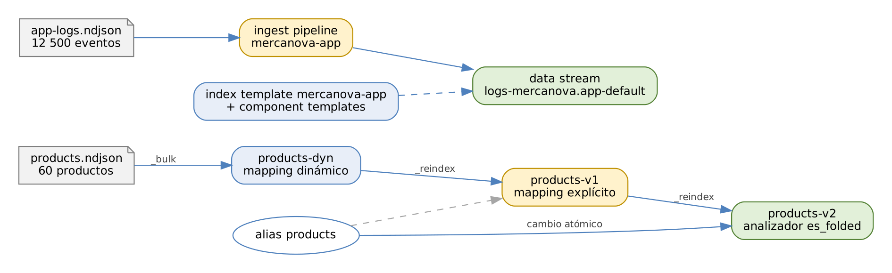

# ELK Stack: Elasticsearch, Logstash y Kibana

## Práctica 3. Diseñar el modelo de datos del catálogo y los logs de MercaNova

### Objetivo

Al finalizar la práctica, serás capaz de:

-   Operar documentos con la API REST: crear, leer, actualizar, borrar y
    controlar la concurrencia.
-   Cargar datos en volumen con la Bulk API y revisar sus errores.
-   Diseñar un mapping explícito con multi-fields y un analizador
    personalizado, y validarlo con `_analyze`.
-   Corregir un mapping sin interrumpir el servicio mediante `_reindex` y
    un cambio atómico de alias.
-   Crear component templates, una index template, un ingest pipeline y
    un data stream para los logs de aplicación.

### Objetivo visual

{width="6.3in"}\

### Duración aproximada

-   105 minutos.

### Prerrequisitos

-   Práctica 2 completada: clúster `mercanova-lab` en green y Kibana
    disponible.
-   Archivos `data/lab03/products.ndjson` (60 productos) y
    `data/lab03/app-logs.ndjson` (12 500 eventos del 19 de octubre de
    2026).

### Instrucciones

**Escenario:** el equipo de MercaNova cargó su catálogo sin diseñar un
mapping y los clientes se quejan: al buscar "audifonos" sin acento, la
tienda no encuentra nada. Además, los logs de las aplicaciones llegan
con nombres de campos propios (`lvl`, `ts`). Diseñarás el modelo de
datos del catálogo, lo corregirás sin interrumpir a la aplicación, que
siempre consulta el alias `products`, y prepararás un data stream para
los logs.

Abre una terminal con las variables del curso y Kibana en **Dev Tools**:

``` 
$ source /home/student/labs/scripts/env.sh
$ cd $LABS
```

------------------------------------------------------------------------

### Tarea 1. Operaciones básicas sobre documentos

#### Paso 1. Indexa un documento con id

``` 
PUT lab03-crud/_doc/SKU-9001
{
  "name": "Audífonos de prueba",
  "category": "audio",
  "price": 999.0,
  "stock": 10
}
```

**Qué hace y por qué:** `PUT <índice>/_doc/<id>` crea el documento con
el id indicado; si el índice no existe, se crea con mapping dinámico.
La respuesta incluye `"result": "created"`, `_version: 1`, `_seq_no` y
`_primary_term`. Repite el mismo `PUT` y verás `"result": "updated"` y
`_version: 2`: con id explícito, `PUT` **reemplaza** el documento
completo.

#### Paso 2. Evita sobrescribir con `_create`

``` 
PUT lab03-crud/_create/SKU-9001
{ "name": "Otro producto" }
```

**Qué hace y por qué:** `_create` solo crea si el id no existe. Aquí
responde **409** `version_conflict_engine_exception`. Es útil al cargar
datos que no deben duplicarse ni pisar versiones existentes.

#### Paso 3. Actualiza solo algunos campos

``` 
POST lab03-crud/_update/SKU-9001
{ "doc": { "price": 899.0 } }

POST lab03-crud/_update/SKU-9001
{
  "script": {
    "source": "ctx._source.stock -= params.qty",
    "params": { "qty": 2 }
  }
}

GET lab03-crud/_doc/SKU-9001
```

**Qué hace y por qué:** `_update` con `doc` fusiona los campos indicados
con el documento existente; con `script` calcula el nuevo valor dentro
del clúster. Usar `params` en lugar de escribir el valor en el código
permite que Elasticsearch compile el script una sola vez y lo reutilice.
El `GET` muestra `price: 899.0` y `stock: 8`.

#### Paso 4. Controla la concurrencia

``` 
GET lab03-crud/_doc/SKU-9001?_source=false
```

Anota `_seq_no` y `_primary_term`, y úsalos dos veces:

``` 
PUT lab03-crud/_doc/SKU-9001?if_seq_no=3&if_primary_term=1
{ "name": "Audífonos de prueba", "price": 799.0, "stock": 8 }
```

**Qué hace y por qué:** la primera vez funciona; la segunda responde
**409** porque `_seq_no` ya cambió. Es el **control optimista de
concurrencia**: si dos procesos leen el mismo documento y lo modifican,
el segundo no pisa el cambio del primero sin darse cuenta. Ajusta los
valores a los que obtuviste.

#### Paso 5. Borra el documento y el índice de prueba

``` 
DELETE lab03-crud/_doc/SKU-9001
DELETE lab03-crud
```

**Qué hace y por qué:** el primer comando borra un documento (marca de
borrado que se limpia en los merges); el segundo elimina el índice
completo con sus shards. En producción, borrar índices debería
restringirse por roles (práctica 8).

### Tarea 2. Bulk API y mapping dinámico

#### Paso 6. Revisa el formato del archivo de productos

``` 
$ head -2 data/lab03/products.ndjson
{"index": {"_id": "SKU-1001"}}
{"sku": "SKU-1001", "name": "Audífonos inalámbricos Pro",
 "description": "Sonido de alta fidelidad ...", "category": "audio",
 "brand": "Sonix", "price": 1899, "stock": 44, "rating": 3.4,
 "tags": ["garantía extendida", "importado"], "on_sale": false,
 "created": "2026-06-04"}
```

**Qué hace y por qué:** el formato **NDJSON** de la Bulk API alterna una
línea de **acción** (`index` con su `_id`) y una línea con el
**documento**. Cada línea es un JSON completo y el archivo termina con un
salto de línea. (El documento se muestra en varias líneas solo por
espacio; en el archivo ocupa una).

#### Paso 7. Carga los productos con la Bulk API

``` 
$ scripts/bulk-load.sh products-dyn data/lab03/products.ndjson
Operaciones: 60  ·  con error: 0
```

**Qué hace y por qué:** el script envía el archivo a
`POST products-dyn/_bulk` con `Content-Type: application/x-ndjson`, en
bloques de 5 000 líneas, y cuenta los elementos con `error` en la
respuesta. Una petición Bulk responde **200 aunque fallen documentos**:
siempre hay que revisar `"errors": true` y los `items`. El índice
`products-dyn` se crea solo, con mapping dinámico.

#### Paso 8. Analiza el mapping que se generó

``` 
GET products-dyn/_mapping
```

**Qué hace y por qué:** observa lo que **infirió** Elasticsearch:

| Campo | Tipo inferido | Problema |
|----------|-----------------------|--------------------------|
| `sku` | `text` + `keyword` | Un código no se busca por palabras: basta `keyword`. |
| `category` | `text` + `keyword` | Doble indexación innecesaria. |
| `price` | `long` | Todos los precios del archivo son enteros: un precio con centavos se truncaría al indexar. |
| `name` | `text` (analizador `standard`) + `keyword` | Sin manejo de acentos: "audifonos" ≠ "audífonos". |
| `created` | `date` | Correcto. |

El mapping dinámico es cómodo para explorar, pero en producción produce
campos duplicados, tipos imprecisos y riesgo de *mapping explosion*.

### Tarea 3. Mapping explícito y alias

#### Paso 9. Crea `products-v1` con mapping explícito

``` 
PUT products-v1
{
  "settings": {
    "number_of_shards": 1,
    "number_of_replicas": 1
  },
  "mappings": {
    "dynamic": "strict",
    "properties": {
      "sku":         { "type": "keyword" },
      "name":        { "type": "text",
                       "fields": { "raw": { "type": "keyword" } } },
      "description": { "type": "text" },
      "category":    { "type": "keyword" },
      "brand":       { "type": "keyword" },
      "price":       { "type": "scaled_float",
                       "scaling_factor": 100 },
      "stock":       { "type": "integer" },
      "rating":      { "type": "half_float" },
      "tags":        { "type": "keyword" },
      "on_sale":     { "type": "boolean" },
      "created":     { "type": "date" }
    }
  }
}
```

**Qué hace y por qué:**

| Decisión | Razón |
|----------------------|--------------------------------------|
| `number_of_shards: 1` | 60 productos caben de sobra en un shard; más shards solo agregarían costo. |
| `number_of_replicas: 1` | Una copia en otro nodo para disponibilidad. |
| `dynamic: strict` | Rechaza documentos con campos no declarados: protege la calidad del catálogo. |
| `name` + `name.raw` | **Multi-field**: `name` para buscar palabras y `name.raw` para ordenar y agregar. |
| `keyword` en `sku`, `category`, `tags` | Valores exactos: filtros, agregaciones y ordenamiento. |
| `scaled_float` (×100) | Guarda el precio como entero de centavos: exacto y compacto. |
| `half_float` en `rating` | Rango 0–5 con un decimal: basta la mitad de precisión. |

#### Paso 10. Copia los datos con `_reindex` y crea el alias

``` 
POST _reindex
{
  "source": { "index": "products-dyn" },
  "dest":   { "index": "products-v1" }
}

POST _aliases
{
  "actions": [
    { "add": { "index": "products-v1", "alias": "products" } }
  ]
}

GET products/_count
```

**Qué hace y por qué:** `_reindex` lee el `_source` de cada documento
del índice origen y lo indexa en el destino, aplicando **el mapping del
destino**. La respuesta indica `total: 60`, `created: 60` y
`failures: []`. El alias `products` es el nombre que usa la aplicación
de MercaNova: nunca consulta `products-v1` directamente, y eso permitirá
cambiar el índice real sin tocar la aplicación.

#### Paso 11. Reproduce el problema de búsqueda

``` 
GET products/_search
{ "query": { "match": { "name": "audifonos" } } }

GET products/_search
{ "query": { "match": { "name": "audífonos" } } }
```

**Qué hace y por qué:** la primera consulta devuelve **0** resultados y
la segunda **4**. El analizador `standard` convierte a minúsculas, pero
conserva los acentos: el término indexado es `audífonos` y la búsqueda
sin acento produce `audifonos`, que no existe en el índice invertido.

### Tarea 4. Analizadores y reindexación sin interrupción

#### Paso 12. Compara analizadores con `_analyze`

``` 
POST _analyze
{
  "analyzer": "standard",
  "text": "Audífonos Inalámbricos PRO"
}

POST _analyze
{
  "tokenizer": "standard",
  "filter": [ "lowercase", "asciifolding" ],
  "text": "Audífonos Inalámbricos PRO"
}
```

**Qué hace y por qué:** el primero genera `audífonos`, `inalámbricos`,
`pro`. El segundo arma un analizador "al vuelo" y genera `audifonos`,
`inalambricos`, `pro`: el filtro **`asciifolding`** convierte los
caracteres acentuados a su equivalente ASCII. Probar con `_analyze`
**antes** de crear el índice evita reindexar por un analizador mal
diseñado.

#### Paso 13. Crea `products-v2` con el analizador `es_folded`

``` 
PUT products-v2
{
  "settings": {
    "number_of_shards": 1,
    "number_of_replicas": 1,
    "analysis": {
      "analyzer": {
        "es_folded": {
          "type": "custom",
          "tokenizer": "standard",
          "filter": [ "lowercase", "asciifolding" ]
        }
      }
    }
  },
  "mappings": {
    "dynamic": "strict",
    "properties": {
      "sku":         { "type": "keyword" },
      "name":        { "type": "text", "analyzer": "es_folded",
                       "fields": { "raw": { "type": "keyword" } } },
      "description": { "type": "text", "analyzer": "es_folded" },
      "category":    { "type": "keyword" },
      "brand":       { "type": "keyword" },
      "price":       { "type": "scaled_float",
                       "scaling_factor": 100 },
      "stock":       { "type": "integer" },
      "rating":      { "type": "half_float" },
      "tags":        { "type": "keyword" },
      "on_sale":     { "type": "boolean" },
      "created":     { "type": "date" }
    }
  }
}
```

**Qué hace y por qué:** el analizador personalizado se declara en
`settings.analysis` y se asigna por campo con `analyzer`. Se usa **al
indexar y al buscar**, así que "audifonos" y "Audífonos" producen el
mismo término. No se puede cambiar el analizador de `products-v1`: el
analizador de un campo existente no es modificable, y por eso se crea un
índice nuevo.

#### Paso 14. Reindexa en segundo plano y sigue la tarea

``` 
POST _reindex?wait_for_completion=false
{
  "source": { "index": "products-v1" },
  "dest":   { "index": "products-v2" }
}

GET _tasks/<task_id_de_la_respuesta>
```

**Qué hace y por qué:** con `wait_for_completion=false`, la petición
responde de inmediato con un `task` y el reindex continúa en segundo
plano: así se manejan reindexaciones de millones de documentos sin
esperar con la conexión abierta. `GET _tasks/<id>` muestra el avance y,
al terminar, `"completed": true` con el resumen.

#### Paso 15. Valida y cambia el alias de forma atómica

``` 
GET _cat/count/products-v1?v
GET _cat/count/products-v2?v

POST _aliases
{
  "actions": [
    { "remove": { "index": "products-v1", "alias": "products" } },
    { "add":    { "index": "products-v2", "alias": "products" } }
  ]
}

GET _alias/products
```

**Qué hace y por qué:** primero se confirma que ambos índices tienen 60
documentos. Las acciones de `_aliases` se ejecutan como **una sola
operación atómica**: no existe un instante en que `products` no apunte a
ningún índice, ni en que apunte a los dos. La aplicación pasa a usar el
índice nuevo sin interrupción.

#### Paso 16. Comprueba la corrección

``` 
GET products/_search
{
  "query": { "match": { "name": "audifonos" } },
  "sort": [ { "name.raw": "asc" } ],
  "_source": [ "sku", "name", "price" ]
}
```

**Qué hace y por qué:** ahora devuelve los **4** audífonos, ordenados
alfabéticamente por `name.raw`. Ordenar por `name` (tipo `text`) daría
error porque los campos `text` no tienen *doc values*; el subcampo
`keyword` sí.

#### Paso 17. Actualiza por consulta y agrega un runtime field

``` 
POST products/_update_by_query?conflicts=proceed
{
  "query":  { "term": { "category": "audio" } },
  "script": { "source": "ctx._source.on_sale = true" }
}

PUT products-v2/_mapping
{
  "runtime": {
    "price_with_tax": {
      "type": "double",
      "script": {
        "source": "emit(doc['price'].value * 1.16)"
      }
    }
  }
}

GET products/_search
{
  "query": { "term": { "on_sale": true } },
  "fields": [ "name", "price", "price_with_tax" ],
  "_source": false
}
```

**Qué hace y por qué:** `_update_by_query` marca en oferta los 10
productos de audio; `conflicts=proceed` continúa aunque algún documento
cambie a la mitad. El **runtime field** `price_with_tax` calcula el
precio con IVA al consultar, sin reindexar: se pide en `fields` porque no
existe en `_source`. Es ideal para explorar; si se usa mucho, conviene
indexarlo.

### Tarea 5. Data stream para los logs de aplicación

#### Paso 18. Crea las component templates

``` 
PUT _component_template/mercanova-settings
{
  "template": {
    "settings": {
      "number_of_shards": 1,
      "number_of_replicas": 1
    }
  }
}

PUT _component_template/mercanova-app-mappings
{
  "template": {
    "mappings": {
      "properties": {
        "@timestamp":     { "type": "date" },
        "event":          { "properties": {
                             "ingested": { "type": "date" } } },
        "log":            { "properties": {
                             "level": { "type": "keyword" } } },
        "service":        { "properties": {
                             "name": { "type": "keyword" } } },
        "host":           { "properties": {
                             "name": { "type": "keyword" } } },
        "message":        { "type": "text" },
        "duration_ms":    { "type": "long" },
        "http": { "properties": {
          "request":  { "properties": {
                          "method": { "type": "keyword" } } },
          "response": { "properties": {
                          "status_code": { "type": "short" } } } } },
        "url":      { "properties": {
                        "path": { "type": "keyword" } } },
        "trace":    { "properties": {
                        "id": { "type": "keyword" } } },
        "customer": { "properties": {
                        "id": { "type": "keyword" } } },
        "order":    { "properties": {
                        "id": { "type": "long" } } },
        "error":    { "properties": {
                        "message":     { "type": "text" },
                        "stack_trace": { "type": "text" } } }
      }
    }
  }
}
```

**Qué hace y por qué:** las **component templates** son bloques
reutilizables. `mercanova-settings` se reutilizará en todos los data
streams del curso: cuando en la práctica 10 le agregues una política de
retención, se aplicará a todos a la vez. `mercanova-app-mappings` define
los campos de los logs de aplicación con nombres **ECS** (`log.level`,
`service.name`, `http.response.status_code`).

#### Paso 19. Crea y prueba el ingest pipeline

``` 
PUT _ingest/pipeline/mercanova-app
{
  "description": "Normaliza los logs de aplicación de MercaNova",
  "processors": [
    { "date":      { "field": "ts", "formats": [ "ISO8601" ] } },
    { "rename":    { "field": "lvl",
                     "target_field": "log.level" } },
    { "lowercase": { "field": "log.level" } },
    { "remove":    { "field": "ts" } },
    { "set":       { "field": "event.ingested",
                     "value": "{{_ingest.timestamp}}" } }
  ],
  "on_failure": [
    { "set": { "field": "error.message",
               "value": "{{ _ingest.on_failure_message }}" } },
    { "set": { "field": "event.kind",
               "value": "pipeline_error" } }
  ]
}

POST _ingest/pipeline/mercanova-app/_simulate
{
  "docs": [ { "_source": {
    "ts": "2026-10-19T14:32:10.481-06:00", "lvl": "ERROR",
    "service": { "name": "payment" },
    "message": "Payment gateway timeout after 30000 ms" } } ]
}
```

**Qué hace y por qué:**

| Procesador | Efecto |
|-----------|-------------------------------------------------|
| `date` | Convierte `ts` en `@timestamp` (su destino por defecto). ISO8601 respeta el desfase `-06:00` y guarda en UTC. |
| `rename` | `lvl` → `log.level`, el nombre ECS. |
| `lowercase` | `ERROR` → `error`: un solo valor por nivel para filtrar. |
| `remove` | Elimina `ts`, ya convertido. |
| `set` | `event.ingested`: hora en que llegó al clúster; permite medir el retraso de la ingesta. |
| `on_failure` | Si algo falla, el documento no se pierde: se marca con el error. |

`_simulate` muestra el documento transformado **sin indexar nada**:
`@timestamp` queda en `2026-10-19T20:32:10.481Z`.

#### Paso 20. Crea la index template del data stream

``` 
PUT _index_template/mercanova-app
{
  "index_patterns": [ "logs-mercanova.app-*" ],
  "data_stream": {},
  "composed_of": [ "mercanova-settings",
                   "mercanova-app-mappings" ],
  "priority": 500,
  "template": {
    "settings": { "index.default_pipeline": "mercanova-app" }
  }
}

POST _index_template/_simulate_index/logs-mercanova.app-default
```

**Qué hace y por qué:**

| Parámetro | Por qué |
|-----------------|-------------------------------------------|
| `index_patterns` | Se aplica a todo data stream que empiece con `logs-mercanova.app-`, en cualquier namespace. |
| `data_stream: {}` | Los nombres que coincidan se crean como data stream. |
| `composed_of` | Combina los bloques en orden; los posteriores ganan si hay conflicto. |
| `priority: 500` | Supera a la plantilla integrada `logs` (prioridad 100, patrón `logs-*-*`), que también coincide. |
| `default_pipeline` | Todo documento pasa por `mercanova-app` sin que el cliente lo indique. |

`_simulate_index` muestra la configuración final que tendría el índice,
**antes** de crearlo.

#### Paso 21. Carga los logs de aplicación

``` 
$ head -2 data/lab03/app-logs.ndjson
{"create":{}}
{"ts": "2026-10-19T00:00:05.959-06:00", "lvl": "INFO", ...}
$ scripts/bulk-load.sh logs-mercanova.app-default \
      data/lab03/app-logs.ndjson
Operaciones: 12500  ·  con error: 0
```

**Qué hace y por qué:** los data streams solo admiten la acción
`create`: son **append-only**. El primer documento crea el data stream
`logs-mercanova.app-default` con su primer backing index. El nombre
sigue el esquema `<tipo>-<dataset>-<namespace>`.

#### Paso 22. Inspecciona el data stream

``` 
GET _data_stream/logs-mercanova.app-default

GET logs-mercanova.app-default/_count

GET logs-mercanova.app-default/_search
{
  "size": 0,
  "aggs": { "niveles": { "terms": { "field": "log.level" } } }
}
```

**Qué hace y por qué:** `_data_stream` muestra el backing index
(`.ds-logs-mercanova.app-default-2026.xx.xx-000001`), la plantilla
`mercanova-app` y el estado. El conteo es **12 500** y la agregación
muestra `info` 11 378, `warn` 598 y `error` 524, ya en minúsculas por el
pipeline.

#### Paso 23. Prueba un rollover manual

``` 
POST logs-mercanova.app-default/_rollover
GET _data_stream/logs-mercanova.app-default?filter_path=*.*.indices
```

**Qué hace y por qué:** el rollover crea un backing index nuevo
(`-000002`) que recibe las escrituras siguientes; el anterior conserva
sus datos y sigue siendo consultable. En la práctica 10 lo hará ILM
automáticamente por tamaño o antigüedad.

#### Paso 24. Limpia los índices intermedios

``` 
DELETE products-dyn
DELETE products-v1
```

**Qué hace y por qué:** el alias ya apunta a `products-v2`; los índices
anteriores solo ocupan disco. Conserva `products-v2`, las templates, el
pipeline y el data stream: se usan en las prácticas siguientes.

### Resultado esperado

-   El alias `products` apunta a `products-v2` (60 documentos):

``` 
GET _alias/products
{ "products-v2": { "aliases": { "products": {} } } }
```

-   La búsqueda de "audifonos" devuelve los 4 audífonos.
-   Los 10 productos de audio tienen `on_sale: true` y el runtime field
    `price_with_tax` funciona.
-   El data stream `logs-mercanova.app-default` tiene **12 500**
    documentos con `@timestamp`, `log.level` en minúsculas y
    `event.ingested`, y dos backing indices tras el rollover.
-   Puedes explicar por qué un analizador no se puede cambiar en sitio,
    cómo se corrige con reindex y alias, y por qué los data streams solo
    admiten `create`.

### Referencias

-   Elastic. *Document APIs \[8.19\].*
    <https://www.elastic.co/guide/en/elasticsearch/reference/8.19/docs.html>
-   Elastic. *Bulk API \[8.19\].*
    <https://www.elastic.co/guide/en/elasticsearch/reference/8.19/docs-bulk.html>
-   Elastic. *Mapping \[8.19\].*
    <https://www.elastic.co/guide/en/elasticsearch/reference/8.19/mapping.html>
-   Elastic. *Text analysis \[8.19\].*
    <https://www.elastic.co/guide/en/elasticsearch/reference/8.19/analysis.html>
-   Elastic. *Index templates \[8.19\].*
    <https://www.elastic.co/guide/en/elasticsearch/reference/8.19/index-templates.html>
-   Elastic. *Data streams \[8.19\].*
    <https://www.elastic.co/guide/en/elasticsearch/reference/8.19/data-streams.html>
-   Elastic. *Ingest pipelines \[8.19\].*
    <https://www.elastic.co/guide/en/elasticsearch/reference/8.19/ingest.html>
