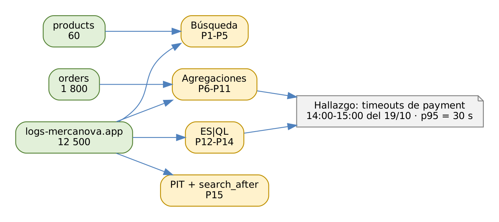

# ELK Stack: Elasticsearch, Logstash y Kibana

## Práctica 4. Responder preguntas de negocio y operación con consultas

### Objetivo

Al finalizar la práctica, serás capaz de:

-   Construir búsquedas de texto completo con tolerancia a errores,
    ponderación de campos y resaltado.
-   Combinar consultas y filtros con `bool` y entender la diferencia
    entre contexto de consulta y de filtro.
-   Calcular indicadores con agregaciones de métricas, buckets y
    pipeline.
-   Resolver preguntas con ES\|QL y exportar resultados en CSV.
-   Recorrer más de 10 000 resultados con *point in time* (PIT) y
    `search_after`.

### Objetivo visual

{width="6.3in"}\

### Duración aproximada

-   105 minutos.

### Prerrequisitos

-   Práctica 3 completada: alias `products` (60 productos) y data stream
    `logs-mercanova.app-default` (12 500 eventos).
-   Archivo `data/lab04/orders.ndjson` con 1 800 pedidos del 13 al 19 de
    octubre de 2026.

### Instrucciones

**Escenario:** el director de MercaNova convocó a una reunión para
revisar la semana del 13 al 19 de octubre. Quiere respuestas concretas:
cuánto se vendió, en qué regiones, qué servicio falló y cuándo. Tu tarea
es responder **15 preguntas** con consultas sobre tres fuentes:
`products`, `orders` y `logs-mercanova.app-default`.

Cada pregunta incluye la consulta de solución y el **resultado
esperado**. Recomendación: intenta escribir tú la consulta antes de leer
la solución.

**Fechas y zonas horarias:** los datos están en hora local de la Ciudad
de México (UTC-06:00) y Elasticsearch los guarda en UTC. Por eso las
consultas usan fechas con desfase (`2026-10-19T00:00:00-06:00`) y las
agregaciones de fecha usan `time_zone`. Una búsqueda por "hoy" o "últimas
24 horas" no encontraría nada: los datos son de octubre de 2026.

------------------------------------------------------------------------

### Tarea 1. Preparar el índice de pedidos

#### Paso 1. Crea el índice `orders` con mapping explícito

``` 
PUT orders
{
  "settings": { "number_of_shards": 1, "number_of_replicas": 1 },
  "mappings": {
    "dynamic": false,
    "properties": {
      "order_id":   { "type": "long" },
      "@timestamp": { "type": "date" },
      "updated_at": { "type": "date" },
      "status":     { "type": "keyword" },
      "total":      { "type": "scaled_float", "scaling_factor": 100 },
      "items":      { "type": "integer" },
      "customer": { "properties": {
        "id":     { "type": "keyword" },
        "name":   { "type": "text",
                    "fields": { "raw": { "type": "keyword" } } },
        "email":  { "type": "keyword" },
        "phone":  { "type": "keyword" },
        "region": { "type": "keyword" },
        "city":   { "type": "keyword" } } },
      "payment": { "properties": {
        "method":     { "type": "keyword" },
        "card_last4": { "type": "keyword" } } }
    }
  }
}
```

**Qué hace y por qué:** el índice guardará pedidos, que no son series de
tiempo append-only (cambian de estado), por eso es un índice normal y no
un data stream. `"dynamic": false` acepta campos no declarados, los guarda
en `_source`, pero **no los indexa**: es menos estricto que `strict` y
evita que Logstash falle en la práctica 5 si agrega algún campo extra.
`customer.email` y `phone` son `keyword` porque se filtran por valor
exacto; en la práctica 8 los ocultarás con seguridad a nivel de campo.

#### Paso 2. Carga los pedidos

``` 
$ source /home/student/labs/scripts/env.sh && cd $LABS
$ scripts/bulk-load.sh orders data/lab04/orders.ndjson
Operaciones: 1800  ·  con error: 0
```

**Qué hace y por qué:** cada acción del archivo es
`{"index":{"_id":"88001"}}`: el `_id` es el número de pedido. Así, en la
práctica 5, Logstash podrá volver a escribir los mismos pedidos desde
MariaDB sin duplicarlos.

#### Paso 3. Verifica las tres fuentes

``` 
GET _cat/count/orders?v
GET _cat/count/products?v
GET _cat/count/logs-mercanova.app-default?v
```

**Qué hace y por qué:** confirma el punto de partida: 1 800 pedidos, 60
productos y 12 500 eventos de aplicación. Si algún conteo no coincide,
corrige la carga antes de seguir: los resultados esperados dependen de
estos datos.

### Tarea 2. Búsqueda

#### Pregunta 1. ¿Qué productos coinciden con "audifonos inalambircos", escrito con errores?

``` 
GET products/_search
{
  "query": {
    "match": {
      "name": {
        "query": "audifonos inalambircos",
        "operator": "and",
        "fuzziness": "AUTO"
      }
    }
  },
  "highlight": { "fields": { "name": {} } },
  "_source": [ "sku", "name", "price" ]
}
```

**Qué hace y por qué:**

| Parámetro | Efecto |
|------------------|------------------------------------------|
| `match` | Analiza el texto con el analizador del campo (`es_folded`): minúsculas y sin acentos. |
| `operator: and` | Exige **todos** los términos; con `or`, el valor por defecto, bastaría uno. |
| `fuzziness: AUTO` | Tolera errores de escritura según la longitud del término: 0 cambios hasta 2 letras, 1 hasta 5 y 2 a partir de 6. "inalambircos" está a 2 cambios de "inalambricos". |
| `highlight` | Devuelve el fragmento con las coincidencias marcadas con `<em>`. |

**Resultado esperado:** 1 resultado, `SKU-1001` *Audífonos inalámbricos
Pro*, con el resaltado `<em>Audífonos</em> <em>inalámbricos</em> Pro`.

#### Pregunta 2. ¿Qué productos se relacionan con "bocina bluetooth", dando más peso al nombre?

``` 
GET products/_search
{
  "query": {
    "multi_match": {
      "query": "bocina bluetooth",
      "fields": [ "name^3", "description" ]
    }
  },
  "_source": [ "name" ]
}
```

**Qué hace y por qué:** `multi_match` busca en varios campos; `^3`
multiplica por 3 el peso de las coincidencias en `name`. Por defecto usa
el tipo `best_fields`: el score de cada documento es el de su mejor
campo. El orden lo decide **BM25**: un producto con las dos palabras en
el nombre supera a los que solo tienen una.

**Resultado esperado:** 4 resultados; el primero es *Bocina Bluetooth
portátil*. Los otros tres (*Bocina inteligente con asistente*,
*Audífonos deportivos Bluetooth* y *Tocadiscos con Bluetooth*) tienen
solo una de las palabras.

#### Pregunta 3. ¿Qué productos de audio cuestan entre 500 y 1 500 pesos, del más barato al más caro?

``` 
GET products/_search
{
  "query": {
    "bool": {
      "filter": [
        { "term":  { "category": "audio" } },
        { "range": { "price": { "gte": 500, "lte": 1500 } } }
      ]
    }
  },
  "sort": [ { "price": "asc" } ],
  "_source": [ "sku", "name", "price" ]
}
```

**Qué hace y por qué:** ambas condiciones van en `filter` porque son de
sí o no: no calculan score y sus resultados se **cachean**, lo que las
hace más rápidas. `term` compara el valor exacto contra el campo
`keyword`. Al ordenar por `price`, el `_score` deja de importar y vale
`null`.

**Resultado esperado:** 5 productos:

| SKU | Producto | Precio |
|------------|---------------------------------------|---------|
| SKU-1002 | Audífonos deportivos Bluetooth | 899 |
| SKU-1005 | Bocina Bluetooth portátil | 1 199 |
| SKU-1004 | Audífonos gamer RGB | 1 299 |
| SKU-1010 | Amplificador de audio compacto | 1 399 |
| SKU-1007 | Bocina inteligente con asistente | 1 499 |

#### Pregunta 4. ¿Cuántos errores de timeout tuvo payment el 19 de octubre, sin contar el host de pruebas?

``` 
GET logs-mercanova.app-default/_search
{
  "track_total_hits": true,
  "size": 3,
  "query": {
    "bool": {
      "must":     [ { "match": { "message": "timeout" } } ],
      "filter":   [
        { "term":  { "service.name": "payment" } },
        { "term":  { "log.level": "error" } },
        { "range": { "@timestamp": {
            "gte": "2026-10-19T00:00:00-06:00",
            "lt":  "2026-10-20T00:00:00-06:00" } } }
      ],
      "must_not": [ { "term": { "host.name": "test-01" } } ]
    }
  },
  "_source": [ "@timestamp", "host.name", "message" ]
}
```

**Qué hace y por qué:**

| Cláusula | Contexto | Uso en esta consulta |
|-----------|---------|-----------------------------------------|
| `must` | consulta | Texto libre "timeout" en el mensaje; calcula score. |
| `filter` | filtro | Servicio, nivel y día exactos. |
| `must_not` | filtro | Excluye el servidor de pruebas, que contamina las métricas de producción. |

`track_total_hits: true` obliga a contar exactamente; sin él, el total
es exacto solo hasta 10 000. Las fechas incluyen `-06:00` para que el
día sea el día **local**.

**Resultado esperado:** `hits.total.value` = **391**. Sin la cláusula
`must_not`, el total sube a 406: el host `test-01` generó 15 timeouts
que no son de producción.

#### Pregunta 5. ¿Cuántos eventos tienen un stack trace?

``` 
GET logs-mercanova.app-default/_count
{
  "query": { "exists": { "field": "error.stack_trace" } }
}
```

**Qué hace y por qué:** `exists` encuentra los documentos que tienen un
valor indexado en el campo. `_count` devuelve solo el número, sin
documentos ni score: es la forma más barata de contar.

**Resultado esperado:** `count` = **58**, todos del servicio `checkout`
con la excepción `NullPointerException`.

### Tarea 3. Agregaciones

#### Pregunta 6. ¿Cuánto se vendió en la semana, cuál fue el ticket promedio y cuántos clientes compraron?

``` 
GET orders/_search
{
  "size": 0,
  "query": { "range": { "@timestamp": {
    "gte": "2026-10-13T00:00:00-06:00",
    "lt":  "2026-10-20T00:00:00-06:00" } } },
  "aggs": {
    "ventas":   { "sum": { "field": "total" } },
    "ticket":   { "avg": { "field": "total" } },
    "clientes": { "cardinality": { "field": "customer.id" } },
    "resumen":  { "stats": { "field": "total" } }
  }
}
```

**Qué hace y por qué:** `size: 0` evita devolver documentos: solo
interesan los indicadores. `cardinality` cuenta valores distintos con el
algoritmo HyperLogLog++; con menos de 3 000 valores, su umbral de
precisión por defecto, el resultado es exacto. `stats` devuelve en una
sola agregación count, min, max, avg y sum.

**Resultado esperado:**

| Indicador | Valor |
|--------------------------------|----------------------------|
| Ventas | 2 757 342.07 |
| Ticket promedio | 1 531.86 |
| Clientes únicos | 570 |
| Pedidos (count) | 1 800 |

#### Pregunta 7. ¿Cuántos pedidos y cuántas ventas hubo por región?

``` 
GET orders/_search
{
  "size": 0,
  "aggs": {
    "region": {
      "terms": { "field": "customer.region", "size": 10 },
      "aggs": { "ventas": { "sum": { "field": "total" } } }
    }
  }
}
```

**Qué hace y por qué:** `terms` crea un bucket por cada valor de
`customer.region`, ordenado por número de documentos. La subagregación
`sum` se calcula **dentro** de cada bucket. Como el índice tiene un solo
shard, los conteos de `terms` son exactos (`doc_count_error_upper_bound:
0`).

**Resultado esperado:** centro 590 pedidos, norte 540, occidente 415 y
sur 255.

#### Pregunta 8. ¿Cómo evolucionaron las ventas por día, cuál es el acumulado y cuál fue el mejor día?

``` 
GET orders/_search
{
  "size": 0,
  "aggs": {
    "por_dia": {
      "date_histogram": {
        "field": "@timestamp",
        "calendar_interval": "day",
        "time_zone": "America/Mexico_City"
      },
      "aggs": {
        "ventas":    { "sum": { "field": "total" } },
        "acumulado": { "cumulative_sum":
                       { "buckets_path": "ventas" } }
      }
    },
    "mejor_dia": { "max_bucket":
                   { "buckets_path": "por_dia>ventas" } }
  }
}
```

**Qué hace y por qué:** `calendar_interval: day` respeta días de
calendario; `time_zone` los corta a medianoche **local**. Sin
`time_zone`, los días se cortarían a medianoche UTC (6:00 p. m. en
México) y las ventas se repartirían mal. `cumulative_sum` y `max_bucket`
son agregaciones **pipeline**: operan sobre los resultados de otras
agregaciones, indicadas con `buckets_path` (`>` entra a una
subagregación).

**Resultado esperado:**

| Día | Ventas | Acumulado |
|------------------|---------------------|---------------------|
| 2026-10-13 | 300 916.14 | 300 916.14 |
| 2026-10-14 | 355 811.48 | 656 727.62 |
| 2026-10-15 | 379 780.90 | 1 036 508.52 |
| 2026-10-16 | 380 847.65 | 1 417 356.17 |
| 2026-10-17 | 424 494.26 | 1 841 850.43 |
| 2026-10-18 | 488 841.44 | 2 330 691.87 |
| 2026-10-19 | 426 650.20 | 2 757 342.07 |

`mejor_dia`: **2026-10-18** con 488 841.44.

#### Pregunta 9. ¿Qué rutas generaron errores 5xx?

``` 
GET logs-mercanova.app-default/_search
{
  "size": 0,
  "query": { "range": {
    "http.response.status_code": { "gte": 500 } } },
  "aggs": {
    "rutas": { "terms": { "field": "url.path", "size": 5 } }
  }
}
```

**Qué hace y por qué:** el `range` sobre un campo numérico
(`short`) filtra los códigos 500 a 599, y `terms` agrupa por la ruta.
Como `url.path` es `keyword`, cada ruta es un valor exacto.

**Resultado esperado:** `/api/payment/charge` 412,
`/api/checkout` 97, `/api/cart/items` 10 y `/api/cart` 5 (total 524).

#### Pregunta 10. ¿Cuál es la latencia p95 de cada servicio?

``` 
GET logs-mercanova.app-default/_search
{
  "size": 0,
  "aggs": {
    "servicio": {
      "terms": { "field": "service.name" },
      "aggs": {
        "p95": { "percentiles": {
          "field": "duration_ms", "percents": [ 50, 95 ] } }
      }
    }
  }
}
```

**Qué hace y por qué:** el **p95** es el valor por debajo del cual está
el 95 % de las peticiones: describe la experiencia de los usuarios más
afectados mejor que el promedio, que oculta los casos lentos.
`percentiles` usa el algoritmo TDigest, que es aproximado; tus valores
pueden variar unas décimas.

**Resultado esperado (aproximado):**

| Servicio | p95 (ms) |
|------------------------------|------------------------------|
| catalog | ≈ 210 |
| auth | ≈ 266 |
| cart | ≈ 280 |
| checkout | ≈ 657 |
| payment | 30 000 |

El p95 de payment es 30 000 ms porque casi 20 % de sus eventos son
timeouts de 30 segundos. Es un hallazgo: el promedio no lo mostraría
con esta claridad.

#### Pregunta 11. ¿En qué horas se concentran los errores de payment?

``` 
GET logs-mercanova.app-default/_search
{
  "size": 0,
  "query": { "bool": { "filter": [
    { "term": { "service.name": "payment" } },
    { "term": { "log.level": "error" } } ] } },
  "aggs": {
    "por_hora": {
      "date_histogram": {
        "field": "@timestamp",
        "fixed_interval": "1h",
        "time_zone": "America/Mexico_City",
        "min_doc_count": 1
      },
      "aggs": {
        "top3": { "bucket_sort": {
          "sort": [ { "_count": { "order": "desc" } } ],
          "size": 3 } }
      }
    }
  }
}
```

**Qué hace y por qué:** `fixed_interval: 1h` crea un bucket por hora;
`min_doc_count: 1` omite las horas sin errores. `bucket_sort` es una
agregación pipeline que reordena los buckets por conteo y conserva solo
los tres primeros.

**Resultado esperado:** 14:00 → **318**, 15:00 → 41 y 13:00 → 12 (hora
local). Primer hallazgo del caso: algo pasó con payment entre las 14:00
y las 15:00.

### Tarea 4. ES|QL

#### Pregunta 12. ¿Cuántos errores tuvo cada servicio? (con ES\|QL)

``` 
POST _query?format=txt
{
  "query": """
    FROM logs-mercanova.app-*
    | WHERE log.level == "error"
    | STATS errores = COUNT(*) BY service.name
    | SORT errores DESC
  """
}
```

**Qué hace y por qué:** cada comando procesa la salida del anterior:
`FROM` lee el origen, `WHERE` filtra, `STATS … BY` agrupa y `SORT`
ordena. `format=txt` devuelve una tabla legible; las triples comillas
`"""` permiten escribir la consulta en varias líneas dentro del JSON.

**Resultado esperado:**

``` 
    errores    | service.name
---------------+---------------
412            |payment
97             |checkout
15             |cart
```

#### Pregunta 13. ¿Cuáles son las advertencias más frecuentes y en qué hora UTC ocurrió el pico de payment?

``` 
POST _query?format=txt
{
  "query": """
    FROM logs-mercanova.app-*
    | WHERE log.level == "warn"
    | STATS total = COUNT(*) BY service.name, message
    | SORT total DESC
    | LIMIT 3
  """
}

POST _query?format=txt
{
  "query": """
    FROM logs-mercanova.app-*
    | WHERE service.name == "payment" AND log.level == "error"
    | EVAL hora = DATE_TRUNC(1 hour, @timestamp)
    | STATS errores = COUNT(*) BY hora
    | SORT errores DESC
    | LIMIT 1
  """
}
```

**Qué hace y por qué:** la primera consulta agrupa por **dos** columnas.
La segunda usa `EVAL` para crear la columna `hora` con `DATE_TRUNC`.
Observa que ES\|QL trabaja en **UTC**: el pico aparece como
`2026-10-19T20:00:00.000Z`, que son las 14:00 en la Ciudad de México.
Kibana convierte la hora a la zona del navegador al mostrarla.

**Resultado esperado:** *Item not found* (catalog) 206,
*Cart item out of stock* (cart) 132 y *Card declined by issuer*
(payment) 95. El pico de payment: 318 errores a las
`2026-10-19T20:00:00.000Z`.

#### Pregunta 14. Exporta a CSV los errores por servicio

``` 
$ Q='FROM logs-mercanova.app-* | WHERE log.level == ?nivel'
$ Q="$Q | STATS errores = COUNT(*) BY service.name"
$ Q="$Q | SORT errores DESC"
$ jq -n --arg q "$Q" '{query: $q, params: [ {nivel: "error"} ]}' \
      > /tmp/errores.json
$ curl -s --cacert $CA -u elastic:$ELASTIC_PWD \
      -H "Content-Type: application/json" \
      "$ES/_query?format=csv" --data-binary @/tmp/errores.json \
      > errores.csv
$ cat errores.csv
errores,service.name
412,payment
97,checkout
15,cart
```

**Qué hace y por qué:** la consulta se arma en la variable `Q` por
partes y `jq` construye un JSON válido, sin problemas de comillas.
`format=csv` entrega el resultado listo para una hoja de cálculo. `?nivel` es un **parámetro con nombre**: su valor llega
aparte en `params`, igual que en una consulta SQL preparada. Así no se
arma la consulta concatenando texto, que es propenso a errores e
inyecciones.

### Tarea 5. Paginación profunda

#### Pregunta 15. Recorre los 12 500 eventos en páginas de 5 000

Primero comprueba el límite de `from` + `size`:

``` 
GET logs-mercanova.app-default/_search
{ "from": 10000, "size": 100 }
```

**Qué hace y por qué:** falla con
`Result window is too large, from + size must be less than or equal
to: [10000]`. El límite `index.max_result_window` protege la memoria:
para devolver la posición 10 000, cada shard tendría que ordenar 10 100
documentos.

Abre un PIT y pide la primera página:

``` 
POST logs-mercanova.app-default/_pit?keep_alive=2m

GET _search
{
  "size": 5000,
  "pit": { "id": "<ID_DEL_PIT>", "keep_alive": "2m" },
  "sort": [ { "@timestamp": "asc" }, { "_shard_doc": "asc" } ],
  "_source": false
}
```

Para la página siguiente, copia el arreglo `sort` del **último** hit en
`search_after` (y usa el `pit.id` que devuelve cada respuesta):

``` 
GET _search
{
  "size": 5000,
  "pit": { "id": "<ID_DEL_PIT>", "keep_alive": "2m" },
  "sort": [ { "@timestamp": "asc" }, { "_shard_doc": "asc" } ],
  "search_after": [ 1760889830123, 4999 ],
  "_source": false
}

DELETE _pit
{ "id": "<ID_DEL_PIT>" }
```

**Qué hace y por qué:**

| Elemento | Función |
|---------------|---------------------------------------------|
| `_pit` | Congela una vista consistente de los datos: documentos nuevos o borrados no alteran la paginación. |
| `keep_alive` | Tiempo que el PIT sigue vivo entre página y página; se renueva en cada petición. |
| `_shard_doc` | Desempate único y eficiente para el orden. |
| `search_after` | Continúa justo después del último documento, sin importar cuántas páginas haya. |
| `DELETE _pit` | Libera los recursos al terminar. |

**Resultado esperado:** tres páginas de 5 000, 5 000 y 2 500 eventos; la
cuarta llega vacía. Los valores de `search_after` serán distintos a los
del ejemplo.

### Resultado esperado

-   15 consultas guardadas en Dev Tools con resultados iguales a los de
    la guía (los percentiles pueden variar ligeramente).
-   Archivo `errores.csv` exportado con ES\|QL.
-   Hallazgo del caso para la reunión: **los timeouts de payment se
    concentran entre las 14:00 y las 15:00 del 19 de octubre** (318
    errores), con un p95 de 30 segundos; el mejor día de ventas fue el
    18 de octubre.
-   Puedes explicar cuándo usar `filter` y cuándo `must`, por qué las
    agregaciones de fecha necesitan `time_zone` y por qué se pagina con
    PIT y no con `from`.

### Referencias

-   Elastic. *Query DSL \[8.19\].*
    <https://www.elastic.co/guide/en/elasticsearch/reference/8.19/query-dsl.html>
-   Elastic. *Aggregations \[8.19\].*
    <https://www.elastic.co/guide/en/elasticsearch/reference/8.19/search-aggregations.html>
-   Elastic. *ES\|QL \[8.19\].*
    <https://www.elastic.co/guide/en/elasticsearch/reference/8.19/esql.html>
-   Elastic. *Paginate search results \[8.19\].*
    <https://www.elastic.co/guide/en/elasticsearch/reference/8.19/paginate-search-results.html>
-   Elastic. *Highlighting \[8.19\].*
    <https://www.elastic.co/guide/en/elasticsearch/reference/8.19/highlighting.html>
