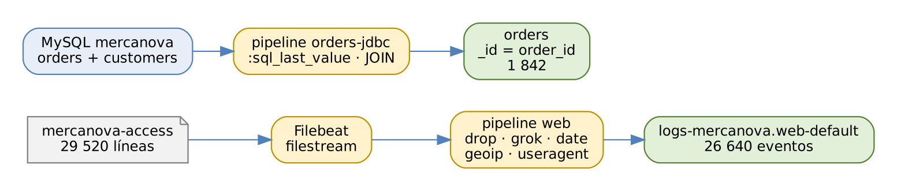

# ELK Stack: Elasticsearch, Logstash y Kibana

## Práctica 5. Construir un pipeline para logs web y datos de pedidos

### Objetivo

Al finalizar la práctica, serás capaz de:

-   Desarrollar y depurar un patrón grok con Grok Debugger y la salida
    `rubydebug`.
-   Construir un pipeline de Logstash que estructure, enriquezca y envíe
    logs de Nginx a un data stream.
-   Leer una base de datos MariaDB (compatible con MySQL) de forma
    incremental con el input JDBC.
-   Ejecutar varios pipelines independientes con `pipelines.yml` y
    autenticar Logstash con una API key.

### Objetivo visual

{width="6.3in"}\

### Duración aproximada

-   105 minutos.

### Prerrequisitos

-   Prácticas 2 a 4 completadas: Logstash y Filebeat instalados,
    component template `mercanova-settings` e índice `orders` con 1 800
    pedidos.
-   MariaDB en la VM y el driver `mariadb-java-client.jar` en
    `$LABS/downloads`.
-   Archivos `data/nginx/mercanova-access-2026.10.19.log`,
    `data/mysql/mercanova.sql` y `data/mysql/new_orders.sql`.

### Instrucciones

**Escenario:** MercaNova quiere ver su tráfico web en Kibana: códigos de
respuesta, rutas, tiempos, países y navegadores. Hoy el log de Nginx es
una línea de texto sin estructura. También quiere que los pedidos de su
base de datos MariaDB lleguen solos a Elasticsearch, incluidos los nuevos
y los que cambian de estado. Construirás dos pipelines de Logstash:
`web` y `orders-jdbc`.

Una línea del log de Nginx de MercaNova tiene este formato (*combined*
más el tiempo de respuesta en segundos):

``` 
201.141.37.112 - - [19/Oct/2026:14:32:10 -0600] "POST /api/checkout
HTTP/1.1" 504 167 "-" "Mozilla/5.0 (iPhone; ...)" 30.008
```

``` 
$ source /home/student/labs/scripts/env.sh && cd $LABS
```

------------------------------------------------------------------------

### Tarea 1. Preparar credenciales y destino

#### Paso 1. Crea una API key para Logstash

``` 
POST _security/api_key
{
  "name": "logstash-mercanova",
  "expiration": "180d",
  "role_descriptors": {
    "logstash_writer": {
      "cluster": [ "monitor" ],
      "indices": [ {
        "names": [ "logs-mercanova.*", "logs-loadtest-*",
                   "orders" ],
        "privileges": [ "create_doc", "create_index", "index",
                        "auto_configure", "view_index_metadata" ]
      } ]
    }
  }
}
```

**Qué hace y por qué:** una **API key** es una credencial para procesos:
tiene privilegios propios, que no pueden exceder los del usuario que la
crea, expira (`180d`) y se revoca sin tocar ningún usuario. La respuesta
trae `id` y `api_key`; Logstash los usa juntos con el formato
`id:api_key`. **Copia ambos valores ahora**: el secreto no se vuelve a
mostrar.

#### Paso 2. Guarda la API key en el keystore de Logstash

``` 
$ cd /opt/elastic/logstash
$ sudo -u elastic bin/logstash-keystore --path.settings config \
      add LS_API_KEY
Enter value for LS_API_KEY: VuaCfGcBCdbkQm-e5aOx:ui2lp2axTNmsyakw9tvNnw
$ sudo -u elastic bin/logstash-keystore --path.settings config \
      add MYSQL_PWD
Enter value for MYSQL_PWD: Logstash#2026
$ sudo -u elastic bin/logstash-keystore --path.settings config list
```

**Qué hace y por qué:** los pipelines usarán `${LS_API_KEY}` y
`${MYSQL_PWD}` sin escribir secretos en los `.conf`. `list` muestra los
nombres guardados, nunca los valores.

#### Paso 3. Crea la plantilla del data stream web

``` 
PUT _component_template/mercanova-web-mappings
{
  "template": {
    "mappings": {
      "properties": {
        "source": { "properties": {
          "address": { "type": "keyword" },
          "ip":      { "type": "ip" },
          "geo": { "properties": {
            "location":         { "type": "geo_point" },
            "city_name":        { "type": "keyword" },
            "country_iso_code": { "type": "keyword" } } } } },
        "http": { "properties": {
          "request":  { "properties": {
            "method": { "type": "keyword" } } },
          "response": { "properties": {
            "status_code": { "type": "short" },
            "body": { "properties": {
              "bytes": { "type": "long" } } } } } } },
        "url": { "properties": {
          "original": { "type": "keyword" },
          "path":     { "type": "keyword" },
          "query":    { "type": "keyword" } } },
        "event": { "properties": {
          "duration_ms": { "type": "long" },
          "duration_s":  { "type": "float" } } },
        "trace": { "properties": { "id": { "type": "keyword" } } }
      }
    }
  }
}

PUT _index_template/mercanova-web
{
  "index_patterns": [ "logs-mercanova.web-*" ],
  "data_stream": {},
  "composed_of": [ "ecs@mappings", "mercanova-settings",
                   "mercanova-web-mappings" ],
  "priority": 500
}
```

**Qué hace y por qué:** el campo `source.geo.location` debe ser
**`geo_point`** para dibujarlo en un mapa (práctica 7); si el mapping
dinámico lo creara como objeto con `lat` y `lon` numéricos, el mapa no
funcionaría. `ecs@mappings` es una component template integrada de 8.x
con reglas para los demás campos ECS (por ejemplo, `*.ip` como `ip`).
`mercanova-settings` aporta shards y réplicas, y en la práctica 10 la
retención.

### Tarea 2. Desarrollar el patrón grok

#### Paso 4. Prueba el patrón en Grok Debugger

Abre **Dev Tools \> Grok Debugger** y pega:

-   **Sample data:** una línea de
    `head -3 data/nginx/mercanova-access-2026.10.19.log | tail -1`.
-   **Grok pattern:**

``` 
^%{HTTPD_COMBINEDLOG} %{NUMBER:[event][duration_s]:float}
```

**Qué hace y por qué:** `HTTPD_COMBINEDLOG` es un patrón integrado que
reconoce el formato *combined* de Apache y Nginx y, en modo ECS, produce
`source.address`, `http.request.method`, `url.original`,
`http.version`, `http.response.status_code`,
`http.response.body.bytes`, `http.request.referrer` y
`user_agent.original`. La sintaxis `%{PATRÓN:campo:tipo}` captura el
tiempo de respuesta y lo convierte a `float`. El ancla `^` hace que el
patrón falle rápido en líneas que no empiezan como se espera.

#### Paso 5. Prueba el pipeline en consola con `rubydebug`

``` 
$ head -5 data/nginx/mercanova-access-2026.10.19.log | \
  sudo -u elastic bin/logstash --path.data /tmp/ls-test -e '
  input { stdin {} }
  filter {
    grok { match => { "message" =>
      "^%{HTTPD_COMBINEDLOG} %{NUMBER:[event][duration_s]:float}" } }
  }
  output { stdout { codec => rubydebug } }'
```

(Ejecútalo desde `/opt/elastic/logstash`).

**Qué hace y por qué:** `-e` recibe la configuración en línea y
`--path.data /tmp/ls-test` usa un directorio de datos distinto al del
servicio, porque dos instancias de Logstash no pueden compartirlo.
`rubydebug` imprime cada evento con todos sus campos: es la forma más
rápida de ver qué produce un filtro. Verás que la primera línea, un
health check desde `127.0.0.1`, también se estructura, pero no aporta
nada al análisis.

### Tarea 3. Pipeline web

#### Paso 6. Revisa el pipeline `web.conf`

``` 
$ less pipelines/web.conf
```

El pipeline aplica, en orden, estos filtros:

| Filtro (id) | Qué hace | Por qué así |
|--------------|-----------------------|-----------------------|
| `drop-health` | Descarta `GET /health`. | Cada 30 s hay un health check: 2 880 eventos diarios sin valor. Se descartan **primero** para no gastar CPU en ellos. |
| `grok-nginx` | Estructura la línea. | Patrón del Paso 4, con un grupo opcional `trace=...` que usarás en la práctica 11. |
| `grok-url` | Separa `url.path` y `url.query`. | Agrupar por ruta sin que cada `?q=` cree un valor distinto. |
| `date-nginx` | Asigna `@timestamp`. | La hora real del evento, no la de llegada. El formato incluye `Z` (`-0600`), así que no hace falta `timezone`. |
| `geoip` | Agrega `source.geo.*`. | País, ciudad y coordenadas con la base GeoLite2 incluida en Logstash. |
| `useragent` | Agrega `user_agent.*`. | Navegador, sistema operativo y dispositivo. |
| `duration-ms` | Calcula `duration_ms`. | Milisegundos enteros, más cómodos en dashboards. |
| `tag-5xx` | Etiqueta `server_error`. | Filtrar errores de servidor con un clic. |
| `set-service` | Limpia campos. | Quita `event.original` y metadatos de Filebeat que duplican información. |

Y la salida:

``` 
elasticsearch {
  hosts => [ "https://localhost:9200" ]
  ssl_certificate_authorities => "/opt/elastic/certs/http_ca.crt"
  api_key => "${LS_API_KEY}"
  data_stream => true
  data_stream_type => "logs"
  data_stream_dataset => "mercanova.web"
  data_stream_namespace => "default"
}
```

**Qué hace y por qué:** con `data_stream => true`, Logstash escribe en
`<type>-<dataset>-<namespace>` = `logs-mercanova.web-default` usando la
acción `create`. Cada plugin tiene un `id` explícito: en la práctica 9
lo usarás para encontrar el filtro más lento en la API de monitoreo.

#### Paso 7. Activa los dos pipelines del curso

``` 
$ sudo tee config/pipelines.yml > /dev/null <<'EOF'
- pipeline.id: web
  path.config: "/opt/elastic/logstash/pipelines/web.conf"
  pipeline.workers: 2

- pipeline.id: orders-jdbc
  path.config: "/opt/elastic/logstash/pipelines/orders.conf"
  pipeline.workers: 1
EOF
```

**Qué hace y por qué:** cada pipeline es independiente: tiene sus
workers, su cola y su configuración. Si MariaDB no responde, el pipeline
`orders-jdbc` falla, pero `web` sigue procesando logs. `orders-jdbc` usa
un worker porque el volumen es bajo y así los pedidos se procesan en
orden. El pipeline `lab02-test` deja de ejecutarse.

#### Paso 8. Instala el driver JDBC y valida la configuración

``` 
$ sudo -u elastic mkdir -p drivers
$ sudo cp $LABS/downloads/mariadb-java-client.jar drivers/
$ sudo chown elastic:elastic drivers/*.jar
$ sudo -u elastic bin/logstash --path.settings config \
      --path.data /tmp/ls-test --config.test_and_exit
Configuration OK
```

**Qué hace y por qué:** sin `-f`, Logstash valida todos los pipelines de
`pipelines.yml`. El input JDBC no incluye drivers: cada base de datos
tiene el suyo y se indica con `jdbc_driver_library`. Se usa el driver
de MariaDB porque Debian incluye MariaDB, compatible con MySQL.

#### Paso 9. Carga la base de datos de MercaNova

``` 
$ sudo mysql < $LABS/data/mysql/mercanova.sql
$ sudo mysql -e "SELECT COUNT(*) AS pedidos,
      MAX(updated_at) AS ultimo FROM mercanova.orders"
+---------+-------------------------+
| pedidos | ultimo                  |
+---------+-------------------------+
|    1800 | 2026-10-19 23:54:01.000 |
+---------+-------------------------+
```

**Qué hace y por qué:** el script crea la base `mercanova` con las tablas
`customers` (600 clientes) y `orders` (1 800 pedidos), y el usuario
`logstash` con permiso **solo de lectura** (`SELECT`): Logstash no
necesita modificar la base de datos.

#### Paso 10. Reinicia Logstash y prepara Filebeat

``` 
$ sudo systemctl restart logstash
$ curl -s localhost:9600/_node/pipelines | jq '.pipelines | keys'
[ "orders-jdbc", "web" ]
$ sudo cp $LABS/config/filebeat/filebeat-lab05.yml \
      /opt/elastic/filebeat/filebeat.yml
$ sudo /opt/elastic/filebeat/filebeat test config \
      -c /opt/elastic/filebeat/filebeat.yml
```

**Qué hace y por qué:** la configuración nueva de Filebeat lee
`/var/log/mercanova/nginx-access.log` con un input `filestream`
(`id: mercanova-web`) y agrega `service.name: nginx`. Revisa en el
archivo los parámetros `bulk_max_size: 2048`, eventos por lote enviado a
Logstash, y `prospector.scanner.check_interval: 5s`, cada cuánto busca
archivos nuevos.

#### Paso 11. Reproduce el log del día y arranca Filebeat

``` 
$ scripts/replay-nginx.sh
Líneas en /var/log/mercanova/nginx-access.log: 29520
$ sudo systemctl start filebeat
$ watch -n 5 'curl -s localhost:9600/_node/stats/pipelines/web | \
  jq ".pipelines.web.events | {in, filtered, out}"'
```

**Qué hace y por qué:** `replay-nginx.sh` copia el log del 19 de
octubre al archivo que vigila Filebeat (con un segundo argumento
reproduce a cierto ritmo, por ejemplo `... log 50` para 50 líneas por
segundo). La API de Logstash muestra cómo avanzan los eventos: `in`
llegará a 29 520 y `out` a 26 640, porque los 2 880 health checks se
descartan. Presiona `Ctrl + C` cuando `in` deje de crecer.

#### Paso 12. Verifica la calidad de los datos

``` 
GET logs-mercanova.web-default/_count

GET logs-mercanova.web-default/_count
{ "query": { "term": { "tags": "_grokparsefailure" } } }

GET logs-mercanova.web-default/_search
{
  "size": 1,
  "query": { "term": { "http.response.status_code": 504 } },
  "_source": [ "@timestamp", "source.geo.city_name",
    "source.geo.country_iso_code", "url.path",
    "http.response.status_code", "event.duration_ms",
    "user_agent.name", "user_agent.os.name", "tags" ]
}

GET logs-mercanova.web-default/_mapping/field/source.geo.location
```

**Qué hace y por qué:** el primer conteo debe ser **26 640** y el de
fallas de grok **0**: así sabes que el patrón cubre todas las líneas. El
documento de ejemplo muestra la estructura final: ciudad y país (pueden
variar según la base GeoLite2), ruta, código 504, duración en
milisegundos, navegador y la etiqueta `server_error`. El último comando
confirma que `source.geo.location` es `geo_point`.

#### Paso 13. Responde dos preguntas rápidas

``` 
GET logs-mercanova.web-default/_search
{
  "size": 0,
  "aggs": {
    "codigos": { "terms": { "field": "http.response.status_code" } },
    "errores_5xx": { "filter": { "term": { "tags": "server_error" } } }
  }
}
```

**Qué hace y por qué:** comprueba que los datos ya responden preguntas
de operación. Resultado esperado: 640 respuestas **504**, 329 respuestas
404 y 749 eventos con la etiqueta `server_error`.

### Tarea 4. Pipeline de pedidos con JDBC

#### Paso 14. Revisa el input JDBC

Fragmento de `pipelines/orders.conf`:

``` 
jdbc {
  jdbc_driver_library =>
    "/opt/elastic/logstash/drivers/mariadb-java-client.jar"
  jdbc_driver_class => "org.mariadb.jdbc.Driver"
  jdbc_connection_string =>
    "jdbc:mariadb://localhost:3306/mercanova"
  jdbc_user => "logstash"
  jdbc_password => "${MYSQL_PWD}"
  jdbc_default_timezone => "America/Mexico_City"
  schedule => "*/5 * * * *"
  statement => "SELECT o.id, ... FROM orders o
    JOIN customers c ON c.id = o.customer_id
    WHERE o.updated_at > :sql_last_value
    ORDER BY o.updated_at"
  use_column_value => true
  tracking_column => "updated_at"
  tracking_column_type => "timestamp"
  last_run_metadata_path =>
    "/opt/elastic/logstash/data/jdbc_orders_last_run"
  jdbc_paging_enabled => true
  jdbc_page_size => 1000
}
```

**Qué hace y por qué:**

| Opción | Por qué |
|----------------------|--------------------------------------|
| `jdbc_driver_library` / `jdbc_driver_class` | Driver de MariaDB Connector/J; la URL usa el esquema `jdbc:mariadb://`. |
| `jdbc_default_timezone` | Las fechas de MariaDB están en hora local; así se convierten bien a UTC. |
| `schedule` | Sintaxis cron: cada 5 minutos. |
| `statement` con `JOIN` | **Desnormaliza**: cada pedido llega con los datos de su cliente, porque Elasticsearch no hace joins al consultar. |
| `:sql_last_value` | Último `updated_at` procesado: cada ejecución lee solo lo nuevo o modificado. |
| `tracking_column` | Columna que alimenta `:sql_last_value`. `updated_at` también detecta **cambios**, no solo inserciones. |
| `last_run_metadata_path` | Archivo donde se recuerda el último valor entre reinicios. |
| `jdbc_paging_enabled` | Lee en páginas de 1 000 filas para no cargar todo en memoria. |

#### Paso 15. Revisa la transformación y la salida

``` 
filter {
  mutate {
    rename => { "id" => "order_id"
                "customer_region" => "[customer][region]" ... }
    copy => { "created_at" => "@timestamp" }
    remove_field => [ "created_at", "@version" ]
  }
}
output {
  elasticsearch {
    index => "orders"
    document_id => "%{order_id}"
    action => "index"
    ...
  }
}
```

**Qué hace y por qué:** `rename` convierte las columnas planas de SQL en
la estructura anidada del índice (`customer.region`, `payment.method`).
`document_id => "%{order_id}"` es la clave del diseño: el `_id` es el
número de pedido, así que **escribir dos veces el mismo pedido lo
actualiza en lugar de duplicarlo**. `action => "index"` crea o
reemplaza; por eso la API key incluye el privilegio `index`.

#### Paso 16. Espera la primera ejecución y verifica

``` 
$ sudo journalctl -u logstash -f | grep -i jdbc
... [orders-jdbc] ... (0.08s) SELECT ... WHERE o.updated_at >
'1970-01-01 00:00:00' ...
```

``` 
GET orders/_count
```

**Qué hace y por qué:** la primera ejecución usa `1970-01-01` como
`:sql_last_value` y lee los 1 800 pedidos. Como ya existían desde la
práctica 4 con los mismos `_id`, el conteo **sigue en 1 800**: se
actualizaron, no se duplicaron. El archivo `jdbc_orders_last_run` ahora
guarda la fecha del último pedido.

#### Paso 17. Inserta pedidos nuevos y actualiza uno

``` 
$ sudo mysql < $LABS/data/mysql/new_orders.sql
$ sudo cat /opt/elastic/logstash/data/jdbc_orders_last_run
--- 2026-10-20 05:54:01.000000000 Z
```

Espera hasta 5 minutos (la siguiente ejecución del `schedule`) y
consulta:

``` 
GET orders/_count

GET orders/_doc/88011?_source=status,updated_at
```

**Qué hace y por qué:** el archivo guarda el último `updated_at` leído
(el pedido de las 23:54:01 hora local, expresado en UTC). El script
inserta 42 pedidos con fecha actual y
cambia a `refunded` el pedido 88011. La siguiente ejecución solo lee las
filas con `updated_at` posterior al último valor: el conteo sube a
**1 842** y el pedido 88011 muestra `status: refunded` con un
`updated_at` reciente.

### Tarea 5. Verificación final

#### Paso 18. Revisa las estadísticas de ambos pipelines

``` 
$ curl -s localhost:9600/_node/stats/pipelines | jq '.pipelines |
  to_entries[] | {pipeline: .key, in: .value.events.in,
  out: .value.events.out}'
```

**Qué hace y por qué:** resume cuántos eventos procesó cada pipeline.
En `web`, la diferencia entre `in` y `out` son los health checks
descartados; en `orders-jdbc`, `in` y `out` son iguales: 1 800 + 43
filas leídas (los 42 nuevos más el actualizado).

### Resultado esperado

-   Data stream `logs-mercanova.web-default` con **26 640** eventos
    estructurados, geolocalizados y con navegador, y **0** fallas de
    grok.
-   640 respuestas 504 y 749 eventos con la etiqueta `server_error`.
-   Índice `orders` con **1 842** pedidos y el pedido 88011 en estado
    `refunded`.
-   Logstash ejecuta los pipelines `web` y `orders-jdbc` con una API key
    guardada en el keystore.
-   Puedes explicar por qué se descartan los health checks al inicio, por
    qué `date` no necesita `timezone` en este caso y cómo
    `document_id` evita duplicados en la lectura incremental.

### Referencias

-   Elastic. *Logstash: Grok filter plugin \[8.19\].*
    <https://www.elastic.co/guide/en/logstash/8.19/plugins-filters-grok.html>
-   Elastic. *Logstash: Jdbc input plugin \[8.19\].*
    <https://www.elastic.co/guide/en/logstash/8.19/plugins-inputs-jdbc.html>
-   Elastic. *Logstash: Elasticsearch output plugin \[8.19\].*
    <https://www.elastic.co/guide/en/logstash/8.19/plugins-outputs-elasticsearch.html>
-   Elastic. *Multiple pipelines \[8.19\].*
    <https://www.elastic.co/guide/en/logstash/8.19/multiple-pipelines.html>
-   Elastic. *Grant access using API keys \[8.19\].*
    <https://www.elastic.co/guide/en/logstash/8.19/ls-security.html>
