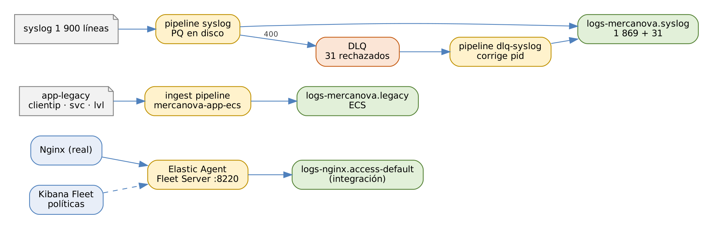

# ELK Stack: Elasticsearch, Logstash y Kibana

## Práctica 6. Normalizar, centralizar y hacer resiliente la ingesta

### Objetivo

Al finalizar la práctica, serás capaz de:

-   Instalar Elastic Agent como Fleet Server y administrar integraciones
    desde Fleet.
-   Normalizar a ECS los logs de una aplicación heredada con un ingest
    pipeline asignado como `default_pipeline`.
-   Diagnosticar un pipeline de Logstash defectuoso con la API de
    monitoreo, `rubydebug` y Grok Debugger.
-   Proteger la ingesta con una cola persistente y recuperar eventos
    rechazados con la dead letter queue.

### Objetivo visual

{width="6.3in"}\

### Duración aproximada

-   105 minutos.

### Prerrequisitos

-   Prácticas 2 a 5 completadas: Logstash con la API key en el keystore y
    las component templates `mercanova-settings` y
    `mercanova-app-mappings`.
-   Instalador `elastic-agent-8.19.x-linux-x86_64.tar.gz` en
    `$LABS/downloads` o acceso a internet.
-   Archivos `data/lab06/app-legacy.ndjson` (400 eventos) y
    `data/syslog/syslog-2026.10.19.log` (1 900 líneas).

### Instrucciones

**Escenario:** MercaNova tiene tres retos de ingesta. Primero, quiere
dejar de configurar agentes servidor por servidor. Segundo, una
aplicación heredada escribe logs con nombres propios (`clientip`, `svc`,
`lvl`) que no se pueden correlacionar con los demás. Tercero, un
compañero dejó un pipeline de syslog que "no funciona" y nadie sabe por
qué. Resolverás los tres y harás que la ingesta resista caídas sin
perder eventos.

``` 
$ source /home/student/labs/scripts/env.sh && cd $LABS
```

------------------------------------------------------------------------

### Tarea 1. Fleet Server y Elastic Agent

#### Paso 1. Obtén la huella de la CA del clúster

``` 
$ openssl x509 -fingerprint -sha256 -noout -in $CA | \
  cut -d= -f2 | tr -d ':'
3F1A9C...E72B
```

**Qué hace y por qué:** la **huella SHA-256** identifica de forma única
el certificado de la CA. Elastic Agent la usa para confiar en el clúster
sin copiar el archivo de la CA a cada servidor. `cut` toma el valor
después del `=` y `tr` quita los dos puntos.

#### Paso 2. Configura Fleet en Kibana

En **Management \> Fleet \> Settings**:

1.  **Fleet Server hosts \> Edit hosts:** `https://elk-lab:8220`.
2.  **Outputs \> default \> Edit:**
    -   *Hosts:* `https://elk-lab:9200`
    -   *Elasticsearch CA trusted fingerprint:* el valor del Paso 1.
3.  Guarda y aplica.

**Qué hace y por qué:** el **Fleet Server host** es la dirección a la
que se conectan los agentes para recibir políticas. El **output** es el
destino de los datos de los agentes; con la huella, cada agente valida
el certificado HTTPS del clúster. Sin este ajuste, el agente rechazaría
la conexión por certificado no confiable.

#### Paso 3. Instala Elastic Agent como Fleet Server

En **Fleet \> Agents \> Add Fleet Server**, elige *Quick Start*,
indica el host `https://elk-lab:8220` y genera el token de servicio.
Kibana muestra un comando como este; ejecútalo:

``` 
$ cd $LABS/downloads
$ tar xzf elastic-agent-$V-linux-x86_64.tar.gz
$ cd elastic-agent-$V-linux-x86_64
$ sudo ./elastic-agent install \
    --fleet-server-es=https://elk-lab:9200 \
    --fleet-server-service-token=AAEAAWVsYXN0aWMvZmxlZXQtc2... \
    --fleet-server-policy=fleet-server-policy \
    --fleet-server-es-ca-trusted-fingerprint=3F1A9C...E72B \
    --fleet-server-port=8220
```

**Qué hace y por qué:**

| Opción | Significado |
|-----------------------------------|-------------------------|
| `install` | Copia el agente a `/opt/Elastic/Agent` y lo registra como servicio `elastic-agent`. |
| `--fleet-server-es` | Clúster donde Fleet Server guarda el estado de los agentes. |
| `--fleet-server-service-token` | Credencial de la cuenta de servicio `elastic/fleet-server`. |
| `--fleet-server-policy` | Política que ejecutará el agente. |
| `--fleet-server-es-ca-trusted-fingerprint` | Confianza en el certificado del clúster. |
| `--fleet-server-port` | Puerto en el que escucha a otros agentes (8220). |

#### Paso 4. Verifica el agente

``` 
$ sudo elastic-agent status
┌─ fleet
│  └─ status: (HEALTHY) Connected
└─ elastic-agent
   └─ status: (HEALTHY) Running
```

**Qué hace y por qué:** el agente reporta su estado local; en **Fleet \>
Agents** verás el host `elk-lab` como **Healthy** con la política
*Fleet Server Policy*. Solo puede haber **un Elastic Agent por host**,
así que este agente será el Fleet Server y también ejecutará las
integraciones de la VM.

### Tarea 2. Integración de Nginx administrada por Fleet

#### Paso 5. Agrega la integración de Nginx a la política

En **Fleet \> Agent policies \> Fleet Server Policy \> Add integration**,
elige **Nginx** y configura:

-   *Collect logs from Nginx instances:* activado, con las rutas
    `/var/log/nginx/access.log*` y `/var/log/nginx/error.log*`.
-   *Collect metrics from Nginx instances:* desactivado (el Nginx del
    laboratorio no expone `stub_status`).
-   Guarda y confirma **Add integration** para desplegarla al agente.

**Qué hace y por qué:** al agregar la integración, Kibana instala en el
clúster sus **assets** (plantillas, ingest pipelines y dashboards) y
Fleet actualiza la política. El agente la recibe en segundos, sin editar
ningún archivo en el servidor: así se administran cientos de agentes.

#### Paso 6. Genera tráfico y revisa los data streams

``` 
$ $LABS/scripts/traffic.sh 90
```

``` 
GET _data_stream/logs-nginx.*?filter_path=data_streams.name

GET logs-nginx.access-default/_search
{
  "size": 1,
  "_source": [ "source.address", "url.original",
               "http.response.status_code", "user_agent.name",
               "data_stream", "event.dataset" ]
}
```

**Qué hace y por qué:** `traffic.sh` genera peticiones reales al Nginx
local. La integración escribe en `logs-nginx.access-default` y
`logs-nginx.error-default`, con los campos ya normalizados a **ECS** y
enriquecidos. No escribiste ni un patrón grok: lo hace el ingest pipeline
de la integración.

#### Paso 7. Explora lo que instaló la integración

``` 
GET _index_template/logs-nginx.access?filter_path=*.*.composed_of
GET _ingest/pipeline/logs-nginx.access-*?filter_path=*.description
GET _ilm/policy/logs?filter_path=*.policy.phases.hot
```

En **Analytics \> Dashboards**, abre
**\[Logs Nginx\] Access and error logs**.

**Qué hace y por qué:** una integración es un paquete con **inputs,
plantillas, ingest pipelines, política de retención y dashboards**.
Comparar este resultado con el pipeline que escribiste a mano en la
práctica 5 muestra la ventaja: para fuentes comunes conviene la
integración; Logstash brilla con fuentes propias o con enrutamientos
complejos.

### Tarea 3. Normalizar a ECS los logs heredados

#### Paso 8. Revisa el formato heredado

``` 
$ sed -n 2p data/lab06/app-legacy.ndjson
{"time": "19/10/2026 00:27", "clientip": "187.41.49.91",
 "svc": "cart", "lvl": "INFO", "message": "Request processed"}
```

**Qué hace y por qué:** cada campo tiene un nombre propio y la fecha
viene como texto en formato día/mes/año **sin zona horaria**. Si se
indexara así, no se podría correlacionar con los logs del resto de la
plataforma, que usan `source.ip`, `service.name`, `log.level` y
`@timestamp`.

#### Paso 9. Crea el ingest pipeline de normalización

``` 
PUT _ingest/pipeline/mercanova-app-ecs
{
  "description": "Normaliza a ECS los logs heredados",
  "processors": [
    { "rename": { "field": "clientip",
        "target_field": "source.ip", "ignore_missing": true } },
    { "rename": { "field": "svc",
        "target_field": "service.name" } },
    { "lowercase": { "field": "lvl" } },
    { "rename": { "field": "lvl", "target_field": "log.level" } },
    { "date": { "field": "time",
        "formats": [ "dd/MM/yyyy HH:mm" ],
        "timezone": "America/Mexico_City" } },
    { "set": { "field": "event.outcome", "value": "failure",
        "if": "ctx.log?.level == 'error'" } },
    { "remove": { "field": "time" } }
  ],
  "on_failure": [
    { "set": { "field": "error.message",
        "value": "{{ _ingest.on_failure_message }}" } }
  ]
}
```

**Qué hace y por qué:**

| Procesador / opción | Por qué |
|------------------------|------------------------------------|
| `rename` + `ignore_missing` | Si un evento no trae IP, el procesador continúa en lugar de fallar. |
| `lowercase` antes de `rename` | Normaliza `ERROR` → `error` para que coincida con los logs de la práctica 3. |
| `date` con `timezone` | La fecha no indica zona: se interpreta como hora de México y se guarda en UTC. Sin `timezone` se supondría UTC y los eventos quedarían 6 horas desfasados. |
| `set` con `if` | Condición en Painless; `?.` evita un error si `log` no existe. |
| `on_failure` | Conserva el documento y documenta el error. |

#### Paso 10. Simula el pipeline con un evento real

``` 
POST _ingest/pipeline/mercanova-app-ecs/_simulate
{
  "docs": [ { "_source": {
    "time": "19/10/2026 14:32", "clientip": "203.0.113.7",
    "svc": "checkout", "lvl": "ERROR",
    "message": "Request failed" } } ]
}
```

**Qué hace y por qué:** el resultado muestra `source.ip`,
`service.name: checkout`, `log.level: error`,
`event.outcome: failure` y `@timestamp: 2026-10-19T20:32:00.000Z`: las
14:32 de México son las 20:32 UTC.

#### Paso 11. Crea la plantilla y carga los datos

``` 
PUT _index_template/mercanova-legacy
{
  "index_patterns": [ "logs-mercanova.legacy-*" ],
  "data_stream": {},
  "composed_of": [ "mercanova-settings",
                   "mercanova-app-mappings" ],
  "priority": 500,
  "template": {
    "settings": {
      "index.default_pipeline": "mercanova-app-ecs" },
    "mappings": { "properties": {
      "source": { "properties": { "ip": { "type": "ip" } } },
      "event":  { "properties": {
        "outcome": { "type": "keyword" } } } } }
  }
}
```

``` 
$ scripts/bulk-load.sh logs-mercanova.legacy-default \
      data/lab06/app-legacy.ndjson
Operaciones: 400  ·  con error: 0
```

**Qué hace y por qué:** la plantilla **reutiliza** los mappings de los
logs de aplicación y agrega solo lo nuevo (`source.ip` de tipo `ip`).
Con `default_pipeline`, quien envía los datos no necesita saber que
existe la normalización.

#### Paso 12. Correlaciona las dos fuentes de aplicación

``` 
POST _query?format=txt
{
  "query": """
    FROM logs-mercanova.app-*, logs-mercanova.legacy-*
    | WHERE log.level == "error"
    | STATS errores = COUNT(*) BY service.name
    | SORT errores DESC
  """
}
```

**Qué hace y por qué:** una sola consulta combina los logs modernos y
los heredados porque ahora comparten nombres de campos. Resultado
esperado: payment 412, checkout 111 (97 + 14 heredados), cart 18
(15 + 3) y catalog 14 (todos heredados). En total, los 31 errores
heredados se suman a los 524 de la práctica 3.

### Tarea 4. Diagnosticar el pipeline de syslog

#### Paso 13. Crea la plantilla del data stream de syslog

``` 
PUT _index_template/mercanova-syslog
{
  "index_patterns": [ "logs-mercanova.syslog-*" ],
  "data_stream": {},
  "composed_of": [ "ecs@mappings", "mercanova-settings" ],
  "priority": 500,
  "template": {
    "mappings": { "properties": {
      "process": { "properties": {
        "name": { "type": "keyword" },
        "pid":  { "type": "long" } } },
      "host": { "properties": {
        "name": { "type": "keyword" } } } } }
  }
}
```

**Qué hace y por qué:** `process.pid` se declara `long`, como define
ECS. Esta decisión, correcta, será la que más adelante envíe algunos
eventos a la dead letter queue.

#### Paso 14. Activa el pipeline defectuoso con cola persistente y DLQ

``` 
$ cd /opt/elastic/logstash
$ sudo cp pipelines/syslog-broken.conf pipelines/syslog.conf
$ sudo tee -a config/pipelines.yml > /dev/null <<'EOF'

- pipeline.id: syslog
  path.config: "/opt/elastic/logstash/pipelines/syslog.conf"
  pipeline.workers: 1
  queue.type: persisted
  queue.max_bytes: 512mb
  dead_letter_queue.enable: true
  dead_letter_queue.max_bytes: 256mb
EOF
$ sudo chown -R elastic:elastic pipelines config
$ sudo systemctl restart logstash
```

**Qué hace y por qué:**

| Ajuste | Efecto |
|------------------------|------------------------------------|
| `queue.type: persisted` | Los eventos se escriben en disco (`data/queue/syslog`) antes de procesarse: sobreviven a reinicios y caídas. |
| `queue.max_bytes` | Tamaño máximo; al llenarse, el input deja de aceptar eventos (backpressure). |
| `dead_letter_queue.enable` | Los eventos que Elasticsearch rechaza con 400 o 404 se guardan en `data/dead_letter_queue/syslog`. |
| `dead_letter_queue.max_bytes` | Límite de la DLQ en disco. |

#### Paso 15. Envía el syslog y observa los síntomas

``` 
$ scripts/send-syslog.sh
Enviadas 1900 líneas a localhost:5514
$ curl -s localhost:9600/_node/stats/pipelines/syslog | jq '
  .pipelines.syslog.plugins.filters[] | {id, events}'
```

``` 
GET logs-mercanova.syslog-default/_count
{ "query": { "term": { "tags": "_grokparsefailure" } } }
```

**Qué hace y por qué:** los eventos **llegan**, pero el conteo de
`_grokparsefailure` es **1 900**: ninguna línea coincidió con el patrón.
En la API, el filtro `grok-syslog` procesó todos los eventos sin extraer
campos. Primer error encontrado.

#### Paso 16. Encuentra la causa con Grok Debugger

Copia una línea del archivo y el patrón del pipeline en **Dev Tools \>
Grok Debugger**:

``` 
2026-10-19 14:05:12 srv-app01 sshd[2231]: Failed password for root
from 89.160.20.12 port 52211 ssh2
```

``` 
^%{TIMESTAMP_ISO8601:ts} %{DATA:[process][name]}\[%{POSINT:
[process][pid]}\]: %{GREEDYDATA:msg}$
```

**Qué hace y por qué:** el patrón no contempla el **nombre del host**
(`srv-app01`) entre la fecha y el proceso. Además, exige un `[pid]`
numérico, pero hay líneas como `kernel: ...` (sin pid) y
`CRON[-]: ...` (pid no numérico). Prueba este patrón corregido:

``` 
^%{TIMESTAMP_ISO8601:ts} %{HOSTNAME:[host][name]}
%{DATA:[process][name]}(?:\[%{DATA:[process][pid]}\])?:
%{GREEDYDATA:message}$
```

(Escríbelo en una sola línea). El grupo `(?: ... )?` hace opcional el
pid, y `DATA` acepta cualquier valor entre corchetes.

#### Paso 17. Corrige el patrón y la zona horaria

Edita `pipelines/syslog.conf`:

``` 
grok {
  id => "grok-syslog"
  match => { "message" => "^%{TIMESTAMP_ISO8601:ts}
    %{HOSTNAME:[host][name]} %{DATA:[process][name]}
    (?:\[%{DATA:[process][pid]}\])?: %{GREEDYDATA:message}$" }
  overwrite => [ "message" ]
}
date {
  id => "date-syslog"
  match => [ "ts", "yyyy-MM-dd HH:mm:ss" ]
  timezone => "America/Mexico_City"
  target => "@timestamp"
  remove_field => [ "ts" ]
}
```

(El patrón va en una sola línea dentro de las comillas.)

**Qué hace y por qué:** `overwrite => ["message"]` reemplaza la línea
completa por el mensaje limpio, sin fecha ni host. El segundo error
estaba en `date`: `timezone => "UTC"` hacía que las 14:05 de México se
guardaran como 14:05 UTC, es decir, **6 horas antes** de la realidad. En
un incidente, eso desordena la línea de tiempo frente a las demás
fuentes. Con `config.reload.automatic`, Logstash recarga el pipeline al
guardar el archivo.

#### Paso 18. Prepara una carga limpia

``` 
DELETE _data_stream/logs-mercanova.syslog-default
```

**Qué hace y por qué:** elimina los 1 900 eventos mal procesados. Al
reenviar, el data stream se creará de nuevo con la plantilla.

### Tarea 5. Cola persistente y dead letter queue

#### Paso 19. Simula la caída del destino

``` 
$ sudo systemctl stop es@01
$ scripts/send-syslog.sh
$ curl -s localhost:9600/_node/stats/pipelines/syslog | jq '
  .pipelines.syslog.queue | {type, events_count,
  queue_size_in_bytes}'
{ "type": "persisted", "events_count": 1900, ... }
```

**Qué hace y por qué:** el pipeline envía a `https://localhost:9200`,
que es es01. Con es01 detenido, la salida no puede escribir y reintenta;
los eventos **se acumulan en la cola en disco** en lugar de perderse.
(Kibana también usa es01, así que dejará de responder unos minutos: es
parte del experimento).

#### Paso 20. Reinicia Logstash: la cola sobrevive

``` 
$ sudo systemctl restart logstash
$ sleep 30; curl -s localhost:9600/_node/stats/pipelines/syslog | \
  jq '.pipelines.syslog.queue.events_count'
1900
```

**Qué hace y por qué:** con una cola en memoria, el reinicio habría
perdido los 1 900 eventos. La cola persistente los conserva y los
procesará cuando el destino vuelva.

#### Paso 21. Restablece el destino y observa la DLQ

``` 
$ sudo systemctl start es@01
$ sleep 60
$ curl -s --cacert $CA -u elastic:$ELASTIC_PWD \
  "$ES/logs-mercanova.syslog-default/_count"
{"count":1869, ...}
$ ls -l /opt/elastic/logstash/data/dead_letter_queue/syslog/
$ curl -s localhost:9600/_node/stats/pipelines/syslog | jq '
  .pipelines.syslog.dead_letter_queue'
```

**Qué hace y por qué:** la cola se vacía (`events_count` vuelve a 0),
pero solo se indexan **1 869** de 1 900 eventos. Los **31** restantes
son líneas `CRON[-]`: su `process.pid` vale `"-"` y Elasticsearch los
rechazó con **400** `document_parsing_exception` porque el campo es
`long`. En lugar de perderse, quedaron en la **DLQ**. Tercer error
encontrado: un problema de **datos**, no de conexión.

#### Paso 22. Reprocesa la DLQ

``` 
$ sudo tee -a /opt/elastic/logstash/config/pipelines.yml \
  > /dev/null <<'EOF'

- pipeline.id: dlq-syslog
  path.config: "/opt/elastic/logstash/pipelines/dlq-reprocess.conf"
  pipeline.workers: 1
EOF
$ sudo systemctl restart logstash
```

Revisa el filtro del pipeline de reproceso:

``` 
mutate {
  add_field => { "[error][message]" =>
    "%{[@metadata][dead_letter_queue][reason]}" }
  add_tag => [ "reprocessed_from_dlq" ]
}
if [process][pid] and [process][pid] !~ /^\d+$/ {
  mutate { remove_field => [ "[process][pid]" ] }
}
```

**Qué hace y por qué:** el input `dead_letter_queue` lee los eventos
rechazados del pipeline `syslog`; `commit_offsets => true` recuerda lo
ya leído para no reprocesarlo en el siguiente reinicio. El motivo del
rechazo, disponible en `@metadata`, se copia a `error.message` para
auditoría. La corrección elimina el pid no numérico: se pierde un dato
sin valor (`-`) y se conserva el evento.

#### Paso 23. Verifica que no se perdió ningún evento

``` 
GET logs-mercanova.syslog-default/_count

GET logs-mercanova.syslog-default/_search
{
  "size": 1,
  "query": { "term": { "tags": "reprocessed_from_dlq" } },
  "_source": [ "@timestamp", "host.name", "process.name",
               "message", "error.message" ]
}
```

**Qué hace y por qué:** el conteo llega a **1 900**: la suma de 1 869
eventos directos y 31 reprocesados. El evento reprocesado muestra en
`error.message` la causa original, por ejemplo,
`failed to parse field [process.pid] of type [long]`.

#### Paso 24. Comprueba la corrección de la hora

``` 
GET logs-mercanova.syslog-default/_search
{
  "size": 1,
  "query": { "match_phrase": { "message": "Failed password" } },
  "sort": [ { "@timestamp": "asc" } ],
  "_source": [ "@timestamp", "message" ]
}
```

**Qué hace y por qué:** compara el `@timestamp` (UTC) con la hora de la
línea original en el archivo: debe haber exactamente **6 horas** de
diferencia, que corresponden a UTC-06:00. En Discover, con la zona
horaria del navegador en México, verás la misma hora del archivo.

### Resultado esperado

-   Elastic Agent **Healthy** como Fleet Server, con la integración de
    Nginx escribiendo en `logs-nginx.access-default`.
-   `logs-mercanova.legacy-default` con 400 eventos en ECS, consultable
    junto con los logs de la práctica 3.
-   Pipeline `syslog` corregido (host, pid opcional y zona horaria) con
    cola persistente y DLQ.
-   `logs-mercanova.syslog-default` con **1 900** eventos: 1 869 directos
    y 31 reprocesados desde la DLQ, sin fallas de grok.
-   Puedes explicar la diferencia entre un error de parseo (grok), un
    error de interpretación (zona horaria) y un rechazo de datos (DLQ), y
    qué protege cada mecanismo: la PQ contra caídas y la DLQ contra
    datos inválidos.

### Referencias

-   Elastic. *Fleet and Elastic Agent Guide \[8.19\].*
    <https://www.elastic.co/guide/en/fleet/8.19/fleet-overview.html>
-   Elastic. *Elastic Common Schema (ECS) Reference.*
    <https://www.elastic.co/guide/en/ecs/current/index.html>
-   Elastic. *Ingest pipelines \[8.19\].*
    <https://www.elastic.co/guide/en/elasticsearch/reference/8.19/ingest.html>
-   Elastic. *Logstash: Persistent queues \[8.19\].*
    <https://www.elastic.co/guide/en/logstash/8.19/persistent-queues.html>
-   Elastic. *Logstash: Dead letter queues \[8.19\].*
    <https://www.elastic.co/guide/en/logstash/8.19/dead-letter-queues.html>
