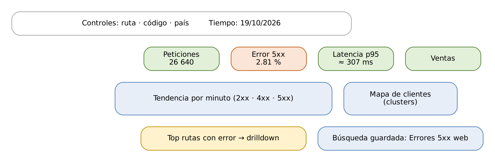

# ELK Stack: Elasticsearch, Logstash y Kibana

## Práctica 7. Construir el dashboard operativo de MercaNova

### Objetivo

Al finalizar la práctica, serás capaz de:

-   Crear data views y configurar la zona horaria de Kibana.
-   Investigar un problema en Discover con KQL, filtros, estadísticas de
    campos, Patterns y documentos circundantes.
-   Construir visualizaciones con Lens, incluidas fórmulas, y un mapa
    con Maps.
-   Diseñar un dashboard interactivo con controles y un drilldown, y
    exportarlo e importarlo como saved objects.

### Objetivo visual

{width="6.3in"}\

### Duración aproximada

-   105 minutos.

### Prerrequisitos

-   Prácticas 3 a 6 completadas: `logs-mercanova.web-default` (26 640
    eventos), `logs-mercanova.app-default`, `logs-mercanova.legacy-default`
    y el índice `orders`.
-   Navegador con acceso a `http://elk-lab:5601`.

### Instrucciones

**Escenario:** el equipo de operaciones de MercaNova quiere un tablero
que responda en cinco segundos: ¿cuánto tráfico hay?, ¿cuántos errores?,
¿qué tan rápido responde la tienda?, ¿cuánto se vende? y ¿dónde está el
problema? Primero investigarás en Discover el pico de errores del 19 de
octubre; después construirás el dashboard **MercaNova · Operación** con
indicadores, tendencia, mapa, detalle, controles y un drilldown.

**Rango de tiempo de trabajo:** los datos web son del **19 de octubre de
2026**. En el selector de tiempo de Kibana usa siempre un rango
**absoluto**: del 19 de octubre de 2026 a las 00:00 al 20 de octubre de
2026 a las 00:00.

------------------------------------------------------------------------

### Tarea 1. Preparar Kibana

#### Paso 1. Configura la zona horaria de presentación

En **Management \> Stack Management \> Advanced Settings**, busca
**Timezone for date formatting** (`dateFormat:tz`), elige
`America/Mexico_City` y guarda.

**Qué hace y por qué:** Elasticsearch guarda las fechas en UTC y Kibana
las muestra en la zona del **navegador** por defecto. Fijar la zona
evita confusiones si alguien abre el dashboard desde otro país o desde
un equipo con otra zona: el pico de las 14:00 se verá a las 14:00.

#### Paso 2. Crea los data views con la API de Kibana

En **Dev Tools \> Console**:

``` 
POST kbn:/api/data_views/data_view
{ "data_view": { "id": "mercanova-web", "name": "MercaNova web",
  "title": "logs-mercanova.web-*", "timeFieldName": "@timestamp" } }

POST kbn:/api/data_views/data_view
{ "data_view": { "id": "mercanova-app", "name": "MercaNova app",
  "title": "logs-mercanova.app-*,logs-mercanova.legacy-*",
  "timeFieldName": "@timestamp" } }

POST kbn:/api/data_views/data_view
{ "data_view": { "id": "mercanova-orders", "name": "Pedidos",
  "title": "orders", "timeFieldName": "@timestamp" } }
```

**Qué hace y por qué:** el prefijo `kbn:` envía la petición a la **API
de Kibana** en lugar de a Elasticsearch. Un **data view** indica qué
índices consultar (`title`, que admite comodines y listas separadas por
comas) y cuál es su campo de tiempo. Fijar el `id` facilita exportar y
reutilizar los objetos. Lo mismo puede hacerse en **Stack Management \>
Data Views \> Create data view**.

#### Paso 3. Da formato a los campos de duración y bytes

En **Stack Management \> Data Views \> MercaNova web**, edita:

-   `event.duration_ms`: formato **Duration**, entrada *Milliseconds*,
    salida *Human readable*.
-   `http.response.body.bytes`: formato **Bytes**.

**Qué hace y por qué:** el formato cambia cómo se **muestra** el valor
(`30 seconds`, `48.1KB`) sin modificar el índice. Se aplica en Discover,
Lens y dashboards.

### Tarea 2. Investigar en Discover

#### Paso 4. Explora los errores del día

En **Analytics \> Discover**, elige el data view **MercaNova web**, el
rango del 19 de octubre y escribe en la barra de consulta:

``` 
http.response.status_code >= 500
```

**Qué hace y por qué:** **KQL** filtra sin calcular relevancia. El
histograma muestra **749** eventos y un pico evidente entre las 14:00 y
las 15:00. Haz clic sobre la barra más alta del histograma: Kibana
acota el rango de tiempo a ese intervalo.

#### Paso 5. Analiza los campos

En la lista de campos de la izquierda, haz clic en `url.path` y después
en `http.response.status_code`. Luego abre la pestaña **Field
statistics**.

**Qué hace y por qué:** la vista rápida de cada campo muestra sus cinco
valores principales calculados sobre una muestra. Resultado esperado:
`/api/payment/charge` y `/api/checkout` concentran los errores, y el
código dominante es **504**, es decir, el servidor web esperó a la
aplicación y se agotó el tiempo. **Field statistics** muestra la
distribución completa y cuántos documentos tienen cada campo.

#### Paso 6. Filtra y guarda la búsqueda

1.  Junto a `/api/checkout` en la vista del campo, haz clic en **+**
    (filtrar por este valor) y luego cámbialo a **exclude** (–) para
    ver solo lo demás.
2.  Quita ese filtro. Agrega como columnas `url.path`,
    `http.response.status_code`, `event.duration_ms`,
    `source.geo.country_iso_code` y `user_agent.name`.
3.  Guarda la búsqueda con el nombre **Errores 5xx web**.

**Qué hace y por qué:** los filtros aparecen como píldoras que se pueden
fijar, invertir o desactivar sin reescribir la consulta. La **búsqueda
guardada** conserva consulta, filtros y columnas: la usarás como panel
del dashboard.

#### Paso 7. Encuentra patrones en los logs de aplicación

Cambia al data view **MercaNova app**, usa la consulta
`log.level : "error"` y abre la pestaña **Patterns**.

**Qué hace y por qué:** **Patterns** agrupa mensajes parecidos aunque
cambien números o identificadores. Verás que *Payment gateway timeout
after 30000 ms* es, por mucho, el patrón más frecuente. En miles de
líneas, esta vista encuentra en segundos qué error se repite.

#### Paso 8. Revisa el contexto de un error

En la tabla, expande un documento de *Payment gateway timeout* y elige
**View surrounding documents**.

**Qué hace y por qué:** muestra los eventos inmediatamente anteriores y
posteriores **sin filtros**, para ver qué ocurría alrededor del error:
otros servicios afectados, el mismo cliente o el mismo host.

### Tarea 3. Visualizaciones con Lens

Crea un dashboard nuevo en **Analytics \> Dashboards \> Create
dashboard** y, desde él, cada visualización con **Create
visualization**. Guarda cada panel en el dashboard al terminarlo.

#### Paso 9. Indicadores (Metric)

| Panel | Data view | Configuración |
|-------------|------------|----------------------------------|
| Peticiones | MercaNova web | Metric: *Count of records* |
| Tasa de error 5xx | MercaNova web | Metric: fórmula `count(kql='http.response.status_code >= 500') / count()`, formato *Percent* |
| Latencia p95 | MercaNova web | Metric: fórmula `percentile(event.duration_ms, percentile=95)` |
| Ventas | Pedidos | Metric: *Sum of total*, formato *Number* |

**Qué hace y por qué:** una **fórmula** combina agregaciones como en una
hoja de cálculo; `kql=` filtra solo esa parte del cálculo. Para la tasa
de error, agrega en **Color by value** un umbral: verde por debajo de
1 % y rojo a partir de 2 %. Resultados esperados para el 19 de octubre:
**26 640** peticiones, **2.81 %** de error 5xx y un p95 cercano a
**307 ms**. Las ventas dependen del rango: el 19 de octubre suma
426 650.20.

#### Paso 10. Tendencia de peticiones y errores

Visualización **Line**, data view **MercaNova web**:

-   *Horizontal axis:* `@timestamp`, intervalo de 5 minutos.
-   *Vertical axis:* *Count of records*.
-   *Breakdown:* **Filters** con tres filtros KQL:
    `http.response.status_code < 400` (etiqueta *2xx-3xx*),
    `http.response.status_code >= 400 and http.response.status_code < 500`
    (*4xx*) y `http.response.status_code >= 500` (*5xx*).
-   Asigna el color rojo a *5xx*.

**Qué hace y por qué:** el desglose por **Filters** crea una serie por
cada condición. Con colores fijos (rojo = error), el pico de las 14:00
salta a la vista. Usa intervalos de 5 minutos: con 1 minuto el gráfico
tiene demasiado ruido para un día completo.

#### Paso 11. Top de rutas con errores

Visualización **Bar horizontal**, data view **MercaNova web**:

-   *Vertical axis:* *Top values* de `url.path`, 10 valores.
-   *Horizontal axis:* *Count of records*.
-   En la barra de consulta del editor: `tags : "server_error"`.

**Qué hace y por qué:** la etiqueta `server_error`, que agregó Logstash
en la práctica 5, filtra con un solo término. Resultado esperado:
`/api/payment/charge` 457, `/api/checkout` 190 y después rutas con
pocos errores aislados.

#### Paso 12. Mapa de clientes

Desde el dashboard, **Add panel \> Maps**:

1.  **Add layer \> Documents**, data view **MercaNova web**, campo
    geoespacial `source.geo.location`.
2.  Cambia el *Scaling* a **Clusters** para agrupar los puntos.
3.  Agrega una capa **Choropleth** de países con la métrica *Count* y
    unión por `source.geo.country_iso_code`.

**Qué hace y por qué:** los **clusters** agrupan miles de puntos en
círculos con su conteo, lo que vuelve el mapa legible y rápido. El mapa
solo funciona porque `source.geo.location` es `geo_point` (práctica 5).

#### Paso 13. Agrega la búsqueda guardada

**Add from library \> Errores 5xx web**.

**Qué hace y por qué:** el panel muestra los documentos con las columnas
elegidas en Discover. Es el **detalle** que complementa los indicadores:
de un vistazo a las filas exactas.

### Tarea 4. Dashboard interactivo

#### Paso 14. Organiza el tablero

Acomoda los paneles:

1.  Fila superior: los cuatro indicadores.
2.  Centro: la tendencia (dos tercios del ancho) y el mapa.
3.  Abajo: top de rutas con errores y búsqueda guardada.

Guarda el dashboard como **MercaNova · Operación** con la opción **Store
time with dashboard** y el rango del 19 de octubre.

**Qué hace y por qué:** lo más importante va arriba a la izquierda,
donde la vista empieza a leer. Guardar el rango de tiempo con el
dashboard hace que siempre abra con el día del caso; en producción se
usaría un rango relativo, como las últimas 24 horas.

#### Paso 15. Agrega controles

**Controls \> Add control:**

| Tipo | Campo | Etiqueta |
|-------------|-----------------------------|------------------|
| Options list | `url.path` | Ruta |
| Options list | `http.response.status_code` | Código de estado |
| Options list | `source.geo.country_iso_code` | País |

**Qué hace y por qué:** los controles filtran **todos** los paneles del
dashboard a la vez. Prueba seleccionar el código 504: los indicadores,
la tendencia, el mapa y el detalle se ajustan al mismo subconjunto.
Los paneles basados en el data view **Pedidos** no se ven afectados
porque `orders` no tiene esos campos.

#### Paso 16. Crea el dashboard de detalle

Crea un segundo dashboard, **MercaNova · Detalle de ruta**, con:

-   Una tabla Lens (data view **MercaNova web**) con *Top values* de
    `http.response.status_code` en filas y las métricas *Count*,
    *Median* y *95th percentile* de `event.duration_ms`.
-   Una barra con *Top values* de `user_agent.name`.

Guárdalo con el mismo rango de tiempo.

#### Paso 17. Configura el drilldown

En **MercaNova · Operación**, abre el menú del panel *Top de rutas con
errores \> Create drilldown \> Go to dashboard*:

-   *Destination:* **MercaNova · Detalle de ruta**.
-   *Use filters and query from origin dashboard:* activado.
-   *Use date range from origin dashboard:* activado.

**Qué hace y por qué:** al hacer clic en una barra, por ejemplo
`/api/payment/charge`, el **drilldown** abre el dashboard de detalle
con un filtro por esa ruta y el mismo rango de tiempo. Así el tablero
principal se mantiene simple y el detalle queda a un clic.

### Tarea 5. Exportar e importar saved objects

#### Paso 18. Obtén el id del dashboard

``` 
GET kbn:/api/saved_objects/_find?type=dashboard&search=MercaNova*
```

**Qué hace y por qué:** `_find` busca saved objects por tipo y título.
Copia el `id` de **MercaNova · Operación**.

#### Paso 19. Exporta el dashboard con sus dependencias

``` 
$ source /home/student/labs/scripts/env.sh
$ curl -s -u elastic:$ELASTIC_PWD -X POST \
    "$KB/api/saved_objects/_export" \
    -H "kbn-xsrf: true" -H "Content-Type: application/json" \
    -d '{"objects":[{"type":"dashboard","id":"<ID>"}],
         "includeReferencesDeep":true}' \
    > $LABS/mercanova-ops.ndjson
$ wc -l $LABS/mercanova-ops.ndjson
```

**Qué hace y por qué:** `includeReferencesDeep` incluye todo lo que el
dashboard necesita: visualizaciones, mapa, búsqueda guardada, data views
y el dashboard de detalle del drilldown. El encabezado `kbn-xsrf` es
obligatorio en las peticiones que modifican datos en la API de Kibana,
como protección contra *cross-site request forgery*. El archivo
**NDJSON** puede versionarse en Git o moverse a otro ambiente.

#### Paso 20. Importa el archivo para validarlo

``` 
$ curl -s -u elastic:$ELASTIC_PWD -X POST \
    "$KB/api/saved_objects/_import?overwrite=true" \
    -H "kbn-xsrf: true" -F file=@$LABS/mercanova-ops.ndjson | \
    jq '{success, successCount}'
{ "success": true, "successCount": 11 }
```

**Qué hace y por qué:** `overwrite=true` reemplaza los objetos con el
mismo id. Una importación sin errores confirma que el archivo es
autocontenido. En la práctica 8 importarás este mismo archivo en otros
espacios de Kibana. El número de objetos depende de los paneles que
hayas creado.

### Resultado esperado

-   Zona horaria `America/Mexico_City` y tres data views:
    *MercaNova web*, *MercaNova app* y *Pedidos*.
-   Búsqueda guardada **Errores 5xx web**.
-   Dashboard **MercaNova · Operación** con 4 indicadores (26 640
    peticiones, 2.81 % de error, p95 ≈ 307 ms y ventas), tendencia,
    mapa, top de rutas, búsqueda guardada, 3 controles y un drilldown al
    dashboard de detalle.
-   Archivo `mercanova-ops.ndjson` importado sin errores.
-   Puedes explicar por qué el pico de 504 entre las 14:00 y las 15:00
    se relaciona con los timeouts de payment de la práctica 4.

### Referencias

-   Elastic. *Discover \[8.19\].*
    <https://www.elastic.co/guide/en/kibana/8.19/discover.html>
-   Elastic. *Kibana Query Language \[8.19\].*
    <https://www.elastic.co/guide/en/kibana/8.19/kuery-query.html>
-   Elastic. *Lens \[8.19\].*
    <https://www.elastic.co/guide/en/kibana/8.19/lens.html>
-   Elastic. *Maps \[8.19\].*
    <https://www.elastic.co/guide/en/kibana/8.19/maps.html>
-   Elastic. *Drilldowns \[8.19\].*
    <https://www.elastic.co/guide/en/kibana/8.19/drilldowns.html>
-   Elastic. *Saved objects API \[8.19\].*
    <https://www.elastic.co/guide/en/kibana/8.19/saved-objects-api.html>
