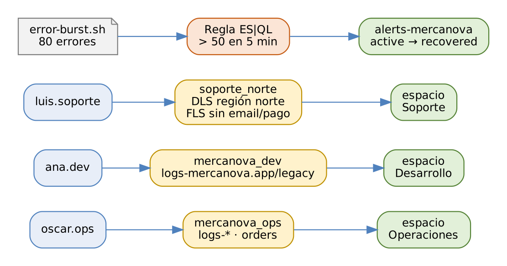

# ELK Stack: Elasticsearch, Logstash y Kibana

## Práctica 8. Configurar acceso por equipos y alertas

### Objetivo

Al finalizar la práctica, serás capaz de:

-   Activar la licencia de prueba y crear espacios de Kibana por equipo.
-   Crear roles con privilegios de índice, de Kibana y con seguridad a
    nivel de documento y de campo (DLS/FLS).
-   Verificar el acceso de cada usuario y aplicar el principio de mínimo
    privilegio.
-   Rotar una API key sin interrumpir la ingesta.
-   Crear conectores y una regla de alerta con ES\|QL, provocar la
    condición y verificar la alerta y su recuperación.

### Objetivo visual

{width="6.3in"}\

### Duración aproximada

-   105 minutos.

### Prerrequisitos

-   Prácticas 2 a 7 completadas: dashboard **MercaNova · Operación**,
    archivo `mercanova-ops.ndjson`, data views y el índice `orders` con
    1 842 pedidos.
-   Llaves de cifrado de Kibana configuradas (práctica 2, Paso 21): sin
    ellas, Kibana no permite crear reglas ni conectores.

### Instrucciones

**Escenario:** hasta ahora todos usan el usuario `elastic`, lo cual es
un riesgo. MercaNova define una matriz de acceso: operaciones ve todo lo
operativo; desarrollo, solo los logs de aplicación; y soporte de la
región norte, solo los pedidos de su región y **sin datos personales ni
de pago**. Además, quiere enterarse en menos de un minuto cuando los
errores de pago se disparen, como ocurrió el 19 de octubre.

  | Equipo | Usuario | Espacio | Datos | Kibana |
  |------|------|-----|-------------------------|-----------------|
  | Operaciones | `oscar.ops` | operaciones | `logs-*`, `orders` (lectura) | Discover, dashboards, mapas y alertas |
  | Desarrollo | `ana.dev` | desarrollo | `logs-mercanova.app-*`, `logs-mercanova.legacy-*` | Discover, dashboards y Dev Tools |
  | Soporte norte | `luis.soporte` | soporte | `orders` de la región norte, sin email, teléfono ni pago | Discover y dashboards de solo lectura |

``` 
$ source /home/student/labs/scripts/env.sh && cd $LABS
```

------------------------------------------------------------------------

### Tarea 1. Licencia y espacios

#### Paso 1. Activa la licencia de prueba

``` 
POST _license/start_trial?acknowledge=true

GET _license?filter_path=license.type,license.expiry_date
```

**Qué hace y por qué:** la licencia **trial** habilita durante 30 días
todas las funciones de pago: DLS/FLS, Machine Learning y conectores como
correo o webhook. `acknowledge=true` acepta los términos. Solo puede
activarse una vez por clúster; al vencer, el clúster regresa a la
licencia Basic sin perder datos.

#### Paso 2. Crea los espacios

``` 
POST kbn:/api/spaces/space
{ "id": "operaciones", "name": "Operaciones",
  "color": "#002A54", "disabledFeatures": [ "siem", "ml" ] }

POST kbn:/api/spaces/space
{ "id": "desarrollo", "name": "Desarrollo",
  "color": "#00A3B1", "disabledFeatures": [ "siem" ] }

POST kbn:/api/spaces/space
{ "id": "soporte", "name": "Soporte",
  "color": "#F5A700",
  "disabledFeatures": [ "siem", "ml", "dev_tools", "fleet" ] }
```

**Qué hace y por qué:** cada espacio tiene sus propios dashboards, data
views y reglas. `disabledFeatures` **oculta** menús que el equipo no
necesita: soporte no ve Dev Tools ni Fleet. Ojo: ocultar un menú
**no es** seguridad; los permisos reales los dan los roles de la
Tarea 2.

#### Paso 3. Copia el dashboard a los espacios de operaciones y soporte

``` 
$ curl -s -u elastic:$ELASTIC_PWD -X POST \
    "$KB/s/operaciones/api/saved_objects/_import?overwrite=true" \
    -H "kbn-xsrf: true" -F file=@$LABS/mercanova-ops.ndjson | \
    jq '{success, successCount}'
```

``` 
POST kbn:/s/soporte/api/data_views/data_view
{ "data_view": { "id": "mercanova-orders", "name": "Pedidos",
  "title": "orders", "timeFieldName": "@timestamp" } }

POST kbn:/s/desarrollo/api/data_views/data_view
{ "data_view": { "id": "mercanova-app", "name": "MercaNova app",
  "title": "logs-mercanova.app-*,logs-mercanova.legacy-*",
  "timeFieldName": "@timestamp" } }
```

**Qué hace y por qué:** la URL `/s/<espacio>/api/...` ejecuta la API
dentro de ese espacio. El archivo de la práctica 7 lleva el dashboard
con todas sus dependencias. Soporte y desarrollo reciben solo el data
view que les corresponde.

### Tarea 2. Roles y usuarios

#### Paso 4. Crea el rol de operaciones

``` 
PUT kbn:/api/security/role/mercanova_ops
{
  "elasticsearch": {
    "cluster": [ "monitor" ],
    "indices": [ { "names": [ "logs-*", "orders" ],
                   "privileges": [ "read",
                                   "view_index_metadata" ] } ]
  },
  "kibana": [ {
    "spaces": [ "operaciones" ],
    "base": [],
    "feature": {
      "discover": [ "all" ], "dashboard": [ "all" ],
      "visualize": [ "all" ], "maps": [ "all" ],
      "stackAlerts": [ "all" ], "actions": [ "all" ]
    }
  } ]
}
```

**Qué hace y por qué:** la API de roles de **Kibana** define en una sola
petición los privilegios de Elasticsearch (qué datos) y los de Kibana
(qué funciones y en qué espacio).

| Elemento | Significado |
|-------------------|-----------------------------------------|
| `indices.privileges: read` | Buscar y leer documentos; no escribir ni borrar. |
| `view_index_metadata` | Ver mappings, necesario para Discover y Lens. |
| `spaces: [operaciones]` | Los privilegios de Kibana solo valen en ese espacio. |
| `base: []` | Sin privilegio global; se otorga **por funcionalidad**. |
| `stackAlerts`, `actions` | Crear reglas y usar conectores. |

#### Paso 5. Crea el rol de desarrollo

``` 
PUT kbn:/api/security/role/mercanova_dev
{
  "elasticsearch": {
    "indices": [ { "names": [ "logs-mercanova.app-*",
                              "logs-mercanova.legacy-*" ],
                   "privileges": [ "read",
                                   "view_index_metadata" ] } ]
  },
  "kibana": [ {
    "spaces": [ "desarrollo" ],
    "base": [],
    "feature": { "discover": [ "all" ], "dashboard": [ "all" ],
                 "visualize": [ "all" ], "dev_tools": [ "all" ] }
  } ]
}
```

**Qué hace y por qué:** desarrollo puede usar **Dev Tools**, pero sus
consultas solo verán los índices de su rol: el privilegio de Kibana da
acceso a la herramienta, no a los datos.

#### Paso 6. Crea el rol de soporte con DLS y FLS

``` 
PUT kbn:/api/security/role/soporte_norte
{
  "elasticsearch": {
    "indices": [ {
      "names": [ "orders" ],
      "privileges": [ "read", "view_index_metadata" ],
      "query": "{\"term\": {\"customer.region\": \"norte\"}}",
      "field_security": {
        "grant": [ "*" ],
        "except": [ "customer.email", "customer.phone",
                    "payment.*" ]
      }
    } ]
  },
  "kibana": [ {
    "spaces": [ "soporte" ],
    "base": [],
    "feature": { "discover": [ "read" ],
                 "dashboard": [ "read" ] }
  } ]
}
```

**Qué hace y por qué:**

| Elemento | Efecto |
|------------|------------------------------------------------|
| `query` (DLS) | Filtro que se aplica **siempre** a todas las búsquedas del rol: solo documentos de la región norte. En la API de Kibana se escribe como texto JSON escapado. |
| `field_security.grant` | Campos visibles: todos (`*`)… |
| `field_security.except` | …excepto email, teléfono y todos los campos de pago. |
| `discover: read` | Puede explorar, pero no guardar búsquedas nuevas. |

DLS y FLS se aplican en Elasticsearch, así que valen igual en Kibana, en
Dev Tools o en cualquier aplicación que use la API. Requieren la licencia
de prueba o Platinum.

#### Paso 7. Crea los usuarios

``` 
POST _security/user/oscar.ops
{ "password": "Mercanova#Ops26", "roles": [ "mercanova_ops" ],
  "full_name": "Óscar Ramírez" }

POST _security/user/ana.dev
{ "password": "Mercanova#Dev26", "roles": [ "mercanova_dev" ],
  "full_name": "Ana López" }

POST _security/user/luis.soporte
{ "password": "Mercanova#Sop26",
  "roles": [ "soporte_norte" ], "full_name": "Luis Torres" }
```

**Qué hace y por qué:** se crean en el realm **native**: el índice de
seguridad del clúster. En una empresa, los usuarios vendrían de LDAP,
Active Directory o SSO, y se asignarían roles con *role mappings*. Cada
persona tiene su usuario, lo que permite auditar quién hizo qué.

### Tarea 3. Verificar los accesos

#### Paso 8. Prueba los datos con cada usuario

``` 
$ for u in oscar.ops:Mercanova#Ops26 ana.dev:Mercanova#Dev26 \
           luis.soporte:Mercanova#Sop26; do
    echo "== ${u%%:*}"
    curl -s --cacert $CA -u "$u" "$ES/orders/_count" | jq -c
    curl -s --cacert $CA -u "$u" \
      "$ES/logs-mercanova.app-default/_count" | jq -c
  done
```

**Qué hace y por qué:** `${u%%:*}` muestra solo el nombre de usuario.
Resultado esperado:

| Usuario | `orders/_count` | `logs-mercanova.app-default/_count` |
|--------|----------------------------|------------------------|
| `oscar.ops` | 1 842 | 12 500 más los eventos que hayas agregado |
| `ana.dev` | error 403 | 12 500 |
| `luis.soporte` | **554** (540 de la semana + 14 nuevos del norte) | error 403 |

El **403** (`security_exception ... unauthorized`) confirma que el rol
no tiene privilegios sobre ese índice. Para `luis.soporte`, el conteo ya
viene filtrado por DLS: para él, los demás pedidos no existen.

#### Paso 9. Comprueba la seguridad a nivel de campo

``` 
$ curl -s --cacert $CA -u luis.soporte:Mercanova#Sop26 \
    "$ES/orders/_search?size=1" | jq '.hits.hits[0]._source'
```

**Qué hace y por qué:** el documento muestra `customer.id`, `name`,
`region` y `city`, pero **no** `email`, `phone` ni el objeto `payment`.
Prueba también una agregación por `payment.method`: no devuelve buckets,
porque para este usuario el campo no existe.

#### Paso 10. Inicia sesión en Kibana con cada usuario

Abre una ventana privada del navegador para cada usuario:

-   `oscar.ops` entra directo al espacio **Operaciones** y ve el
    dashboard completo.
-   `ana.dev` solo ve el espacio **Desarrollo**; en Dev Tools,
    `GET orders/_search` responde 403.
-   `luis.soporte` solo ve **Soporte**; en Discover, el data view
    *Pedidos* muestra 554 documentos sin campos de pago.

**Qué hace y por qué:** un usuario con un solo espacio entra directo a
él. Si a `luis.soporte` se le diera acceso al espacio de operaciones, el
dashboard web le mostraría paneles vacíos o con errores: el espacio
organiza el contenido, pero **los datos los protege el rol**.

### Tarea 4. Rotar la API key de Logstash

#### Paso 11. Crea una API key nueva y actualiza el keystore

``` 
POST _security/api_key
{
  "name": "logstash-mercanova-2026q4",
  "expiration": "180d",
  "role_descriptors": { "logstash_writer": {
    "cluster": [ "monitor" ],
    "indices": [ { "names": [ "logs-mercanova.*",
                              "logs-loadtest-*", "orders" ],
      "privileges": [ "create_doc", "create_index", "index",
                      "auto_configure",
                      "view_index_metadata" ] } ] } }
}
```

``` 
$ cd /opt/elastic/logstash
$ sudo -u elastic bin/logstash-keystore --path.settings config \
      add LS_API_KEY --force
Enter value for LS_API_KEY: <id>:<api_key>
$ sudo systemctl restart logstash
```

**Qué hace y por qué:** rotar credenciales de forma periódica limita el
daño si una se filtra. `--force` reemplaza el valor existente en el
keystore. Logstash lee el keystore al arrancar, por eso se reinicia.

#### Paso 12. Invalida la API key anterior

``` 
GET _security/api_key?name=logstash-mercanova*&active_only=true

DELETE _security/api_key
{ "name": "logstash-mercanova" }
```

**Qué hace y por qué:** el `GET` lista las llaves activas con ese
prefijo. El `DELETE` invalida la llave **por nombre exacto**: la nueva
(`logstash-mercanova-2026q4`) sigue activa. Verifica en la API de
Logstash (`_node/stats/pipelines`) que los pipelines siguen sin
errores.

### Tarea 5. Conectores y regla de alerta

#### Paso 13. Crea los conectores

``` 
POST kbn:/s/operaciones/api/actions/connector
{
  "name": "Historial de alertas MercaNova",
  "connector_type_id": ".index",
  "config": { "index": "alerts-mercanova", "refresh": true }
}

POST kbn:/s/operaciones/api/actions/connector
{
  "name": "Log de Kibana",
  "connector_type_id": ".server-log"
}
```

**Qué hace y por qué:** ambos conectores están incluidos en la licencia
Basic y no requieren servicios externos. **Index** guarda cada
notificación como documento en `alerts-mercanova`: un historial
consultable y graficable. **Server log** escribe en el log de Kibana. En
producción se agregarían correo, Teams o webhook, con la licencia
correspondiente. Ajusta el rol `mercanova_ops` si quieres que Óscar
también escriba en `alerts-mercanova`.

#### Paso 14. Crea la regla con ES\|QL

Como `elastic`, en el espacio **Operaciones**, ve a **Stack Management
\> Rules \> Create rule \> Elasticsearch query**:

| Ajuste | Valor |
|----------------|--------------------------------------------|
| Name | `MercaNova · errores de payment` |
| Query type | **ES\|QL** |
| Query | La consulta del bloque siguiente |
| Time field | `@timestamp` |
| Time window | Last 5 minutes |
| Check every | 1 minute |

``` 
FROM logs-mercanova.app-*
| WHERE service.name == "payment" AND log.level == "error"
| STATS errores = COUNT(*)
| WHERE errores > 50
```

**Qué hace y por qué:** cada minuto, Kibana ejecuta la consulta sobre
los últimos 5 minutos. Con ES\|QL, la regla se activa cuando la
consulta **devuelve filas**: el último `WHERE errores > 50` solo deja
una fila si hay más de 50 errores. La ventana de 5 minutos suaviza
picos aislados.

#### Paso 15. Agrega las acciones

1.  **Action 1:** conector *Historial de alertas MercaNova*, frecuencia
    *On status changes*, con el documento:

``` 
{
  "@timestamp": "{{context.date}}",
  "rule": { "name": "{{rule.name}}" },
  "alert": { "status": "active" },
  "message": "{{context.message}}"
}
```

2.  Agrega a la misma acción un segundo grupo **Recovered** con el mismo
    documento y `"status": "recovered"`.
3.  **Action 2:** conector *Log de Kibana* con el mensaje
    `{{rule.name}}: {{context.message}}`.
4.  Guarda la regla.

**Qué hace y por qué:** las variables entre `{{ }}` (sintaxis Mustache)
se reemplazan al ejecutar la acción. La frecuencia **On status changes**
notifica al activarse y al recuperarse, no en cada minuto: evita la
fatiga de alertas. Notificar la **recuperación** le dice al equipo que
ya no necesita intervenir.

#### Paso 16. Provoca el pico de errores

``` 
$ scripts/error-burst.sh 80
{ "errors": false, "items": 80 }
```

**Qué hace y por qué:** el script indexa 80 errores de payment con la
**hora actual** en `logs-mercanova.app-default` (pasan por el ingest
pipeline `mercanova-app`). Simula lo que pasó el 19 de octubre a las
14:00.

#### Paso 17. Verifica la alerta

Espera uno o dos minutos y revisa:

``` 
GET alerts-mercanova/_search
{ "sort": [ { "@timestamp": "desc" } ], "size": 2 }
```

``` 
$ sudo journalctl -u kibana --since "5 min ago" | \
    grep "errores de payment"
```

En **Stack Management \> Rules**, la regla aparece como **Active**.

**Qué hace y por qué:** la regla detectó 80 errores en la ventana de 5
minutos. El historial tiene un documento con `alert.status: active` y
el log de Kibana muestra el mensaje del conector Server log.

#### Paso 18. Verifica la recuperación

Espera unos 6 minutos sin generar errores y repite la consulta a
`alerts-mercanova`.

**Qué hace y por qué:** cuando los 80 errores salen de la ventana de 5
minutos, la consulta ya no devuelve filas: la regla pasa a **Recovered**
y se escribe un segundo documento con `alert.status: recovered`.

### Tarea 6. Reto opcional: auditoría

#### Paso 19. Habilita el log de auditoría en un nodo

Agrega en `/opt/elastic/es01/config/elasticsearch.yml`:

``` 
xpack.security.audit.enabled: true
xpack.security.audit.logfile.events.include:
  [ "authentication_failed", "access_denied",
    "security_config_change" ]
```

Reinicia `es@01`, intenta un `GET orders/_search` con `ana.dev` y
revisa:

``` 
$ sudo tail -3 /opt/elastic/es01/logs/mercanova-lab_audit.json | jq -c \
  '{type: ."event.action", user: ."user.name", action}'
```

**Qué hace y por qué:** el log de auditoría registra quién intentó qué y
con qué resultado. Filtrar los eventos (`events.include`) evita un
volumen excesivo. En producción se habilita en todos los nodos y se
envía a un clúster separado.

### Resultado esperado

-   Licencia de prueba activa y espacios **Operaciones**, **Desarrollo**
    y **Soporte**.
-   Roles `mercanova_ops`, `mercanova_dev` y `soporte_norte` (con DLS y
    FLS) y un usuario por equipo.
-   `luis.soporte` ve **554** pedidos del norte sin email, teléfono ni
    datos de pago; `ana.dev` recibe 403 al consultar `orders`.
-   API key de Logstash rotada; la anterior, invalidada.
-   Regla **MercaNova · errores de payment** con dos documentos en
    `alerts-mercanova`: `active` y `recovered`.
-   Puedes explicar por qué un espacio no es una frontera de seguridad y
    por qué DLS/FLS protegen los datos en cualquier herramienta.

### Referencias

-   Elastic. *User authorization \[8.19\].*
    <https://www.elastic.co/guide/en/elasticsearch/reference/8.19/authorization.html>
-   Elastic. *Document level security \[8.19\].*
    <https://www.elastic.co/guide/en/elasticsearch/reference/8.19/document-level-security.html>
-   Elastic. *Kibana role management API \[8.19\].*
    <https://www.elastic.co/guide/en/kibana/8.19/role-management-api.html>
-   Elastic. *Spaces \[8.19\].*
    <https://www.elastic.co/guide/en/kibana/8.19/xpack-spaces.html>
-   Elastic. *Elasticsearch query rule \[8.19\].*
    <https://www.elastic.co/guide/en/kibana/8.19/rule-type-es-query.html>
-   Elastic. *Enable audit logging \[8.19\].*
    <https://www.elastic.co/guide/en/elasticsearch/reference/8.19/enable-audit-logging.html>
