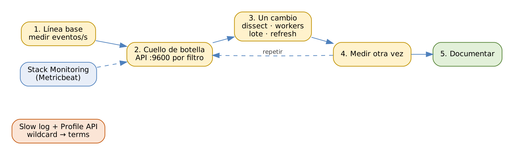

# ELK Stack: Elasticsearch, Logstash y Kibana

## Práctica 9. Medir y optimizar el rendimiento de la ingesta

### Objetivo

Al finalizar la práctica, serás capaz de:

-   Habilitar Stack Monitoring con Metricbeat para Elasticsearch, Kibana
    y Logstash.
-   Medir una línea base de throughput y ubicar el filtro más costoso con
    la API de monitoreo de Logstash.
-   Optimizar un pipeline (dissect, workers, tamaño de lote) y un data
    stream (refresh y réplicas) midiendo el efecto de cada cambio.
-   Detectar una consulta lenta con los slow logs y corregirla con la
    Profile API.

### Objetivo visual

{width="6.3in"}\

### Duración aproximada

-   75 minutos.

### Prerrequisitos

-   Prácticas 2 a 8 completadas: pipelines `web`, `orders-jdbc`,
    `syslog` y `dlq-syslog` funcionando.
-   Instalador `metricbeat-8.19.x-linux-x86_64.tar.gz` en
    `$LABS/downloads`.
-   Al menos 1 GB libre en disco para el archivo y el data stream de
    carga.

### Instrucciones

**Escenario:** el Buen Fin se acerca y MercaNova espera tres veces el
tráfico normal. El equipo debe saber cuántos eventos por segundo
soporta la ingesta y dónde está el cuello de botella antes de que
llegue el pico. Medirás, cambiarás **una sola variable a la vez** y
volverás a medir.

**Importante:** en una sola VM, Logstash y los tres nodos de
Elasticsearch compiten por la misma CPU y el mismo disco. Tus números
serán distintos a los de esta guía; lo que importa es la **tendencia**
y el método.

Usa esta tabla para registrar tus resultados:

| Prueba | Cambio | eventos/s | ms/evento | CPU (%) |
|---------|--------------------------|---------|---------|---------|
| 1 | Línea base: grok, 1 worker, lote 125 | | | |
| 2 | grok → dissect | | | |
| 3 | 4 workers | | | |
| 4 | Lote de 500 | | | |
| 5 | `refresh_interval` 10 s y 0 réplicas | | | |

``` 
$ source /home/student/labs/scripts/env.sh && cd $LABS
```

------------------------------------------------------------------------

### Tarea 1. Stack Monitoring con Metricbeat

#### Paso 1. Asigna contraseña al usuario de monitoreo

``` 
POST _security/user/remote_monitoring_user/_password
{ "password": "Monitoreo#2026" }

GET /?filter_path=cluster_uuid
```

**Qué hace y por qué:** `remote_monitoring_user` es un usuario integrado
con el rol `remote_monitoring_collector`: puede **leer** métricas de los
nodos y **escribir** en los índices de monitoreo, nada más. Anota el
`cluster_uuid`: lo necesitará Logstash en el Paso 3.

#### Paso 2. Instala y configura Metricbeat

``` 
$ sudo mkdir -p /opt/elastic/metricbeat
$ sudo tar -xzf downloads/metricbeat-$V-linux-x86_64.tar.gz \
      -C /opt/elastic/metricbeat --strip-components=1
$ cd /opt/elastic/metricbeat
$ sudo cp $LABS/config/metricbeat/metricbeat.yml .
$ sudo rm -f modules.d/system.yml
$ sudo cp $LABS/config/metricbeat/*-xpack.yml modules.d/
$ sudo ./metricbeat keystore create
$ sudo ./metricbeat keystore add MON_PWD
$ sudo chown -R root:root .
$ sudo chmod go-w metricbeat.yml modules.d/*
$ sudo ./metricbeat test config && sudo ./metricbeat test output
```

**Qué hace y por qué:** el módulo `elasticsearch` con
`xpack.enabled: true` recolecta exactamente las métricas que muestra la
interfaz de **Stack Monitoring**. Revisa en
`modules.d/elasticsearch-xpack.yml`:

| Parámetro | Por qué |
|---------------|---------------------------------------------|
| `hosts` | Los tres nodos (9200, 9201, 9202). |
| `scope: node` | Metricbeat consulta cada nodo por separado; si cae uno, sigue recibiendo métricas de los demás. |
| `period: 10s` | Frecuencia de recolección: buena resolución sin saturar. |
| `ssl.certificate_authorities` | La CA del clúster. |

Se elimina `system.yml` porque no queremos métricas del sistema
operativo en este ejercicio.

#### Paso 3. Vincula Logstash al clúster y arranca Metricbeat

``` 
$ echo 'monitoring.cluster_uuid: "<CLUSTER_UUID>"' | \
  sudo tee -a /opt/elastic/logstash/config/logstash.yml
$ sudo systemctl restart logstash
$ sudo cp $LABS/config/systemd/metricbeat.service /etc/systemd/system/
$ sudo systemctl daemon-reload && sudo systemctl enable --now metricbeat
```

**Qué hace y por qué:** Logstash no pertenece al clúster, así que
`monitoring.cluster_uuid` le indica a Stack Monitoring a qué clúster
mostrarlo asociado. Después de 1 o 2 minutos, abre **Management \> Stack
Monitoring**: verás los 3 nodos, Kibana y Logstash con sus pipelines.

#### Paso 4. Recorre las métricas clave

En Stack Monitoring revisa **Nodes** (heap, CPU, disco), **Indices**
(tasa de indexación) y **Logstash \> Pipelines**. Complementa con:

``` 
GET _cat/nodes?v&h=name,heap.percent,cpu,load_1m,disk.used_percent
GET _cat/thread_pool/write,search?v&h=node_name,name,queue,rejected
```

**Qué hace y por qué:** el thread pool `write` atiende las peticiones
de indexación. Si `queue` crece y `rejected` es mayor que 0, Elasticsearch
está rechazando escrituras: el cuello de botella está en el clúster, no
en Logstash. Anota los valores de reposo para compararlos durante la
carga.

### Tarea 2. Línea base

#### Paso 5. Genera el archivo de carga

``` 
$ scripts/make-loadfile.sh
Archivo de carga: /home/student/labs/data/lab09/load-101523.log
(293040 líneas)
```

**Qué hace y por qué:** repite 11 veces el log web del 19 de octubre,
sin health checks: casi 300 000 líneas, suficiente para medir varios
minutos de carga sostenida.

#### Paso 6. Agrega el pipeline de prueba con la configuración base

``` 
$ sudo tee -a /opt/elastic/logstash/config/pipelines.yml \
  > /dev/null <<'EOF'

- pipeline.id: loadtest
  path.config: "/opt/elastic/logstash/pipelines/loadtest.conf"
  pipeline.workers: 1
  pipeline.batch.size: 125
EOF
$ sudo systemctl restart logstash
```

**Qué hace y por qué:** `loadtest.conf` lee el archivo con
`mode => "read"` y `sincedb_path => "/dev/null"`: cada reinicio vuelve a
leerlo completo, lo que permite repetir la prueba. Aplica `grok`,
`date`, `geoip` y `useragent`, igual que el pipeline web, y escribe en
`logs-loadtest-default`. Empezamos con 1 worker y lote de 125 para tener
una línea base modesta.

#### Paso 7. Mide el throughput

Espera 20 segundos después del reinicio y ejecuta:

``` 
$ scripts/ls-throughput.sh loadtest 30
pipeline=loadtest  eventos=99300  segundos=30  eventos/s=3310
ms/evento: 0.29
$ top -b -n 1 | head -15
```

**Qué hace y por qué:** el script lee `events.out` de la API de Logstash
al inicio y al final de 30 segundos y calcula eventos por segundo. El
valor `ms/evento` es el tiempo promedio de procesamiento por evento
(`duration_in_millis / out`). En `top`, observa cuánta CPU usa el
proceso `java` de Logstash frente a los de Elasticsearch. Anota la
**prueba 1**.

#### Paso 8. Ubica el filtro más costoso

``` 
$ curl -s localhost:9600/_node/stats/pipelines/loadtest | jq -r '
  .pipelines.loadtest.plugins.filters[] |
  "\(.id)\t\(.events.duration_in_millis) ms\t\(.events.out) ev"'
grok-load       41250 ms   120000 ev
useragent-load  16810 ms   120000 ev
geoip-load       6020 ms   120000 ev
date-load        2210 ms   120000 ev
```

**Qué hace y por qué:** cada filtro reporta el tiempo **acumulado** que
ha consumido. El `id` explícito de cada plugin hace legible esta salida;
sin él, verías identificadores aleatorios. En este ejemplo, grok consume
más de la mitad del tiempo: es el primer candidato a optimizar.

### Tarea 3. Optimizar el pipeline

#### Paso 9. Reemplaza grok por dissect

``` 
$ cd /opt/elastic/logstash
$ sudo cp pipelines/loadtest.conf pipelines/loadtest.conf.grok
$ sudo vi pipelines/loadtest.conf
```

Sustituye el bloque `grok { ... }` por:

``` 
dissect {
  id => "dissect-load"
  mapping => { "message" => '%{[source][address]} - %{[user][name]}
    [%{timestamp}] "%{[http][request][method]} %{[url][original]}
    HTTP/%{[http][version]}" %{[http][response][status_code]}
    %{[http][response][body][bytes]} "%{[http][request][referrer]}"
    "%{[user_agent][original]}" %{[event][duration_s]}' }
  convert_datatype => {
    "[http][response][status_code]" => "int"
    "[http][response][body][bytes]" => "int"
    "[event][duration_s]" => "float"
  }
}
```

(El valor de `mapping` va en una sola línea).

**Qué hace y por qué:** **dissect** divide la línea por **delimitadores
fijos** (espacios, corchetes, comillas) sin expresiones regulares, por
eso es mucho más rápido que grok. Funciona porque el formato del log de
Nginx es estable. `convert_datatype` convierte los números, que grok
convertía con `:int` y `:float`. El costo: dissect no tolera variaciones
de formato; si una línea no coincide, la marca con
`_dissectfailure`.

#### Paso 10. Mide de nuevo

``` 
DELETE _data_stream/logs-loadtest-default
```

``` 
$ sudo systemctl restart logstash && sleep 20
$ scripts/ls-throughput.sh loadtest 30
```

**Qué hace y por qué:** borrar el data stream antes de cada prueba
evita que el tamaño creciente del índice afecte la comparación. Anota la
**prueba 2** y revisa otra vez los tiempos por filtro: ahora
`useragent-load` es el más costoso.

#### Paso 11. Aumenta los workers

Edita en `pipelines.yml` el pipeline `loadtest`:
`pipeline.workers: 4`. Borra el data stream, reinicia, mide y anota la
**prueba 3**.

**Qué hace y por qué:** cada worker toma un lote de la cola y ejecuta
filtros y salidas en paralelo. Aumentar los workers ayuda mientras haya
CPU libre; en una VM compartida, a partir de cierto punto, Logstash le
quita CPU a Elasticsearch y el throughput deja de crecer o incluso baja.

#### Paso 12. Aumenta el tamaño del lote

Cambia `pipeline.batch.size: 500`, borra el data stream, reinicia,
mide y anota la **prueba 4**.

**Qué hace y por qué:** cada lote se envía a Elasticsearch como una
petición Bulk. Lotes más grandes reducen el número de peticiones y su
overhead, a cambio de más memoria en Logstash
(`workers × batch.size` eventos en vuelo) y algo más de latencia.

#### Paso 13. Ajusta el destino: refresh y réplicas

``` 
PUT _index_template/loadtest
{
  "index_patterns": [ "logs-loadtest-*" ],
  "data_stream": {},
  "composed_of": [ "ecs@mappings" ],
  "priority": 500,
  "template": { "settings": {
    "index.refresh_interval": "10s",
    "index.number_of_replicas": 0 } }
}

DELETE _data_stream/logs-loadtest-default
```

Reinicia Logstash, mide y anota la **prueba 5**.

**Qué hace y por qué:**

| Ajuste | Efecto en la carga | Costo |
|---------|---------------------------|------------------------|
| `refresh_interval: 10s` | Menos segmentos pequeños y menos merges: más eventos por segundo. | Los datos tardan hasta 10 s en ser buscables. |
| `number_of_replicas: 0` | Cada documento se indexa una vez, no dos. | Sin redundancia: aceptable solo durante una carga inicial. |

Para una carga histórica masiva, la receta es: réplicas en 0 y refresh
desactivado (`-1`) durante la carga, y restaurarlos al terminar.

#### Paso 14. Compara y concluye

Completa la tabla del inicio. Un resultado típico en la VM del curso:

``` 
Prueba                         eventos/s   ms/evento
-----------------------------  ---------   ---------
1 Línea base                       3 300        0.29
2 grok -> dissect                  4 600        0.21
3 4 workers                        7 400        0.22
4 lote 500                         8 300        0.20
5 refresh 10 s + 0 réplicas        9 600        0.19
```

**Qué hace y por qué:** cada ajuste tiene un efecto medible y aislado.
Si un cambio no mejoró, revierte: optimizar sin medir lleva a
configuraciones más complejas sin beneficio. Al terminar, quita el
pipeline `loadtest` de `pipelines.yml`, reinicia Logstash y borra el
data stream y el archivo de carga para liberar disco.

### Tarea 4. Consultas lentas

#### Paso 15. Activa los slow logs del data stream web

``` 
PUT logs-mercanova.web-default/_settings
{
  "index.search.slowlog.threshold.query.warn": "500ms",
  "index.search.slowlog.threshold.query.info": "50ms",
  "index.search.slowlog.threshold.fetch.info": "50ms"
}
```

**Qué hace y por qué:** toda consulta cuya fase *query* tarde más de
50 ms se registra con nivel INFO, y más de 500 ms con WARN, incluido el
texto completo de la consulta. Los umbrales tan bajos son solo para el
laboratorio; en producción se usan valores de segundos.

#### Paso 16. Ejecuta la consulta lenta del dashboard

``` 
GET logs-mercanova.web-default/_search
{
  "size": 0,
  "profile": true,
  "query": { "bool": { "filter": [
    { "wildcard": { "url.original": "*checkout*" } },
    { "range": { "http.response.status_code": { "gte": 500 } } }
  ] } }
}
```

``` 
$ sudo grep -h checkout /opt/elastic/es0[12]/logs/\
mercanova-lab_index_search_slowlog.json | tail -1 | jq -c \
  '{took: ."elasticsearch.slowlog.took"}'
```

**Qué hace y por qué:** `"profile": true` agrega a la respuesta el tiempo
de cada componente de la consulta por shard. Observa que el
`WildcardQuery` sobre `url.original` es, por mucho, el componente más
costoso: un comodín **al inicio** obliga a recorrer todos los términos
del campo. El slow log, en el nodo que tiene el shard, muestra la misma
consulta con su duración.

#### Paso 17. Corrige la consulta

``` 
GET logs-mercanova.web-default/_search
{
  "size": 0,
  "profile": true,
  "query": { "bool": { "filter": [
    { "terms": { "url.path": [ "/api/checkout" ] } },
    { "range": { "http.response.status_code": { "gte": 500 } } }
  ] } }
}
```

**Qué hace y por qué:** como en la práctica 5 se separó `url.path` como
`keyword`, la pregunta "errores de checkout" se responde con un `terms`
exacto, que es una búsqueda directa en el índice invertido. Compara en
**Dev Tools \> Search Profiler** ambas versiones: la segunda es varias
veces más rápida y devuelve el mismo conteo (190). **Lección:** el mejor
optimizador de consultas es un buen mapping.

#### Paso 18. Restablece los umbrales

``` 
PUT logs-mercanova.web-default/_settings
{
  "index.search.slowlog.threshold.query.warn": "2s",
  "index.search.slowlog.threshold.query.info": null,
  "index.search.slowlog.threshold.fetch.info": null
}
```

**Qué hace y por qué:** `null` regresa un ajuste a su valor por defecto
(deshabilitado). Se conserva un umbral de advertencia razonable de 2 s.

### Resultado esperado

-   Stack Monitoring muestra los 3 nodos, Kibana y Logstash.
-   Tabla de resultados completa con el efecto de cada ajuste; el
    throughput final es claramente superior a la línea base.
-   Puedes señalar el filtro más costoso con la API de Logstash y
    explicar por qué dissect es más rápido que grok.
-   La consulta con `wildcard` aparece en el slow log y la versión con
    `terms` sobre `url.path` es varias veces más rápida.
-   Puedes explicar cuándo conviene aumentar workers, lote o refresh y
    qué se sacrifica en cada caso.

### Referencias

-   Elastic. *Collecting monitoring data with Metricbeat \[8.19\].*
    <https://www.elastic.co/guide/en/elasticsearch/reference/8.19/configuring-metricbeat.html>
-   Elastic. *Tuning and profiling Logstash performance \[8.19\].*
    <https://www.elastic.co/guide/en/logstash/8.19/tuning-logstash.html>
-   Elastic. *Logstash: Dissect filter plugin \[8.19\].*
    <https://www.elastic.co/guide/en/logstash/8.19/plugins-filters-dissect.html>
-   Elastic. *Tune for indexing speed \[8.19\].*
    <https://www.elastic.co/guide/en/elasticsearch/reference/8.19/tune-for-indexing-speed.html>
-   Elastic. *Slow log \[8.19\].*
    <https://www.elastic.co/guide/en/elasticsearch/reference/8.19/index-modules-slowlog.html>
-   Elastic. *Profile API \[8.19\].*
    <https://www.elastic.co/guide/en/elasticsearch/reference/8.19/search-profile.html>
