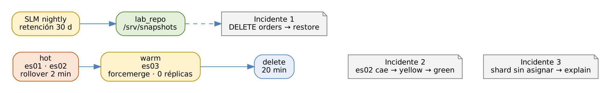

# ELK Stack: Elasticsearch, Logstash y Kibana

## Práctica 10. Retención, respaldo y recuperación ante fallas

### Objetivo

Al finalizar la práctica, serás capaz de:

-   Crear políticas de ILM con rollover, fase warm y borrado, y observar
    cómo los índices migran al nodo warm.
-   Registrar un repositorio de snapshots y programar respaldos con SLM y
    una política de retención.
-   Restaurar un índice borrado por error.
-   Recuperar el clúster tras la caída de un nodo y aplicar un rolling
    restart sin interrumpir el servicio.
-   Diagnosticar shards sin asignar con `_cluster/allocation/explain` y
    revisar la preparación para migrar a 9.x.

### Objetivo visual

{width="6.3in"}\

### Duración aproximada

-   75 minutos.

### Prerrequisitos

-   Clúster `mercanova-lab` en green con `es03` como nodo
    `data_warm` (práctica 2).
-   `path.repo: ["/srv/snapshots"]` en los tres nodos (práctica 2).
-   Índice `orders` con 1 842 pedidos (práctica 5).

### Instrucciones

**Escenario:** el área legal de MercaNova pide conservar los logs 30
días; el área de finanzas exige poder recuperar los pedidos ante
cualquier error; y operaciones quiere un procedimiento probado para
cuando falle un servidor. Configurarás la retención automática, los
respaldos diarios y practicarás tres incidentes: un índice borrado, un
nodo caído y un shard que no se asigna.

Como las fases reales de ILM duran días, usarás una política de
**prueba** con tiempos en minutos sobre un data stream propio, y después
aplicarás la política real a los data streams del curso.

``` 
$ source /home/student/labs/scripts/env.sh && cd $LABS
```

------------------------------------------------------------------------

### Tarea 1. ILM en acción

#### Paso 1. Acelera la evaluación de ILM

``` 
PUT _cluster/settings
{ "persistent": { "indices.lifecycle.poll_interval": "30s" } }
```

**Qué hace y por qué:** ILM revisa las condiciones de cada índice cada 10
minutos por defecto. En el laboratorio se reduce a 30 segundos para ver
las transiciones en clase. **No lo hagas en producción**: aumenta la
carga del master sin beneficio.

#### Paso 2. Crea la política de prueba

``` 
PUT _ilm/policy/mercanova-logs-test
{
  "policy": {
    "phases": {
      "hot": {
        "actions": {
          "rollover": { "max_age": "2m", "max_docs": 100 }
        }
      },
      "warm": {
        "min_age": "3m",
        "actions": {
          "forcemerge": { "max_num_segments": 1 },
          "allocate": { "number_of_replicas": 0 }
        }
      },
      "delete": {
        "min_age": "20m",
        "actions": { "delete": {} }
      }
    }
  }
}
```

**Qué hace y por qué:**

| Fase | Acción | Efecto |
|------|----------|--------------------------------------------|
| hot | `rollover` | Crea un backing index nuevo a los 2 minutos o 100 documentos, lo que ocurra primero. |
| warm | `min_age: 3m` | Entra a warm 3 minutos **después del rollover**, no después de crearse. |
| warm | migración automática | ILM cambia la preferencia de nivel a `data_warm`: el índice se mueve a **es03**. |
| warm | `forcemerge` | Fusiona los segmentos en uno: menos memoria y búsquedas más rápidas en datos que ya no cambian. |
| warm | `allocate` réplicas 0 | En el laboratorio solo hay un nodo warm; una réplica no tendría dónde ubicarse. |
| delete | `delete` | Borra el índice 20 minutos después del rollover. |

#### Paso 3. Crea la plantilla del data stream de prueba

``` 
PUT _index_template/mercanova-ilmtest
{
  "index_patterns": [ "logs-mercanova.ilmtest-*" ],
  "data_stream": {},
  "composed_of": [ "mercanova-settings" ],
  "priority": 500,
  "template": {
    "settings": { "index.lifecycle.name": "mercanova-logs-test" }
  }
}
```

**Qué hace y por qué:** `index.lifecycle.name` asocia la política a cada
backing index que se cree. Los ajustes del bloque `template` tienen
prioridad sobre los de las component templates, por eso esta política de
prueba no se mezcla con la real.

#### Paso 4. Alimenta el data stream y observa las fases

En una terminal aparte:

``` 
$ source /home/student/labs/scripts/env.sh
$ $LABS/scripts/ilm-feeder.sh
```

Cada minuto, ejecuta en Dev Tools:

``` 
GET logs-mercanova.ilmtest-default/_ilm/explain

GET _cat/shards/.ds-logs-mercanova.ilmtest*?v&h=index,prirep,node
```

**Qué hace y por qué:** el script escribe un documento por segundo.
`_ilm/explain` muestra, por cada backing index, la política, la fase
(`phase`), la acción (`action`), el paso (`step`) y la antigüedad
(`age`). En unos 10 minutos verás la secuencia completa:

``` 
index                                     prirep node
.ds-logs-mercanova.ilmtest-...-000001     p      es03
.ds-logs-mercanova.ilmtest-...-000002     p      es03
.ds-logs-mercanova.ilmtest-...-000003     p      es01
.ds-logs-mercanova.ilmtest-...-000003     r      es02
```

Los índices antiguos están en warm, en **es03** y sin réplica; el índice
de escritura sigue en hot, en es01 y es02. `_ilm/explain` muestra la
fase, la acción y el paso actual. Si un paso falla, aparece como
`ERROR` con el motivo.

#### Paso 5. Aplica la política real a los data streams del curso

``` 
PUT _ilm/policy/mercanova-logs
{
  "policy": {
    "phases": {
      "hot": { "actions": {
        "rollover": { "max_primary_shard_size": "10gb",
                      "max_age": "1d" },
        "set_priority": { "priority": 100 } } },
      "warm": { "min_age": "2d", "actions": {
        "forcemerge": { "max_num_segments": 1 },
        "allocate": { "number_of_replicas": 0 },
        "set_priority": { "priority": 50 } } },
      "delete": { "min_age": "30d",
        "actions": { "delete": {} } }
    }
  }
}

PUT _component_template/mercanova-settings
{
  "template": { "settings": {
    "number_of_shards": 1, "number_of_replicas": 1,
    "index.lifecycle.name": "mercanova-logs" } }
}
```

**Qué hace y por qué:** al actualizar la component template
`mercanova-settings`, **todas** las plantillas que la usan (app,
legacy, web y syslog) heredan la política. `max_primary_shard_size`
mantiene los shards cerca del tamaño recomendado y `max_age` garantiza
un índice por día. `set_priority` hace que, tras un reinicio, los
índices hot se recuperen antes que los warm. En producción, con varios
nodos warm, conservarías una réplica.

#### Paso 6. Aplica la política con un rollover

``` 
POST logs-mercanova.app-default/_rollover
POST logs-mercanova.web-default/_rollover

GET logs-mercanova.app-default/_ilm/explain?filter_path=**.policy
```

**Qué hace y por qué:** las plantillas solo afectan a índices **nuevos**.
El rollover crea un backing index que ya nace con `mercanova-logs`; los
backing indices anteriores conservan su configuración. Detén ahora el
script `ilm-feeder.sh` con `Ctrl + C`.

### Tarea 2. Snapshots y SLM

#### Paso 7. Registra y verifica el repositorio

``` 
PUT _snapshot/lab_repo
{
  "type": "fs",
  "settings": { "location": "/srv/snapshots", "compress": true }
}

POST _snapshot/lab_repo/_verify
```

**Qué hace y por qué:** un repositorio `fs` debe ser **accesible desde
todos los nodos con datos**: cada nodo copia sus propios shards. En el
laboratorio los tres nodos comparten el disco de la VM; en producción
sería un NFS montado en todos los nodos, o un repositorio S3, Azure o
GCS. `_verify` hace que cada nodo escriba un archivo de prueba: responde
con la lista de nodos que pudieron hacerlo. `compress` comprime los
metadatos del snapshot.

#### Paso 8. Crea la política SLM y ejecútala

``` 
PUT _slm/policy/nightly
{
  "schedule": "0 30 1 * * ?",
  "name": "<nightly-{now/d}>",
  "repository": "lab_repo",
  "config": {
    "indices": [ "*" ],
    "include_global_state": true
  },
  "retention": {
    "expire_after": "30d",
    "min_count": 5,
    "max_count": 50
  }
}

POST _slm/policy/nightly/_execute
```

**Qué hace y por qué:**

| Parámetro | Significado |
|------------|------------------------------------------------|
| `schedule` | Cron con **segundos**: todos los días a las 01:30, hora del clúster (UTC). |
| `name` | Date math: `nightly-2026.xx.xx`; SLM agrega un sufijo único. |
| `indices: ["*"]` | Todos los índices y data streams. |
| `include_global_state` | Incluye plantillas, políticas ILM, pipelines y la configuración del clúster, para reconstruirlo completo. |
| `retention` | Borra snapshots de más de 30 días, pero conserva al menos 5 y nunca más de 50. |

`_execute` ejecuta la política en ese momento para no esperar a la
madrugada.

#### Paso 9. Verifica el snapshot

``` 
GET _slm/policy/nightly?filter_path=*.last_success
GET _cat/snapshots/lab_repo?v&h=id,status,failed_shards,duration
GET _slm/stats
```

**Qué hace y por qué:** el snapshot debe aparecer con estado `SUCCESS` y
`failed_shards: 0`. Los snapshots son **incrementales**: el siguiente
solo copiará los segmentos nuevos. Ejecuta `_execute` otra vez y compara
la duración.

### Tarea 3. Incidente 1: índice borrado por error

#### Paso 10. "Borra" el índice de pedidos

``` 
GET orders/_count

DELETE orders

GET orders/_count
```

**Qué hace y por qué:** el primer conteo es 1 842; después del borrado,
la consulta responde `index_not_found_exception`. En la práctica 8,
ningún rol de equipo tiene privilegio para borrar índices: el borrado
accidental de producción suele venir de cuentas administrativas, por eso
`elastic` no debe usarse a diario.

#### Paso 11. Restaura desde el último snapshot

``` 
GET _cat/snapshots/lab_repo?v&h=id,status&s=start_epoch:desc

POST _snapshot/lab_repo/<NOMBRE_DEL_SNAPSHOT>/_restore
{
  "indices": "orders",
  "include_global_state": false
}

GET _cat/recovery/orders?v&h=index,shard,type,stage,files_percent
GET orders/_count
```

**Qué hace y por qué:** se restaura **solo** el índice `orders`
(`include_global_state: false` evita sobrescribir la configuración
actual del clúster). `_cat/recovery` muestra el avance con tipo
`snapshot`. El conteo vuelve a **1 842**. Si el índice existiera, habría
que borrarlo o cerrarlo, o restaurarlo con otro nombre mediante
`rename_pattern` y `rename_replacement`.

### Tarea 4. Incidente 2: un nodo cae

#### Paso 12. Detén es02 y observa el clúster

``` 
$ sudo systemctl stop es@02
$ curl -s --cacert $CA -u elastic:$ELASTIC_PWD \
  "$ES/_cluster/health?filter_path=status,unassigned_shards"
```

``` 
GET _cat/shards?v&h=index,prirep,state,node,unassigned.reason
```

**Qué hace y por qué:** el estado pasa a **yellow**: los shards cuya
réplica estaba en es02 quedan sin réplica (`UNASSIGNED`, motivo
`NODE_LEFT`), pero **ningún dato se perdió**: donde el primario estaba
en es02, su réplica en es01 se **promovió a primario**. Por defecto,
Elasticsearch espera 1 minuto
(`index.unassigned.node_left.delayed_timeout`) antes de recrear réplicas,
por si el nodo regresa pronto. Aquí no hay otro nodo hot disponible, así
que el estado seguirá en yellow.

#### Paso 13. Restablece el nodo

``` 
$ sudo systemctl start es@02
$ curl -s --cacert $CA -u elastic:$ELASTIC_PWD \
  "$ES/_cluster/health?wait_for_status=green&timeout=3m"
{"status":"green"}
```

**Qué hace y por qué:** al volver, es02 conserva sus datos en disco y
solo necesita recuperar los cambios ocurridos mientras estuvo fuera
(recuperación basada en *operaciones*, no copia completa).
`wait_for_status=green` espera hasta 3 minutos a que el clúster se
recupere.

#### Paso 14. Aplica un rolling restart a es03

``` 
PUT _cluster/settings
{ "persistent": {
    "cluster.routing.allocation.enable": "primaries" } }

POST _flush
```

``` 
$ sudo systemctl restart es@03
```

``` 
GET _cat/nodes?v&h=name,node.role,master

PUT _cluster/settings
{ "persistent": {
    "cluster.routing.allocation.enable": null } }

GET _cluster/health?wait_for_status=green&timeout=3m
```

**Qué hace y por qué:**

| Paso | Por qué |
|---------------|---------------------------------------------|
| `allocation.enable: primaries` | Mientras el nodo está fuera, el clúster no intenta copiar réplicas a otros nodos: evita mover datos innecesariamente. |
| `_flush` | Confirma en disco las operaciones del translog: la recuperación es más rápida. |
| Reiniciar el nodo | Es el momento de aplicar el cambio: configuración, parche de versión o mantenimiento del sistema operativo. |
| `enable: null` | Regresa la asignación a su valor por defecto (`all`). |

Es el procedimiento para cualquier mantenimiento: **un nodo a la vez**,
esperando green antes del siguiente, y el master elegido al final.

Mientras es03 reinicia, el clúster puede pasar brevemente a **red**: los
índices warm del data stream de prueba no tienen réplica y su único
shard vive en es03. Es la razón por la que en producción se usan al
menos dos nodos por nivel.

### Tarea 5. Incidente 3: un shard no se asigna

#### Paso 15. Provoca el problema

``` 
PUT lab10-bad
{
  "settings": {
    "number_of_replicas": 0,
    "index.routing.allocation.require._name": "es09"
  }
}

GET _cluster/health?filter_path=status,unassigned_shards
```

**Qué hace y por qué:** el índice exige un nodo llamado `es09`, que no
existe. Su único shard primario no puede asignarse y el clúster pasa a
**red**: hay datos no disponibles. Simula un error común en producción:
un filtro de asignación mal escrito o un nodo retirado.

#### Paso 16. Diagnostica con allocation explain

``` 
GET _cluster/allocation/explain
{ "index": "lab10-bad", "shard": 0, "primary": true }
```

**Qué hace y por qué:** la respuesta explica la decisión **por cada
nodo**: el *decider* `filter` dice que el nodo no cumple
`index.routing.allocation.require._name: es09`. Es la herramienta más
útil ante un clúster yellow o red: no adivina, explica.

#### Paso 17. Corrige y limpia

``` 
PUT lab10-bad/_settings
{ "index.routing.allocation.require._name": null }

GET _cluster/health?wait_for_status=green&timeout=1m&filter_path=status

DELETE lab10-bad
```

**Qué hace y por qué:** al quitar el filtro, el shard se asigna de
inmediato y el clúster vuelve a green. Si el shard hubiera agotado sus
reintentos (5 por defecto), se reintentaría con
`POST _cluster/reroute?retry_failed=true`.

#### Paso 18. Revisa disco y watermarks

``` 
GET _cat/allocation?v&h=node,shards,disk.used,disk.avail,disk.percent

GET _cluster/settings?include_defaults&filter_path=**.watermark
```

**Qué hace y por qué:** los **watermarks** protegen el disco: con 85 %
(*low*) no se asignan shards nuevos al nodo; con 90 % (*high*) se mueven
shards a otros nodos; con 95 % (*flood stage*) los índices pasan a solo
lectura. Como los tres nodos comparten el disco de la VM, en el
laboratorio los tres alcanzarían el umbral al mismo tiempo: otra
diferencia frente a producción.

### Tarea 6. Preparar la migración a 9.x

#### Paso 19. Revisa las deprecaciones

``` 
GET _migration/deprecations
```

En Kibana: **Stack Management \> Upgrade Assistant**.

**Qué hace y por qué:** 8.19 es la versión **puente** hacia 9.x: el
Upgrade Assistant lista los ajustes deprecados y los índices que
requieren acción. Los índices creados en 7.x deben reindexarse o marcarse
de solo lectura antes de migrar; en este clúster no hay ninguno, porque
todo se creó en 8.19. Antes de una migración real: snapshot completo,
prueba en un ambiente separado y revisión de los *breaking changes*
de 9.0.

#### Paso 20. Restablece el intervalo de ILM

``` 
PUT _cluster/settings
{ "persistent": { "indices.lifecycle.poll_interval": null } }
```

**Qué hace y por qué:** regresa a los 10 minutos por defecto. El data
stream de prueba `logs-mercanova.ilmtest-default` se borrará solo
cuando sus índices cumplan 20 minutos.

### Resultado esperado

-   Índices antiguos de `logs-mercanova.ilmtest-default` en fase warm,
    ubicados en **es03** y sin réplica; los primeros, borrados por la
    fase delete.
-   Política `mercanova-logs` heredada por todos los data streams del
    curso a través de `mercanova-settings`.
-   Repositorio `lab_repo` verificado y política SLM `nightly` con al
    menos dos snapshots exitosos.
-   Índice `orders` restaurado con **1 842** pedidos.
-   Clúster de nuevo en **green** después de la caída de es02, del
    rolling restart de es03 y del shard sin asignar.
-   Puedes explicar la diferencia entre yellow y red en cada incidente,
    por qué se limita la asignación durante un reinicio y por qué un
    snapshot es el único respaldo válido.

### Referencias

-   Elastic. *Index lifecycle management \[8.19\].*
    <https://www.elastic.co/guide/en/elasticsearch/reference/8.19/index-lifecycle-management.html>
-   Elastic. *Data tiers \[8.19\].*
    <https://www.elastic.co/guide/en/elasticsearch/reference/8.19/data-tiers.html>
-   Elastic. *Snapshot and restore \[8.19\].*
    <https://www.elastic.co/guide/en/elasticsearch/reference/8.19/snapshot-restore.html>
-   Elastic. *Rolling restart \[8.19\].*
    <https://www.elastic.co/guide/en/elasticsearch/reference/8.19/restart-cluster.html>
-   Elastic. *Cluster allocation explain API \[8.19\].*
    <https://www.elastic.co/guide/en/elasticsearch/reference/8.19/cluster-allocation-explain.html>
-   Elastic. *Upgrade Assistant \[8.19\].*
    <https://www.elastic.co/guide/en/kibana/8.19/upgrade-assistant.html>
