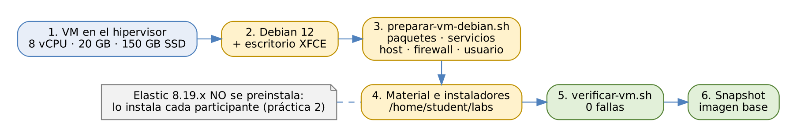

# ELK Stack: Elasticsearch, Logstash y Kibana

## Guía de preparación del ambiente de laboratorio · Debian 12 con interfaz gráfica

### Objetivo

Al finalizar esta guía, el equipo de infraestructura habrá preparado la
**imagen base** de la VM que usará cada participante, con:

-   Debian 12 (bookworm) con escritorio XFCE y Firefox ESR.
-   Los paquetes y servicios del sistema que requieren las 11 prácticas.
-   El material del curso y los instaladores de Elastic 8.19.x listos en
    `/home/student/labs`.
-   Una verificación automática sin fallas y un snapshot listo para
    clonar.

### Objetivo visual

{width="6.3in"}\

### Duración aproximada

-   60 a 90 minutos para la primera imagen; después, solo se clona.

### Alcance

**Esta guía no instala Elasticsearch, Kibana, Logstash, Filebeat,
Metricbeat ni Elastic Agent.** Instalarlos es parte del aprendizaje:
cada participante lo hace en la práctica 2 y siguientes. La imagen solo
deja listos el sistema operativo, las fuentes de datos (Nginx y MariaDB),
las utilerías y los instaladores.

------------------------------------------------------------------------

### Tarea 1. Requisitos de la VM

#### Paso 1. Dimensiona la VM

| Recurso | Mínimo | Recomendado | Por qué |
|----------------|----------------|----------------|------------------------------------|
| vCPU | 8 (x86_64) | 8 | 3 nodos de Elasticsearch, Logstash y Kibana trabajan a la vez; la práctica 9 satura la CPU a propósito. |
| RAM | 16 GB | **20 GB** | El escritorio y el navegador con Kibana consumen unos 2 GB adicionales. |
| Disco | 150 GB SSD | 150 GB SSD | Datos, snapshots y prueba de carga. Elasticsearch es sensible a la latencia del disco. |
| Video | 128 MB | 128 MB, sin aceleración 3D | Escritorio XFCE a 1920 × 1080. |
| Red | 1 interfaz | NAT o puente, con salida a internet | Ver la Tarea 6. |

**Qué hace y por qué:** el presupuesto de memoria con escritorio es:

| Componente | Memoria |
|------------------------------------------------|----------------|
| 3 nodos de Elasticsearch × 1.5 GB de heap | 4.5 GB |
| Caché de archivos para Lucene | ~4 GB |
| Kibana | ~1.5 GB |
| Logstash (1 GB de heap) | ~1.5 GB |
| Elastic Agent, Filebeat, Metricbeat, Nginx, MariaDB | ~1.5 GB |
| Escritorio XFCE y Firefox con Kibana | ~2 GB |
| Sistema operativo | ~1 GB |
| **Total** | **~16 GB** |

Con 16 GB la VM funciona, pero queda sin margen: es recomendable cerrar
pestañas y aplicaciones que no se usen. Con 20 GB queda un margen cómodo
para la práctica 9 (carga). El disco no debe pasar del 85 % de uso: a
partir de ese umbral, Elasticsearch deja de asignar shards.

#### Paso 2. Configura la VM en el hipervisor

-   **Tipo de sistema operativo:** Debian 12 de 64 bits.
-   **CPU:** 8 vCPU; si el hipervisor lo permite, 1 socket con 8
    núcleos.
-   **Disco:** 150 GB en almacenamiento SSD. Puede ser de asignación
    dinámica (*thin*), pero en un datastore con al menos 150 GB libres
    por VM.
-   **Firmware:** UEFI o BIOS, ambos funcionan.
-   **Portapapeles compartido:** activado, útil para copiar tokens y
    contraseñas.

**Qué hace y por qué:** Elasticsearch usa *mmap* y escribe muchos
archivos pequeños: un disco lento o sobrecomprometido vuelve lentas
todas las prácticas. Si varias VM comparten un mismo host, conviene no
sobrecomprometer la RAM física: con *swapping* en el host, los nodos
pierden contacto entre sí y el clúster se vuelve inestable.

### Tarea 2. Instalar Debian 12 con escritorio

#### Paso 3. Instala Debian 12 desde la imagen netinst

Usa la imagen `debian-12.x.x-amd64-netinst.iso` más reciente de
<https://www.debian.org/distrib/> y elige estas opciones en el
instalador:

| Pantalla del instalador | Valor |
|------------------------------|------------------------------------------------|
| Idioma / país | Español / México |
| Teclado | Latinoamericano |
| Nombre de la máquina | `elk-lab` |
| Nombre de dominio | (vacío) |
| Contraseña de root | **Vacía**: así el primer usuario queda con `sudo` |
| Usuario | Nombre completo *Participante ELK*, usuario `student` |
| Particionado | Guiado, todo el disco, todos los ficheros en una partición |
| Selección de programas | **Entorno de escritorio Debian**, **Xfce**, **servidor SSH**, **utilidades estándar del sistema** |

**Qué hace y por qué:**

-   **Root sin contraseña:** el instalador agrega a `student` al grupo
    `sudo`. Las guías usan `sudo` en todos los comandos de
    administración.
-   **Xfce:** es el escritorio más ligero de los que ofrece el
    instalador; GNOME consume casi el doble de memoria.
-   **Swap:** el particionado guiado crea una partición de swap. Se deja:
    el participante la desactiva en la práctica 2, Paso 3, como parte de
    la preparación de Elasticsearch.
-   **Debian 12:** es la versión recomendada. Si se usa Debian 13
    (trixie), el script funciona igual, pero antes hay que confirmar en
    la matriz de soporte de Elastic que la versión esté certificada para
    8.19.

Si el escritorio no se instaló, el script de la Tarea 3 lo agrega con
la opción `--gui`.

#### Paso 4. Inicia sesión y abre una terminal

Inicia sesión como `student` en el escritorio XFCE y abre **Aplicaciones
\> Emulador de terminal**. Comprueba:

``` 
$ cat /etc/debian_version
12.x
$ sudo -v && echo "sudo OK"
sudo OK
```

**Qué hace y por qué:** confirma la versión de Debian y que `student`
tiene privilegios `sudo`. Si `sudo` falla porque se asignó contraseña a
root durante la instalación, agrega el usuario al grupo como root:
`su - -c "usermod -aG sudo student"` y cierra y abre la sesión.

### Tarea 3. Instalar paquetes y servicios

#### Paso 5. Copia el material del curso

Copia la carpeta `material_labs` del paquete del curso a
`/home/student/labs`, por ejemplo con una carpeta compartida del
hipervisor, `scp` o una memoria USB:

``` 
$ cp -r /ruta/al/paquete/material_labs /home/student/labs
$ ls /home/student/labs
config  data  downloads  final  README.md  scripts
```

**Qué hace y por qué:** las guías esperan el material en
`/home/student/labs` (en las guías, `$LABS`). El script de preparación
está en `scripts/` y, al terminar, ajusta el dueño y los permisos de
toda la carpeta.

#### Paso 6. Ejecuta el script de preparación

``` 
$ cd /home/student/labs/scripts
$ sudo ./preparar-vm-debian.sh
```

Si el escritorio no se instaló en el Paso 3:

``` 
$ sudo ./preparar-vm-debian.sh --gui
```

**Qué hace y por qué:** el script es **idempotente**, es decir, se
puede ejecutar varias veces sin efectos secundarios, y hace en orden lo
siguiente:

| Bloque | Qué hace | Por qué |
|----------------|------------------------------|------------------------------------|
| 1. Actualización | `apt-get update` y `full-upgrade` | Parches de seguridad antes de congelar la imagen. |
| 2. Paquetes base | Instala las utilerías de la tabla del Paso 7. | Comandos que usan las guías y los scripts. |
| 2b. Escritorio (`--gui`) | `task-xfce-desktop`, Firefox ESR, Mousepad, terminal | Navegador para Kibana dentro de la VM. |
| 3. Hipervisor | Detecta VMware, KVM o Hyper-V e instala sus herramientas. | Portapapeles, resolución automática y apagado limpio. |
| 4. Fuentes de datos | Instala y habilita Nginx y MariaDB. | Logs web y base de pedidos del caso MercaNova. |
| 5. Hora | Zona `America/Mexico_City`; reemplaza `systemd-timesyncd` por `chrony`. | Las guías usan `chronyc` y los datos del curso están en UTC-06:00. |
| 6. Idioma | Genera y activa `es_MX.UTF-8`. | Acentos correctos en terminal y archivos. |
| 7. Nombre de host | `elk-lab` en `/etc/hosts` con 127.0.1.1. | Las guías usan `https://elk-lab:9200` y `http://elk-lab:5601`. |
| 8. Firewall | Instala y habilita `firewalld`; permite SSH y Kibana (5601). | La práctica 2 abre los puertos de Elastic con `firewall-cmd`. |
| 9. Usuario | Crea `student` si no existe y lo agrega a `sudo`, `adm` y `systemd-journal`. | Leer logs del sistema y de los servicios sin `sudo`. |
| 10. Material | Dueño `student` en `/home/student/labs`, scripts ejecutables y `/var/log/mercanova`. | Carpeta que vigila Filebeat en las prácticas 5 y 11. |

Al terminar, **reinicia la VM** para aplicar el idioma y, si se instaló,
el escritorio.

#### Paso 7. Revisa el inventario de paquetes

Estos son los paquetes que quedan instalados y su uso en el curso:

| Paquete Debian | Uso en el curso | Prácticas |
|----------------------|------------------------------------------|----------------|
| `nginx` | Servidor web que genera logs reales | 2, 6 |
| `mariadb-server`, `mariadb-client` | Base de datos `mercanova` (compatible con MySQL) leída por JDBC | 5, 11 |
| `curl`, `wget`, `ca-certificates` | Llamadas a las APIs y descargas | Todas |
| `jq` | Lectura de respuestas JSON en scripts y guías | Todas |
| `netcat-openbsd` | Comando `nc`: envío de syslog al puerto TCP 5514 | 6, 11 |
| `tar`, `gzip`, `zip`, `unzip` | Instaladores tar.gz y empaquetado | 2 |
| `openssl` | Huella SHA-256 de la CA para Fleet | 6 |
| `perl` | Comando `shasum` para verificar los instaladores | 2 |
| `chrony` | Sincronización de hora (`chronyc tracking`) | 2 |
| `firewalld` | Firewall con `firewall-cmd` | 2 |
| `procps`, `iproute2`, `lsof`, `sysstat`, `htop`, `psmisc` | `top`, `ss`, diagnóstico de procesos y puertos | 2, 9 |
| `vim`, `nano`, `less`, `bash-completion`, `man-db` | Edición de configuraciones | Todas |
| `rsyslog` | Syslog tradicional del sistema | Opcional |
| `locales`, `tzdata` | Idioma y zona horaria | — |
| `python3`, `git` | Utilerías del instructor | Opcional |
| `task-xfce-desktop`, `firefox-esr`, `mousepad`, `xfce4-terminal` | Escritorio, navegador para Kibana, editor gráfico y terminal | Todas |

**Qué hace y por qué:** no se instala Java: Elasticsearch y Logstash
incluyen su propio JDK. Tampoco se instalan los paquetes `.deb` de
Elastic: el curso usa los tar.gz para poder ejecutar tres nodos en la
misma VM.

#### Paso 8. Revisa los servicios habilitados

``` 
$ systemctl is-enabled nginx mariadb chrony firewalld
enabled
enabled
enabled
enabled
$ curl -s -o /dev/null -w "%{http_code}\n" http://localhost/
200
$ sudo mysql -e "SELECT VERSION();"
```

**Qué hace y por qué:**

| Servicio | Estado esperado | Puerto | Para qué |
|----------------|----------------|----------------|------------------------------------|
| `nginx` | activo y habilitado | 80 (local) | Fuente de logs reales para Filebeat y Elastic Agent |
| `mariadb` | activo y habilitado | 3306 (local) | Base `mercanova`; el participante la carga en la práctica 5 |
| `chrony` | activo y habilitado | — | Hora sincronizada para correlacionar eventos y validar TLS |
| `firewalld` | activo y habilitado | 22 y 5601 abiertos | Los demás puertos los abre el participante en la práctica 2 |
| `ssh` | activo y habilitado | 22 | Acceso remoto del instructor (opcional) |
| `systemd-timesyncd` | deshabilitado | — | Lo reemplaza chrony; dos clientes NTP a la vez entran en conflicto |

MariaDB 10.11, la versión de Debian 12, es compatible con los scripts
SQL del curso. `root` entra con `sudo mysql` mediante autenticación por
socket de Unix, sin contraseña: así lo usan las guías.

### Tarea 4. Instaladores de Elastic y driver JDBC

#### Paso 9. Descarga los instaladores 8.19.x

Elige **una sola versión de parche** (la más reciente de 8.19) y
descarga los seis archivos de Linux x86_64 en `downloads/`:

``` 
$ cd /home/student/labs/downloads
$ V=8.19.x          # sustituir por la versión de parche elegida
$ B=https://artifacts.elastic.co/downloads
$ for p in elasticsearch/elasticsearch kibana/kibana \
           logstash/logstash beats/filebeat/filebeat \
           beats/metricbeat/metricbeat \
           beats/elastic-agent/elastic-agent; do
    curl -fLO "$B/$p-$V-linux-x86_64.tar.gz"
    curl -fLO "$B/$p-$V-linux-x86_64.tar.gz.sha512"
  done
$ for f in *.sha512; do shasum -a 512 -c "$f"; done
```

**Qué hace y por qué:**

| Archivo | Tamaño aprox. | Práctica |
|------------------------------------------|----------------|----------------|
| `elasticsearch-8.19.x-linux-x86_64.tar.gz` | 600 MB | 2 |
| `kibana-8.19.x-linux-x86_64.tar.gz` | 350 MB | 2 |
| `logstash-8.19.x-linux-x86_64.tar.gz` | 400 MB | 2 |
| `filebeat-8.19.x-linux-x86_64.tar.gz` | 60 MB | 2 |
| `elastic-agent-8.19.x-linux-x86_64.tar.gz` | 600 MB | 6 |
| `metricbeat-8.19.x-linux-x86_64.tar.gz` | 70 MB | 9 |

`-f` hace que `curl` falle si el archivo no existe, en lugar de guardar
una página de error. `shasum -c` debe responder `OK` para cada archivo.
**Todos los productos deben tener la misma versión**: Elastic no
garantiza compatibilidad entre versiones de parche distintas dentro de
un mismo despliegue. Los instaladores ocupan alrededor de 2 GB: dejarlos
en la imagen evita que 20 participantes los descarguen al mismo tiempo.
Los tamaños son aproximados.

#### Paso 10. Descarga el driver JDBC de MariaDB

Descarga **MariaDB Connector/J 3.5.x** (archivo
`mariadb-java-client-3.5.x.jar`) desde
<https://mariadb.com/downloads/connectors/connectors-data-access/java8-connector/>
o Maven Central, y guárdalo con un nombre fijo:

``` 
$ mv mariadb-java-client-3.5.*.jar \
     /home/student/labs/downloads/mariadb-java-client.jar
```

**Qué hace y por qué:** el pipeline `orders-jdbc` de la práctica 5 usa
`org.mariadb.jdbc.Driver` con la URL `jdbc:mariadb://localhost:3306`.
El nombre fijo `mariadb-java-client.jar` evita editar la configuración
cuando cambie la versión del driver.

### Tarea 5. Ajustes del escritorio

#### Paso 11. Prepara Firefox y el escritorio

1.  En Firefox ESR, crea marcadores para:
    -   Kibana: `http://elk-lab:5601`
    -   Guías del curso: la carpeta con los archivos de las prácticas, si
        se distribuyen dentro de la VM.
2.  En **Configuración \> Gestor de energía**, desactiva el bloqueo de
    pantalla y la suspensión.
3.  Fija la resolución en 1920 × 1080 (**Configuración \> Pantalla**).
4.  Agrega al panel los lanzadores de **Terminal**, **Firefox** y
    **Mousepad**.

**Qué hace y por qué:** el participante usará Kibana desde el navegador
de la propia VM; así no depende de la red del aula para llegar al puerto
5601. Una suspensión automática a mitad de una práctica larga detiene
los servicios y confunde los resultados.

### Tarea 6. Red y acceso a internet

#### Paso 12. Confirma los accesos necesarios

| Destino | Obligatorio | Para qué |
|------------------------------------------|----------------|------------------------------------|
| `https://epr.elastic.co` | **Sí** | Kibana descarga la integración de Nginx en la práctica 6 (Elastic Package Registry). |
| `https://artifacts.elastic.co` | No, si los instaladores ya están en `downloads/` | Descarga de instaladores. |
| `deb.debian.org`, `security.debian.org` | Solo al preparar la imagen | Paquetes de Debian. |
| Equipo del instructor → VM, puerto 22 | Opcional | Soporte remoto por SSH. |
| Equipo del participante → VM, puerto 5601 | Opcional | Solo si se quiere abrir Kibana desde fuera de la VM. |

**Qué hace y por qué:** sin acceso a `epr.elastic.co`, Fleet no puede
instalar integraciones y la Tarea 2 de la práctica 6 no funciona. En
redes sin internet, Elastic permite montar un registro de paquetes local
(*air-gapped*); en ese caso, hay que prepararlo antes del curso. La
geolocalización de Logstash funciona sin internet porque incluye su
propia base GeoLite2.

### Tarea 7. Verificar y congelar la imagen

#### Paso 13. Ejecuta la verificación

``` 
$ /home/student/labs/scripts/verificar-vm.sh
== Sistema operativo
  [ OK ]  Debian 12.x (bookworm)
  [ OK ]  Arquitectura x86_64
== Recursos
  [ OK ]  vCPU: 8
  [ OK ]  RAM: 19 GB
  ...
== Material del curso (/home/student/labs)
  [ OK ]  Instalador elasticsearch-8.19.x-linux-x86_64.tar.gz
  ...
Resultado: 47 correctos · 0 avisos · 0 fallas
```

**Qué hace y por qué:** el script revisa recursos, comandos, servicios,
nombre de host, puertos libres, acceso a `epr.elastic.co`, escritorio,
datos del curso, los seis instaladores (y que sean de la misma versión)
y el driver JDBC. **Una imagen solo está lista con 0 fallas**. Un
**aviso** no impide el curso, por ejemplo 16 GB de RAM en lugar de 20,
pero conviene revisarlo. `free -g` reporta un poco menos de la RAM
asignada; por eso 20 GB aparecen como 19.

#### Paso 14. Limpia y toma el snapshot

``` 
$ sudo apt-get clean
$ history -c
$ sudo poweroff
```

Toma un **snapshot** de la VM apagada con el nombre
`elk-lab-base-8.19.x`.

**Qué hace y por qué:** `apt-get clean` libera la caché de paquetes y
`history -c` borra el historial de comandos de la preparación. El
snapshot es la imagen de la que se clonan las VM de los participantes y
a la que se regresa entre un grupo y otro. Recuerda que la licencia de
prueba de la práctica 8 solo se activa **una vez por clúster**: cada
grupo nuevo debe partir de esta imagen limpia.

#### Paso 15. Clona las VM de los participantes

Para cada clon, al primer arranque:

``` 
$ sudo rm -f /etc/machine-id /var/lib/dbus/machine-id
$ sudo systemd-machine-id-setup
$ sudo rm -f /etc/ssh/ssh_host_*
$ sudo dpkg-reconfigure openssh-server
$ sudo reboot
```

**Qué hace y por qué:** los clones heredan el mismo `machine-id` y las
mismas llaves SSH del original. Regenerarlos evita conflictos de DHCP
(algunas redes asignan la IP por `machine-id`) y advertencias de SSH.
Todos los clones conservan el nombre `elk-lab`: es correcto, porque cada
uno es un ambiente aislado y las guías usan ese nombre.

#### Paso 16. Snapshots de rescate durante el curso (recomendado)

Al terminar cada sesión, toma un snapshot de una VM de referencia del
instructor que haya completado las prácticas de ese día:

| Snapshot | Estado | Sirve para |
|------------------------------------------|------------------------------------|----------------|
| `rescate-sesion1` | Clúster de 3 nodos, Kibana, Logstash y Filebeat instalados | Sesión 2 |
| `rescate-sesion2` | Prácticas 3 y 4 completadas | Sesión 3 |
| `rescate-sesion3` | Prácticas 5 y 6 completadas | Sesión 4 |
| `rescate-sesion4` | Prácticas 7 y 8 completadas | Sesión 5 |

**Qué hace y por qué:** si un participante pierde su ambiente o se
atrasa, se le clona el snapshot del día y continúa con el grupo. En las
copias de rescate, las contraseñas son las de la VM del instructor.

### Problemas frecuentes

| Síntoma | Causa probable | Solución |
|------------------------------------|------------------------------|------------------------------------|
| `student no está en el archivo sudoers` | Se asignó contraseña a root en la instalación | `su - -c "usermod -aG sudo student"` y volver a iniciar sesión |
| `firewall-cmd: command not found` en la práctica 2 | No se ejecutó el script de preparación | Ejecutar `preparar-vm-debian.sh` |
| La VM se vuelve lenta en la práctica 9 | RAM insuficiente o host sobrecomprometido | Asignar 20 GB y no sobrecomprometer la RAM del host |
| Falla `epr.elastic.co` en la verificación | Proxy o firewall corporativo | Permitir la salida HTTPS a `epr.elastic.co` o montar un registro local |
| `mysql: command not found` | No se instaló `mariadb-client` | `sudo apt-get install mariadb-client` |
| La hora no se sincroniza | Red sin acceso NTP | Configurar en `/etc/chrony/chrony.conf` el servidor NTP de la organización |
| Resolución fija o sin portapapeles | Faltan las herramientas del hipervisor | Instalar `open-vm-tools-desktop`, `spice-vdagent` o las Guest Additions |

### Resultado esperado

-   VM Debian 12 con escritorio XFCE, 8 vCPU, 20 GB de RAM y 150 GB de
    disco, con nombre de host `elk-lab` y usuario `student` con `sudo`.
-   Nginx, MariaDB, chrony y firewalld activos y habilitados.
-   Material del curso en `/home/student/labs`, con los seis
    instaladores 8.19.x de la misma versión y el driver
    `mariadb-java-client.jar`.
-   `verificar-vm.sh` con **0 fallas**.
-   Snapshot `elk-lab-base-8.19.x` listo para clonar.

### Referencias

-   Debian. *Debian 12 "bookworm" Installation Guide.*
    <https://www.debian.org/releases/bookworm/installmanual>
-   Elastic. *Support Matrix.* <https://www.elastic.co/support/matrix>
-   Elastic. *Install Elasticsearch from archive on Linux \[8.19\].*
    <https://www.elastic.co/guide/en/elasticsearch/reference/8.19/targz.html>
-   Elastic. *Air-gapped environments (Fleet) \[8.19\].*
    <https://www.elastic.co/guide/en/fleet/8.19/air-gapped.html>
-   MariaDB. *MariaDB Connector/J.*
    <https://mariadb.com/kb/en/about-mariadb-connector-j/>
